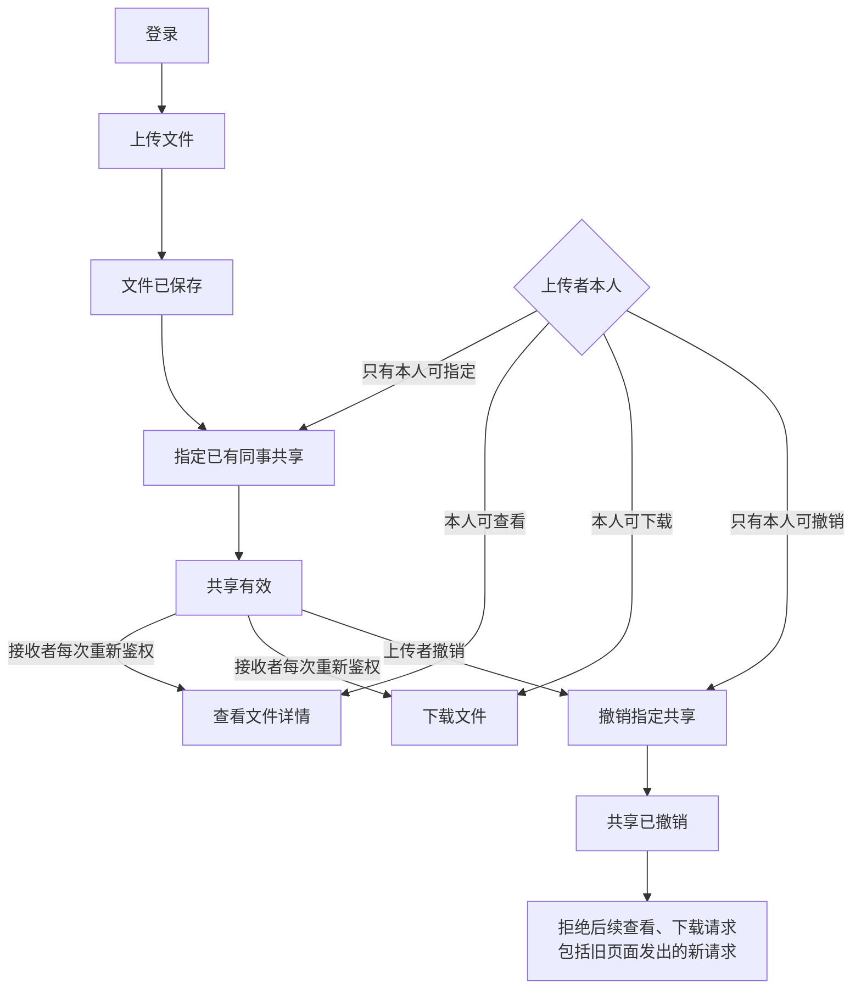
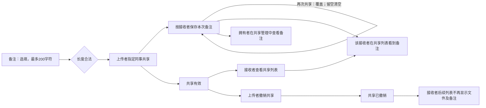

# VibeLens file sharing: completed v0.11.3 upgrade (AI-simulated user answers)

Trial prompts and follow-ups delivered by the coordinating AI are scripted-user records. They are not independent human usability evidence.

Local paths are normalized as listed in dialogue.json. Original trial answers and checks are archived separately.

## 01 · scripted-user · 2026-11-04T05:38:53.261Z

使用 $vibelens 帮我做一个小型团队文件共享网站。用户登录后可以上传文件，指定已有同事共享，对方能查看和下载；上传者可以撤销共享。先跟我确认必要的细节，确认后再开发，做完给我程序和 VibeLens 的访问地址。

工程放在 WORKSPACE。这里已经从 GitHub 的 v0.11.0 安装好了 Skill，请使用这个工程内 .agents/skills/vibelens/SKILL.md 的版本。源码、标识符和注释用英文，网页用中文。只在这个独立目录里工作，遵守目录里的 AGENTS.md。

## 02 · assistant · 2026-11-04T05:38:56.376Z

我会先阅读工程里的 `AGENTS.md` 和指定版本的 VibeLens Skill，再确认影响业务规则的必要细节；确认前先不开发。

## 03 · assistant · 2026-11-04T05:39:32.661Z

我会使用工程内的 VibeLens v0.11.0 Skill，先把登录、上传、指定同事共享、查看下载和撤销画成草图。需要确认的重点是账号来源、“查看”的含义，以及运行方式和存储选择；这些未确认前只准备设计图。

## 04 · assistant-question · 2026-11-04T05:39:56.008Z

{"questions":[{"title":"VibeLens 运行方式和存储怎么选？drive 让程序按状态声明执行；observe 保留程序自己的业务逻辑，由图观察执行，两种都维护图和监测。这个小型版本建议用 SQLite + SQLAlchemy，无需额外数据库服务；如已有数据库请写明。","options":["observe + SQLite + SQLAlchemy","drive + SQLite + SQLAlchemy"]},{"title":"“已有同事”的账号从哪里来？是由这个独立工程预置几个可登录的演示账号，还是接入你已有的账号系统？","options":["预置 3 个演示账号","接入已有账号系统（请说明来源）"]},{"title":"“查看”是仅看文件详情（名称、大小、上传者），还是需要在线预览内容（请说明文件类型）？撤销暂理解为上传者撤销指定同事的权限，撤销成功后旧页面再次查看或下载也会被拒绝；已下载的副本无法收回。请确认或纠正。"}]}

## 05 · scripted-user · 2026-11-04T05:40:28.304Z

这个版本用 drive，让程序按状态声明执行，数据库就用 SQLite + SQLAlchemy。先预置 3 个演示账号，不接外部账号系统。“查看”先做文件详情，不用在线预览；上传者本人也能查看和下载自己的文件。共享只允许上传者指定或撤销，接收者不能再转给别人，其他同事看不到。撤销后，旧页面再次查看、下载都要重新检查权限并拒绝。按这个范围做即可。

## 06 · assistant · 2026-11-04T05:40:38.216Z

范围已确认：使用 drive 和 SQLite + SQLAlchemy，预置 3 个演示账号；查看只做文件详情。只有上传者能维护共享，本人和仍获共享的同事可以查看、下载；撤销后，旧页面发出的请求也重新检查权限。我会把这些规则保存到同一张图里，然后开始开发。

## 07 · scripted-user · 2026-11-04T05:43:11.007Z

先把这轮停在设计确认阶段，保留目前的文件和对话，不继续写应用代码。请把当前理解的业务流程图直接发在对话里，并给我可查看草图的 VibeLens 地址。我先审查这个范围，之后再继续。

## 08 · assistant · 2026-11-04T05:43:16.955Z

已停在设计确认阶段，尚未编写应用代码。现有设计文件和对话记录会保留。我只继续检查草图访问地址；刚才本地浏览器连接超时，确认可访问后就把流程图和地址发给你审查。

## 09 · assistant · 2026-11-04T05:44:43.804Z

草图已可访问：HTTP 返回 200，浏览器也显示了中文业务图和“设计声明 · 尚未实现”标记。设计与对话记录已保留在工程的 `review/` 中，开发保持暂停。

## 10 · assistant · 2026-11-04T05:45:23.786Z

已停在设计确认阶段，尚未编写应用代码；现有文件和对话记录已保留。

[VibeLens 草图地址](http://127.0.0.1:8841/graph)已通过 HTTP 和浏览器访问验证。当前方案是 **drive + SQLite + SQLAlchemy、3 个演示账号、仅查看文件详情**。

接收者不能转共享，其他同事看不到文件。网页中可展开共享的权限规则；目前展示的是设计声明。

设计与暂停记录 (`WORKSPACE/review/design-hold.md`)已保存，等待你审查后继续。

<oai-mem-citation>
<citation_entries>
MEMORY.md:232-232|note=[discovery record schema and local Skill usage]
</citation_entries>
<rollout_ids>
01a18332-cb51-7471-83f8-990d88886b9d
</rollout_ids>
</oai-mem-citation>

## 11 · scripted-user · 2026-11-04T05:50:36.909Z

草图里的理解是对的，就按这个范围继续实现吧。先把这几条流程做成简单、可运行的网站，其他功能暂时不用加。做完给我程序、VibeLens 的访问地址，以及你实际验证过的结果。

## 12 · assistant · 2026-11-04T05:50:40.228Z

我会按已确认的草图继续实现，保持范围不变。先做可运行的网站，再用实际请求验证共享、越权拒绝和撤销后旧页面访问，同时保留 VibeLens 的映射与运行证据。

## 13 · user · 2026-11-04T05:50:51.500Z

<send_user_message_question_reply>
[{"questionItemId":"[\"request_user_input_async\",\"call_39c3bb02783b49d6b599bb47087849c2\",0]","question":"VibeLens 运行方式和存储怎么选？drive 让程序按状态声明执行；observe 保留程序自己的业务逻辑，由图观察执行，两种都维护图和监测。这个小型版本建议用 SQLite + SQLAlchemy，无需额外数据库服务；如已有数据库请写明。","answer":"drive + SQLite + SQLAlchemy"},{"questionItemId":"[\"request_user_input_async\",\"call_39c3bb02783b49d6b599bb47087849c2\",1]","question":"“已有同事”的账号从哪里来？是由这个独立工程预置几个可登录的演示账号，还是接入你已有的账号系统？","answer":"预置 3 个演示账号"},{"questionItemId":"[\"request_user_input_async\",\"call_39c3bb02783b49d6b599bb47087849c2\",2]","question":"“查看”是仅看文件详情（名称、大小、上传者），还是需要在线预览内容（请说明文件类型）？撤销暂理解为上传者撤销指定同事的权限，撤销成功后旧页面再次查看或下载也会被拒绝；已下载的副本无法收回。请确认或纠正。","answer":"仅查看基本信息即可，其他确认"}]
</send_user_message_question_reply>

## 14 · assistant · 2026-11-04T05:50:55.069Z

收到，与你之前确认的范围一致：drive、SQLite + SQLAlchemy、3 个演示账号，查看只展示基本信息。我会继续按这套规则实现。

## 15 · assistant · 2026-11-04T05:53:35.127Z

网站会保持简单：登录后展示“我的文件”和“共享给我”，上传者在文件详情中指定或撤销同事权限。权限会在每次服务端请求时检查，撤销后即使对方还停留在旧页面，也不能继续查看或下载。

## 16 · assistant · 2026-11-04T05:58:17.906Z

上传、共享和撤销的服务端逻辑已写好，共享状态从声明执行，并与权限变更一起保存到 SQLite。接下来会接上中文页面和 VibeLens 采集；界面会按 `frontend-design` 技能做简洁的文件列表与共享管理页。

## 17 · assistant · 2026-11-04T06:07:52.425Z

第一轮业务测试已通过：本人和有效接收者可访问，其他同事不可见、不能下载；接收者不能转共享或撤销；撤销后再次查看、下载都被拒绝。还验证了撤销一人不影响其他接收者，以及写入中途失败会回滚。接下来检查 VibeLens 是否如实记录这些结果。

## 18 · assistant · 2026-11-04T06:10:48.805Z

VibeLens 已采到实际执行事件。开启观察时，正常流程和边界流程的采集错误、丢失事件、数据库适配错误均为 0；关闭观察或注入观察服务故障后，业务结果仍一致。正在运行完整校验，随后验证浏览器操作、录制停止和回放。

## 19 · assistant · 2026-11-04T06:14:27.718Z

网站已在本机运行。完整校验发现了采集配置中的两处遗漏：部分输入只在函数入口记录，校验用例却只选了出口；上传长度断言也缺少对应的出口值。我已补齐记录和入口用例，保留首次失败报告，正在重跑原校验。浏览器验收将使用 `webapp-testing` 技能和独立会话完成。

## 20 · assistant · 2026-11-04T06:18:49.543Z

完整校验现已通过：实现映射、状态约束、业务规则和项目检查四项均通过。浏览器首轮也确认了旧页面下载返回实际的 403，并生成了无缺口的录制。负向测试确认：源码不同步、缺少权限事件或导出实例时会被拒绝；聚焦采集、停止排空失败和队列丢失也按预期报告。

## 21 · scripted-user · 2026-11-04T06:19:03.434Z

先把网站和业务、源码映射的原生检查完成。VibeLens v0.11.0 已定位到一处旧数据状态的回放显示问题，官方补丁正在验收；如果浏览器遇到“已提交/已转换”相关报错，请保留原始失败记录，等更新工具后再复测。业务规则保持我们确认的范围。

## 22 · assistant · 2026-11-04T06:19:23.039Z

明白，业务规则保持不变。网站业务、状态执行、源码映射和 API 采集的原生检查已经通过，正在保存最终验收记录。浏览器回放会单独报告；若出现“已提交/已转换”相关报错，我会保留原始失败，等官方工具更新后复测，不修改 Skill 或绕过检查。

## 23 · assistant · 2026-11-04T06:28:19.852Z

当前构建的原生检查已接受，最终检查返回 `current`。浏览器完整流程也已复测通过，录制保留了 340 个事件且无缺口；该录制能打开、跳到末步并返回实时视图，本轮未出现“已提交/已转换”报错。这个结果不代表官方提到的旧数据回放问题已修复。现在整理程序包和验收报告。

## 24 · assistant · 2026-11-04T06:30:33.699Z

网站已完成，两个服务都在运行：

- [文件共享网站](http://127.0.0.1:8041/)
- [VibeLens](http://127.0.0.1:8841/graph)
- 程序源码包 ZIP (`WORKSPACE/dist/team-file-share-v1.zip`)
- 实际验收报告 (`WORKSPACE/review/acceptance-report.md`)

演示账号：`alice`、`bob`、`carol`，密码均为 `Demo123!`。

已验证：69 项业务断言全部通过；原生源码映射、状态约束和项目检查通过；撤销后旧页面查看、下载均返回实际的 **403**。录制包含 **340 个事件、无缺口**，程序包也已解压运行验证。

本轮新录制的回放检查通过；官方提到的旧数据回放补丁尚未纳入验收。

<oai-mem-citation>
<citation_entries>
MEMORY.md:232-232|note=[project-local Skill workflow and discovery record structure]
</citation_entries>
<rollout_ids>
01a18332-cb51-7471-83f8-990d88886b9d
</rollout_ids>
</oai-mem-citation>

## 25 · scripted-user · 2026-11-04T06:31:48.858Z

这版先保留好，接着加一个小改动：分享文件时可以写一句备注，接收者在共享列表里能看到，其他用户看不到。备注可以不填，最多 200 个字符。原来的权限和撤销行为保持一致。先让我看看这次改到哪段业务流，确认后再继续开发。

## 26 · assistant · 2026-11-04T06:31:53.318Z

我会先保留当前已验收版本，再展示“填写共享备注 → 接收者在共享列表看到备注”影响的业务片段。本轮先做设计确认，不改应用代码。

## 27 · assistant · 2026-11-04T06:37:07.939Z

当前版本的程序包、验收记录和数据库快照已保留。草图按“每位接收者各自对应一条备注”表达：备注在分享时填写，在该接收者的共享列表展示。还有一处需要确认：再次共享给同一人时，留空备注是清空旧备注，还是保留旧备注；我会在图中标为待确认。

## 28 · scripted-user · 2026-11-04T06:40:02.756Z

再次共享给同一个人时，就以这次填写为准；留空会清空旧备注。备注只给该接收者和文件拥有者看。先把图里的这个细节补上，再给我看一下这次改动的流程。

## 29 · assistant · 2026-11-04T06:41:14.539Z

已补充：再次共享以本次填写为准，留空会清空旧备注；可见范围改为“该接收者和文件拥有者”。我会更新草图，补上拥有者查看备注的分支，仍不开始改代码。

## 30 · assistant · 2026-11-04T06:43:28.996Z

已补上：**本次备注覆盖旧备注，留空清空；仅该接收者和文件拥有者可见。**旧版已备份，目前只更新草图，尚未改应用代码。

[查看更新后的 VibeLens 草图](http://127.0.0.1:8842/graph)

同一文件共享给不同同事时，各自只看到发给自己的备注；拥有者可查看对应备注。原有查看、下载权限及撤销后旧页面请求的拒绝行为继续保留。

请确认这版流程，确认后我再开始开发。

<oai-mem-citation>
<citation_entries>
MEMORY.md:232-232|note=[local Skill and discovery record conventions]
</citation_entries>
<rollout_ids>
01a18332-cb51-7471-83f8-990d88886b9d
</rollout_ids>
</oai-mem-citation>

## 31 · scripted-user · 2026-11-04T06:45:19.964Z

这版流程符合我的意思。先保留这份已确认的设计，暂时不要改应用代码，等我把 VibeLens 更新到官方补丁版本后再继续这一轮开发。

## 32 · assistant · 2026-11-04T06:45:23.474Z

我会保存这份已确认的备注设计，并记录暂停状态；应用代码保持不变，等你更新官方补丁后再继续这一轮开发。

## 33 · assistant · 2026-11-04T06:47:09.202Z

已保存已确认设计及续接记录 (`WORKSPACE/review/remark-design/RESUME.md`)，并记录开发暂停。

旧版和备份已保留，应用代码未改。等你更新官方补丁后，从这份设计继续。

## 34 · scripted-user · 2026-11-04T07:47:17.062Z

新版 VibeLens 已经从 GitHub 的固定候选提交 c56fd19f 安装到这个项目的 .agents/skills/vibelens，305 个文件都和审核过的补丁一致，安装记录在 review/installation/github-install-v0.11.1-candidate.json。正式版本还在验收，发布后我会另行核对标签。

请重新读取新版 Skill，先用它提供的升级流程更新项目中的观察模块，保留现有程序、数据库、个人视图和之前的验收材料。也把项目自身的源码、依赖目录、上传文件和运行记录的范围整理清楚，文件结构图和代码检查使用同一份范围；被 gitignore 忽略的自有模块仍应算源码。

然后继续刚才确认的共享备注：可不填，最多 200 字符；再次共享时本次内容覆盖原备注，留空就清空。上传者可以查看，只有本次接收者能在共享列表里看到，其他人看不到。原来的权限和撤销规则保持原样。

完成后请实际运行并验收，重点看这轮修改是否自动更新了业务、规则、状态、接口、函数参数、代码、文件结构和数据层；原有节点身份和个人布局是否保留，旧记录与新版本是否正确区分。再检查真实界面中的 2D/3D、节点展开拖动、筛选和自定义视图、完整源码定位、录制回放及 Timeline 的生命周期和调用连线。保留发现问题、修复和复测的过程、对话和截图，不要修改 VibeLens 安装源码来绕过检查。遇到需要我确认的业务细节，照常先问我。

## 35 · assistant · 2026-11-04T07:47:38.499Z

我会先重新读取候选版 Skill 和安装记录，按它的升级流程更新项目内的观察模块，再实现已确认的备注规则。现有程序、数据库、个人视图和验收材料会保留；界面、录制和回放将作为单独的实际验收项，发现问题会保留原始证据。

## 36 · assistant · 2026-11-04T07:49:43.346Z

升级计划显示：当前固定提交为 `c56fd19f`，项目内有 10 个受管文件需要更新，未发现本地修改冲突。我会按候选提交记录验收，不把它视为正式标签已核对。

范围将统一为：自有 Python 模块、模板和样式属于项目源码；虚拟环境、缓存和 VibeLens 受管副本属于依赖；SQLite 文件内容、日志、录制、截图及打包产物属于运行数据。`.gitignore` 仅作为参考，不用于排除自有模块。

## 37 · assistant · 2026-11-04T07:55:31.289Z

已确认使用 drive + SQLite + SQLAlchemy，预置 3 个演示账号，文件仅显示基本信息；撤销后，旧页面再次查看或下载也必须被拒绝。我会继续完成实现和验证，并保留现有数据及验收记录。

## 38 · assistant · 2026-11-04T07:55:46.826Z

我会继续按项目内的 VibeLens Skill 维护图、源码映射和观测记录。备注将遵循已确认的规则：最多 200 字，本次输入覆盖旧值，留空清空；上传者可查看各接收人的备注，接收人仅可查看发给自己的备注。

## 39 · assistant · 2026-11-04T07:57:44.349Z

备注的写入和读取已接入应用：写入前校验长度，读取时检查当前用户、文件拥有者和该接收人的有效授权。接下来会验证 200/201 字边界、覆盖与清空、多接收人隔离、撤销后的拒绝访问，以及写入失败时的完整回滚。

## 40 · assistant · 2026-11-04T08:01:23.600Z

独立业务测试已通过。源码范围的反例检查也已通过：被 `.gitignore` 忽略的自有模块仍会被索引；已分类的依赖和文件存储目录不会被遍历；指向这些目录的执行映射会被拒绝。升级前后的原业务数据、旧录制和个人布局校验一致。

## 41 · assistant · 2026-11-04T08:07:21.808Z

备注的真实浏览器操作已通过，包括两位接收人的备注隔离、200 字接受、201 字拒绝、留空清空，以及撤销后旧页面下载被拒绝。原生门禁的 126 项业务断言全部通过；映射检查发现两个新增规则输入尚未关联到实际执行场景，我会补齐后重跑。图页面验收脚本也有一处诊断字段名用错，错误记录已保留。

## 42 · assistant · 2026-11-04T08:11:31.294Z

回放未打开的原因已定位：部分验收日志仍被计入工程树，日志增长触发了图版本变化。我已补齐这些文件的产物分类，并将后续输出放入独立目录；审查脚本本身仍参与源码索引。正在重测回放、Timeline 和 2D/3D 的一致性。

## 43 · scripted-user · 2026-11-04T08:13:55.619Z

补充版本信息：v0.11.1 已正式发布，GitHub 完整检查 8/8 通过，主分支和 Pages 也已更新。我又从正式标签下载了一份，305 个 Skill 文件与你正在使用的候选版逐一一致，无需更换当前副本。核对记录在 review/installation/github-install-v0.11.1-tag.json。继续完成当前测试即可，材料中保留先安装候选、后核对正式标签的真实顺序。

## 44 · assistant · 2026-11-04T08:14:14.805Z

2D/3D 拖动、自定义视图保存、完整源码查看、录制回放、Timeline 区间和调用连线已通过浏览器检查；同一录制在两种视图中的事件与生命周期一致，图操作未新增业务事件。

我也收到了正式版发布信息，会核对本地标签记录，在材料中保留“先安装候选版、后核对正式标签”的顺序，再完成最终验收。

## 45 · assistant · 2026-11-04T08:19:32.241Z

四类原生门禁均已通过：映射、状态规则、项目检查和业务断言。旧版数据库备份连续迁移两次后，原数据仍一致；旧录制的 committed/transformed 区间也已在当前官方 Timeline 组件中验证。最后一轮发现 3D 拖动受相机范围影响，已复核实际位移并调整验收脚本；现在完成最终版本复测和打包。

## 46 · assistant · 2026-11-04T08:25:19.508Z

最终浏览器回归的 28 项检查，以及源码漂移、缺失规则证据、聚焦录制、队列丢失等 13 项反例检查，现已全部通过。严格文档检查还发现两个历史审查辅助函数缺少说明，我会补齐并重验最终构建。程序和 VibeLens 的原访问地址已恢复，原数据与个人布局均保留。

## 47 · assistant · 2026-11-04T08:29:39.243Z

最终验收已通过，独立 V2 程序包也完成了解压运行验证。包内使用全新演示数据，备注隐私、清空、撤销和图绑定均正常，观测器无丢失或错误。现在只做最后的服务版本核对和验收进程清理，然后给你程序包、访问地址和报告。

## 48 · assistant · 2026-11-04T08:30:18.223Z

已完成，包含已确认的备注功能，原数据和个人布局保留。126 项业务断言、28 项浏览器检查通过，程序包已独立解压验证。

- [打开程序](http://127.0.0.1:8041/)
- [打开 VibeLens](http://127.0.0.1:8841/graph)
- 下载 V2 程序包 (`WORKSPACE/dist/team-file-share-v2.zip`)
- 查看验收报告 (`WORKSPACE/review/remark-v2/acceptance-report.md`)

演示账号：`alice`、`bob`、`carol`，密码均为 `Demo123!`。

<oai-mem-citation>
<citation_entries>
MEMORY.md:232-232|note=[local Skill and discovery conventions]
</citation_entries>
<rollout_ids>
01a18332-cb51-7471-83f8-990d88886b9d
</rollout_ids>
</oai-mem-citation>

## 49 · scripted-user · 2026-11-04T08:36:36.657Z

/vibelens 我想单独检查共享备注这条链：上传者填写备注，检查长度和权限，保存后接收者读取并看到自己的备注。请生成一个自定义视图，只保留这条链的业务、规则、接口、核心函数和值、数据操作，收起其他内容并整理布局。再从刚才的完整记录里筛出一次成功分享及接收者随后读取的过程，让时间轴放大到能看清节点的开始、结束和调用连接；完整记录继续保留。

请实际在页面里检查这个视图和筛选结果，分别留一张易于看清的 2D、可辨层次的倾斜 3D 和局部 Timeline 截图。这里只调整 VibeLens 的观察范围和展示，不修改应用的业务代码或规则。

## 50 · assistant · 2026-11-04T08:36:41.302Z

我会按 `/vibelens` 的展示控制流程，生成共享备注链的自定义视图，并从完整录制中筛选一次成功分享及随后读取的过程。完成后在页面核查 2D、倾斜 3D 和局部 Timeline，保留原始录制。

## 51 · assistant · 2026-11-04T08:39:48.358Z

已定位到上次验收的完整录制，共 1364 个事件。我会选取其中 Alice 成功向 Bob 分享备注，随后 Bob 在接收列表读取同一文件备注的这一次过程；其他分享、拥有者读取和边界测试会从回放选择中排除，原录制保持完整。

## 52 · assistant · 2026-11-04T08:44:35.282Z

发现了回放阻塞：页面将这份记录判为“旧版本的图”。核对后，记录与当前程序的 build、模型哈希、API 节点和关系都一致，差异来自生成的 `manifest.json` 文件大小，进而改变了 API 修订号。

我会保留这次拒绝及差异证据，继续完成自定义视图和 2D/3D 截图；局部 Timeline 暂时受这项版本校验阻塞。

## 53 · scripted-user · 2026-11-04T08:51:45.522Z

旧记录与当前图修订不一致，就保留这次拒绝和原始记录，不需要绕过校验。先完成当前自定义视图；接着对当前源码重新执行严格的扫描和验收，确认版本一致后，重新录一次 Alice 给 Bob 分享带备注的文件、Bob 打开接收列表读到备注的真实操作。请用新记录验证局部筛选与 Timeline，保留完整新记录和筛选结果，并给我清楚的2D、倾斜3D和局部Timeline截图。不要改业务规则，也不要为了回放修改旧记录或放宽版本校验。

## 54 · assistant · 2026-11-04T08:52:42.201Z

收到。我会保留旧记录和拒绝证据，先重新完成严格扫描与验收；版本核对通过后，再录制一次新的 Alice 分享、Bob 读取操作，用新记录完成局部筛选和 Timeline 检查。

## 55 · assistant · 2026-11-04T09:00:56.823Z

严格扫描、文档/API 检查和验收已重新通过。新的真实操作已录制完成：共 110 个事件、零缺口，记录与当前图的 build、模型和 API 修订一致。Alice 分享和 Bob 随后读取这两个调用中，已定位到 30 个链内事件，正在页面中应用局部筛选并整理截图。

## 56 · scripted-user · 2026-11-04T09:07:54.163Z

/vibelens 这轮只需收尾已请求的自定义视图、30个链内事件筛选和截图验证。保留旧记录拒绝、新记录和每次失败证据；确认主记录字节未被筛选改写，给我当前结果与尚未通过项后先停下来。后续我会单独进行新版观察模块升级，不需要继续扩展业务或追加场景。

## 57 · scripted-user · 2026-11-04T09:07:54.169Z

/vibelens 我看到截图仍接近俯视。请在图中真正的空白画布处拖动来倾斜视角，避开节点、展开圈、标签和工具条；这些位置可能会拖节点或圈。保留实际相机变化的检查结果。只通过现有界面操作，不直接改相机数据或放宽检查；如果做不到就如实列出未通过项并结束这轮。

## 58 · assistant · 2026-11-04T09:08:20.086Z

30 个链内事件的筛选已通过页面核对，完整新记录仍保留 110 个事件。已在空白画布上用原生手势将视角从俯视倾斜，局部 Timeline 的开始、结束和调用/返回连接也已验证。

我只再保存同一次手势前后的相机检查结果，并核对主记录字节未变，随后结束本轮。

## 59 · assistant · 2026-11-04T09:14:13.409Z

已收尾并停止本轮工作：

- 自定义视图及 **110→30 个事件**筛选已完成。
- 3D 通过空白画布实际拖动，偏离俯视约 **59.45°**；相机前后数据已保存。
- 新旧主记录字节均未改变，业务源码和规则未改动。
- 尚未通过：旧记录仍被版本校验拒绝；默认视图的空间/图层设置保留检查失败，来源待核对，未覆盖。

[打开自定义视图](http://127.0.0.1:8841/graph?vl_session=<local-session-1>) · 完整检查结果 (`WORKSPACE/review/remark-v2/results/remark-control/result-summary.md`)

2D 截图 (`WORKSPACE/review/remark-v2/results/remark-control/remark-chain-2d.png`) · 局部 Timeline 截图 (`WORKSPACE/review/remark-v2/results/remark-control/remark-chain-timeline.png`)

实际倾斜的3D视图 (`WORKSPACE/review/remark-v2/results/remark-control/remark-chain-3d-oblique.png`)

<oai-mem-citation>
<citation_entries>
MEMORY.md:232-232|note=[local Skill and discovery conventions]
</citation_entries>
<rollout_ids>
01a18332-cb51-7471-83f8-990d88886b9d
</rollout_ids>
</oai-mem-citation>

## 60 · scripted-user · 2026-11-04T09:29:57.291Z

$vibelens 请开始最后一次观察模块升级验收。项目本地 Skill 已由官方安装工具从 GitHub 提交 ad50f70d 安装为0.11.2，305个文件逐一核对通过，旧版本已备份。请先重新读取当前 Skill，然后使用受管 plan/apply 升级运行模块和页面，保持业务源码、规则、状态机执行器、原始基线和历史验收不变。共享备注功能已经完成，这轮复用现有业务和负例用例，不新增功能；重新执行现有源码/图/埋点映射、严格文档/API、状态和业务检查，并核对各层仍完整。升级前保留当前个人配置和记录的哈希，检查受管升级本身不会改动它们。重启后通过本对话的带会话标识图地址做一次分享和接收者读取的真实录制、局部Timeline回放，复用已经做好的浏览器用例；图的新版本拒绝旧记录时保留证据并用新记录，不改旧记录。不扩大测试范围，完成后停下来，给我明确分项结果和证据路径。默认视图之前的历史配置差异继续保留为来源未确定；独立的真实浏览器隔离复测已确认带会话标识的操作只改私有视图，默认配置和所有18份记录字节不变，不需要擅自修复或覆盖旧配置。

## 61 · assistant · 2026-11-04T09:30:15.423Z

我会先重读当前 0.11.2 Skill，保存升级前的配置和录制哈希，再执行受管升级。之后复用现有用例核对映射、严格文档/API、状态和业务检查，并通过本聊天的会话地址完成一次新录制与局部回放。默认视图的历史差异继续保留，不覆盖。

## 62 · scripted-user · 2026-11-04T09:32:56.251Z

补充这轮测试边界：所有观察器浏览器操作都使用 activate 返回的带会话标识地址，复用现有脚本时也要传入该地址；不要另开无会话标识的默认图来改视图。业务应用页面仍按原地址操作。独立隔离测试曾在本会话私有视图临时隐藏规则层，录制回放时请通过现有界面恢复显示本链的规则，测试完留下这条链可读的私有视图。默认配置与原始记录继续保留，检查结果分清受管升级的原样保留和授权的私有视图操作。

## 63 · assistant · 2026-11-04T09:35:08.366Z

升级前快照已保存：12 份配置、18 份录制，以及业务源码和历史验收哈希。新版工具因自身指纹变化拒绝直接建立新基线；我已用备份的旧版规范工具确认候选与上次接受版本完全一致，并单独建立升级基线，旧验收目录保持不变。

0.11.2 的受管计划需更新 3 个运行文件，页面资源已一致。后续浏览器操作会使用本聊天的会话地址，规则层也只在该私有视图中恢复。

## 64 · assistant · 2026-11-04T09:38:31.284Z

受管升级后的即时哈希检查全部通过：业务源码与合同、12 份配置、18 份原记录、旧验收目录，以及规则和状态机定义均未改变。严格文档和 API 检查也已通过。正在完成现有原生用例和负例复测，随后只做已约定的一次会话内录制与局部回放。

## 65 · assistant · 2026-11-04T09:46:19.887Z

0.11.2 的业务用例和负例复测已通过。浏览器验收在恢复规则图层时被画布遮挡，尚未开始新的业务录制；我会调整测试脚本的交互方式，继续完成会话内回放。

## 66 · assistant · 2026-11-04T09:47:22.766Z

新的 Alice→Bob 共享和 Bob 接收列表读取已完成，录制包含 134 个真实事件，未报告缺口。规则图层已通过原生键盘操作恢复；旧记录仍被界面识别为旧版本，原文件保留。接下来只回放本次文件对应的调用，再核对所有原记录和默认视图的哈希。

## 67 · assistant · 2026-11-04T09:50:15.630Z

2D、3D 和局部 Timeline 检查已通过。回放筛选在首次关闭测试浏览器时尚未保存完成，重开后显示了全部事件；现在已补上保存确认，同一组 30 个事件已写入本会话私有配置，正在复查重开后的恢复结果。

## 68 · assistant · 2026-11-04T09:52:12.374Z

最后核对已通过：业务源码、规则、状态机、原始基线和 18 份原记录均未改变；默认视图保持升级前的字节。本轮后续配置变化仅在当前会话的控制文件和私有视图。重开后的 30 事件筛选及 9 项浏览器检查全部通过；我会保存分项报告，然后结束本轮验收。

## 69 · assistant · 2026-11-04T09:53:22.729Z

0.11.2 观察模块升级验收已完成，本轮工作已停止。

- 受管升级替换了 3 个运行模块文件；页面资源已一致。
- 映射、状态约束、业务规则和工程检查通过：业务断言 **126/126**、负例 **13/13**、源码范围 **10/10**。
- 新录制包含 **134 个真实事件、零缺口**；局部回放选择 30 个事件，浏览器检查 **9/9**。
- 业务源码、规则、执行器、原始基线及 **18 份原记录**均保留；默认视图未变。此前历史配置差异仍标记为来源未确定。

分项报告与证据路径 (`WORKSPACE/review/remark-v2/results/upgrade-v0112/acceptance-report.md`) · [本会话图与回放](http://127.0.0.1:8841/graph?vl_session=<local-session-1>)

<oai-mem-citation>
<citation_entries>
MEMORY.md:232-232|note=[local Skill and discovery conventions]
</citation_entries>
<rollout_ids>
01a18332-cb51-7471-83f8-990d88886b9d
</rollout_ids>
</oai-mem-citation>

## 70 · scripted-user · 2026-11-04T10:36:13.116Z

$vibelens

我们继续刚才的团队文件共享项目。本轮只升级已经从 GitHub 安装的 VibeLens v0.11.3，并验证现有功能，业务规则和应用源码保持原样。请先重新阅读当前安装的 Skill，用它规定的 managed plan/apply 流程更新观察模块，再用已有的测试和检查完成这一轮收尾。

请把当前这轮开始前的应用源码、业务和状态定义、验收历史、全部已有录制（当前共21份，以实际启动快照为准）、默认布局以及个人视图分别留好哈希。沿用现有对话专属 graph_url 和 vl_session，浏览器验收始终打开这个地址，别动默认视图。不要修改或重新批准旧验收，也不要改写旧记录使其适配新构建。确实因新版构建而不能回放的旧记录，请保留原文件并如实记下原因，改用新录制。

功能还是原来的文件共享和收件人备注。复用已有126项业务检查、负例、源码范围、静态映射、API/注释以及状态机和运行采集检查，确认升级后的 graph 与源码、当前构建对应。请用真实的分享和 Bob 查看操作录一段新记录，保留之前关注的分享—备注—读取链路视图；检查2D、可旋转的3D、源码打开、筛选和 Timeline 的生命周期及跨层连接。暂停选定有因果连线的一步，停留超过1.3秒，确认事件没有跳步、连线仍运动，用实际浏览器帧和事件 ID 留证，不要编造事件或时长。

另补一项单独测量：开始一段覆盖完整事件流的空白录制，只操作 VibeLens 自身的视图、图层、2D/3D、源码和 Timeline 控件，不操作文件共享应用。确认服务端保存已经完成后停止并排空录制，记录操作前后事件数、实际动作、网络请求和 gaps，断言业务事件增量为0，并在浏览器验收收据中用 checks.viewer_controls_no_business_events 标记这项实测结果。需要观察器自身请求，但不要把它们伪装成业务事件。

沿用现有有限的验收范围，有失败先保留原因和截图，再修复属于本项目的真实问题；发现框架问题请明确指出，别靠关闭检查通过。完成后停在可审查结果，给出本轮收据、录制和截图路径。对话用自然中文，源码和注释保持英文。

## 71 · assistant · 2026-11-04T10:36:16.930Z

我会先读取当前安装的 VibeLens Skill，保存本轮开始时的源码、定义、历史、录制和视图哈希，再按受管升级流程执行。浏览器验收沿用本对话专属图地址，并单独留下暂停动画和“观察器控件不产生业务事件”的实测收据。

## 72 · assistant · 2026-11-04T10:38:01.695Z

启动快照确认现有录制为 21 份，另已分别保存 52 份源码与合同、默认布局、个人配置，以及旧验收目录的哈希。当前安装确为 0.11.3；新版工具指纹使旧候选标识发生变化，我会先核对这一版本边界，保留旧验收原件。

## 73 · assistant · 2026-11-04T10:40:03.612Z

受管升级已替换运行模块和 Timeline 页面文件，但保留检查发现一项异常：本轮浏览器尚未启动，默认布局版本已从 147 变为 174；源码、个人视图、21 份录制及旧验收均未变。同时发现同工程的 8842 设计服务仍在运行。目前不能确定写入来源，我会保留前后文件和差异，不恢复或覆盖默认布局，并继续完成其余验收。

## 74 · scripted-user · 2026-11-04T10:42:17.209Z

默认布局提前变化这件事请如实保留，不要恢复文件，也不要把保留检查改成通过。请核对 8842 是否确为你此前为同一个试用项目启动、已经不用的设计预览服务；保留其进程、命令行、端口及可取得的请求日志。如果确认是你自己的旧辅助服务，可以停止它，避免继续干扰这轮观察；其它进程和页面保持原样。不能仅凭发现另一个服务就认定它是写入来源。完成当前有限验收后，单独比较只操作当前对话专属视图时默认布局是否还会变化，记录真实偏好 POST 的目标、字段及修订号（公开材料将对会话凭据脱敏）。继续现有功能验收即可，不新增业务，也不改用户的历史数据；最终把首次保留失败与后续隔离测量分别报告。

## 75 · assistant · 2026-11-04T10:42:25.180Z

我会把首次默认布局保留失败原样保留。接下来先核对 8842 的启动记录；只有确认它是本项目此前留下的辅助服务后才停止。随后单独测量本对话视图的偏好写入目标和修订号，将隔离结果与首次失败分别报告。

## 76 · assistant · 2026-11-04T10:45:25.371Z

8842 已与此前保存的 PID 和命令行核对一致，是本项目旧的设计预览服务；我已保存进程、端口和现有日志，并仅停止了该服务。日志中没有可用的请求明细，因此仍不认定它是写入来源。126 项业务断言及严格检查已通过，接下来进入会话内真实录制和浏览器验收。

## 77 · assistant · 2026-11-04T10:48:32.989Z

新一段真实录制已完成，包含 158 个事件；原有 9 项浏览器检查全部通过，分享—备注—读取链路和 30 事件筛选均保留。正在补充两项指定测量：暂停同一事件超过 1.3 秒的实际帧，以及仅操作观察器控件的空白完整录制。

## 78 · assistant · 2026-11-04T10:54:12.106Z

两项补充测量已完成：同一事件 ID 在约 2.09 秒内保持不变，1.52 秒和 1.82 秒的实际 Timeline 帧显示因果连线仍在运动；仅操作观察器控件的完整录制为 0 个业务事件、0 gaps，偏好保存已获服务端确认。该独立测量中默认布局未变；首次保留失败仍单独记为失败。正在整理最终收据和哈希核对。

## 79 · assistant · 2026-11-04T10:58:35.187Z

本轮有限验收已结束。**功能与隔离测量通过；首次默认布局保留失败仍未解决，整轮不标为全部通过。**

- 业务 **126/126**、负例 **13/13**、源码范围 **10/10**、原浏览器检查 **9/9**。
- 新共享录制含 **158 个事件**；暂停同一事件约 **2.09 秒**，连线持续运动。
- 控件专用录制：业务事件 **0→0→0**，gaps、待排空数量均为 **0**；该次测量默认布局未变。
- 原有 **21 份录制**、源码、规则和旧验收均未改写。8842 旧辅助服务已核验并停止，最初布局写入来源仍不确定。

验收报告 (`WORKSPACE/review/remark-v2/results/upgrade-v0113/acceptance-report.md`) · 浏览器收据 (`WORKSPACE/review/remark-v2/results/upgrade-v0113/browser-acceptance-receipt.json`)

共享录制 (`WORKSPACE/bo_stategraph/data/recordings/65317e95167a448fba9bec149c3d8a4e.json`) · 控件录制 (`WORKSPACE/bo_stategraph/data/recordings/a0d96133db1a44009a67a28fe738eb5a.json`) · 1.52 秒帧 (`WORKSPACE/review/remark-v2/results/upgrade-v0113/paused-timeline-3.png`) · 1.82 秒帧 (`WORKSPACE/review/remark-v2/results/upgrade-v0113/paused-timeline-4.png`)

<oai-mem-citation>
<citation_entries>
MEMORY.md:232-232|note=[local Skill and discovery conventions]
</citation_entries>
<rollout_ids>
01a18332-cb51-7471-83f8-990d88886b9d
</rollout_ids>
</oai-mem-citation>
