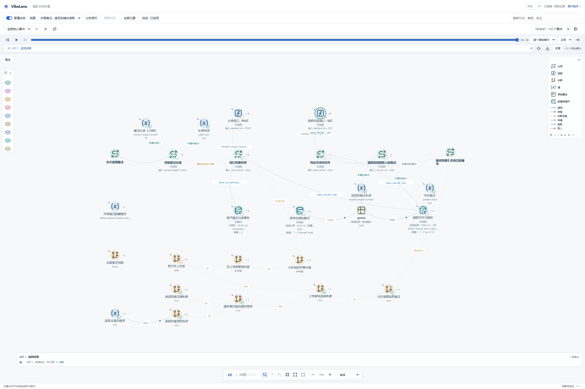
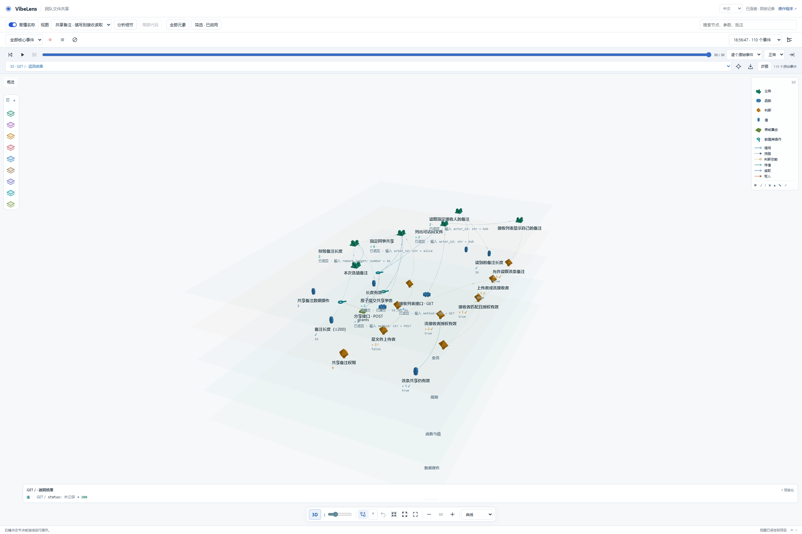
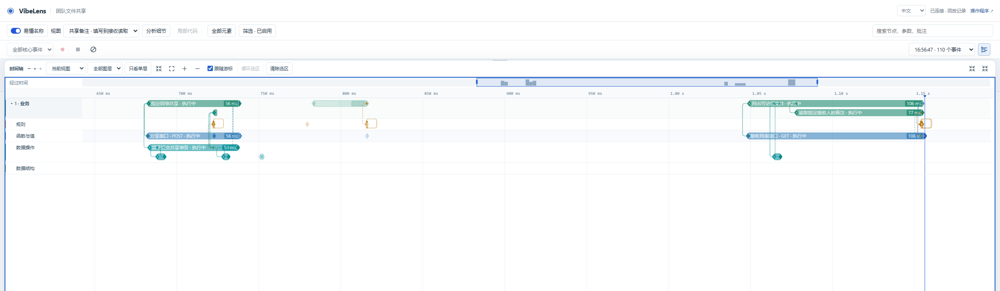

# Completed custom-view and recording controls

This snapshot follows the completed conversation-control turn on the c56fd19f /
v0.11.1 trial. Managed v0.11.2 installation and acceptance are separate work.

- [Results and source hashes](summary.json): nine true browser checks, no browser
  exceptions, and the exact copied-file inventory.
- [Preference comparison](preference-adjudication.json): 51 of 52 protected files
  are byte-identical. The default local display configuration is the exception;
  its original failed aggregate result is retained.
- [Camera gesture](camera-proof.json): a native drag on verified empty canvas
  changed the camera to 59.45 degrees from vertical. No camera assignment was
  used for this proof.
- [Source check](final-source-check.json), [strict acceptance](strict-accept.json),
  [verification](strict-verification.json), [API coverage](api-strict.json) and
  [source descriptions](docs-strict.json) are copied from this completed turn.

The real synthetic-account flow produced a 110-event recording with zero gaps.
Thirty events from the share and subsequent recipient read are selected in the
custom view. The original complete recording remains byte-identical, as does
the earlier master recording. These are actual browser form submissions and
HTTP responses; the conversation's user answers were simulated by an agent.

## Focused views

The business chain runs horizontally, with rule checks and data operations below.
The focused view is substantially easier to follow than the earlier whole-graph
overview. Long edge captions remain truncated at this scale, and some small
input/output captions still need zooming. This screenshot supports a focused
inspection claim, not a general legibility guarantee.

The final screenshot visibly separates the business, rule, execution and data
planes. Near the center, several labels still overlap at this fitted overview
scale. Camera interaction is proven separately by the before/after receipt.

The zoomed interval exposes the share's 56 ms period and the recipient read's
approximately 106–108 ms nested periods. Horizontal succession and cross-layer
call/return connectors are visible. The interval labels describe their recorded
phase; they do not establish business success by themselves.

## Retained issues

The default local view changed at 16 decoded leaf paths: two visibility lists,
two camera arrays, eleven layer-height coordinates, and the preference revision.
The 41 main and 26 business planar positions are intact; all existing spatial
horizontal coordinates and pin flags are intact. Those facts do not establish
the cause of the unscoped writes. Their provenance remains unattributed. The
subsequent [native scoped-isolation test](../../preference-isolation-0112/result.json)
passes nine checks: every preference request has the original conversation
scope, and all 73 protected files remain byte-identical while the private view
changes. That result rules out leakage in the exercised path; it does not explain
the earlier default-view change or supersede its failed preservation receipt.

The earlier same-build recording refusal after the manifest's line-ending
revision change remains preserved. Neither the old recording nor its revision
guard was rewritten. The earlier falsely named “oblique” screenshot and failed
camera check remain in the parent evidence directory.

Raw recordings, runtime payloads, databases, credentials, uploads and personal
preference files are excluded from this review copy.
