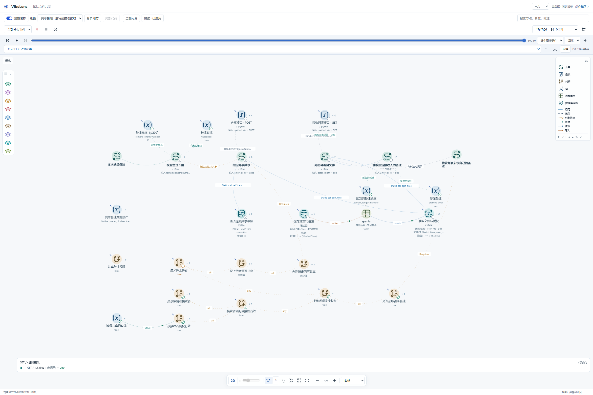
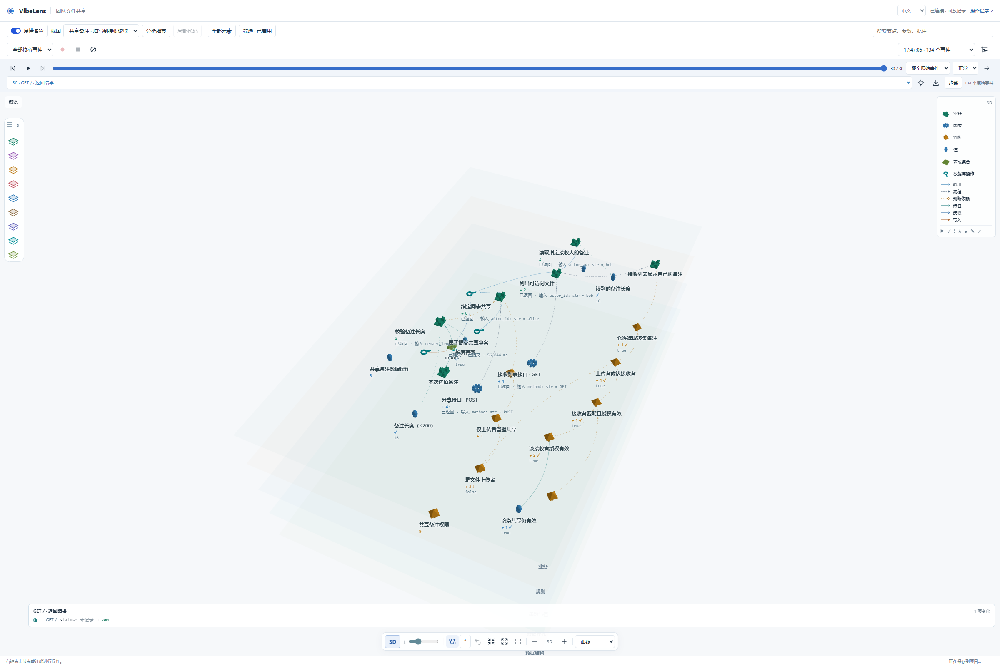
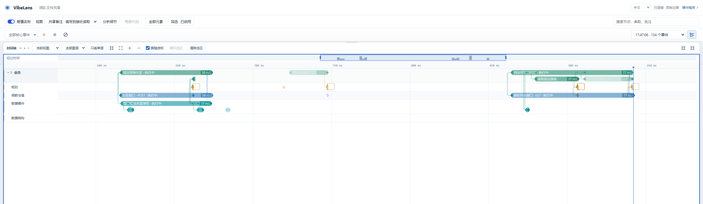

# Managed v0.11.2 application upgrade

The completed trial replaced three managed runtime files. Business source,
contracts, policy and the project-owned state executor were retained. This is
the installed v0.11.2 application, separate from the v0.11.3 animation fix.

[Independent snapshot](summary.json) rehashes the actual retained files:

- 52/52 owned source and contract files, 18/18 previous recordings and 18/18
  historical baseline/acceptance files are byte-identical.
- The default display file and ten of twelve original configuration files are
  byte-identical. Only this conversation's control and view files changed.
- All 162 authored node IDs, policy and machine definitions are unchanged.
- The new complete 134-event recording has zero gaps and its recorded SHA256
  matches the actual file. Browser presentation and saved replay select the
  same 30 events; the server acknowledged the preference save.

Native reports distinguish mapping, state rules, project checks and the 126
business assertions. Thirteen negative checks and ten source-scope checks pass
separately. The finite presentation run reports nine true checks and no browser
exceptions. These use synthetic accounts and AI-simulated conversational answers.

The [receipt auditor](../../observer-v0112-independent-01.json) confirms accepted
candidate/build identity, 49 manifest source inputs, 36 accepted inventory
sources, current API/docs revisions and the observation receipt digest. It
retains one missing metric: this fresh browser schema lacks an explicit
measurement that viewer controls add zero business events. No identifiable
observer-runtime events were detected. That narrower evidence does not replace
the missing measured browser check.

## Captures

The focused 2D chain and separate rule region are readable at this scale.
Some edge captions are truncated. The tilted view separates the planes, with
several central labels still crowding. The Timeline shows the approximately
58 ms share and 77 ms recipient-read scopes with cross-layer connections.
These screenshots establish those finite observations, not a general usability
or sustained-animation pass.

An initial replay-persistence attempt closed before the preference save was
acknowledged; that failed attempt remains in the isolated trial. The final replay
receipt confirms the save and restored 30-event selection. Old-version record
refusals and the earlier unattributed default-view change also remain preserved.
The independent v0.11.3 paused-connector regression has its own failure/fix
evidence and is not attributed to this application's acceptance.

No raw recordings, database content, uploads, credentials, private preference
content or temporary session URL capability is copied here.
