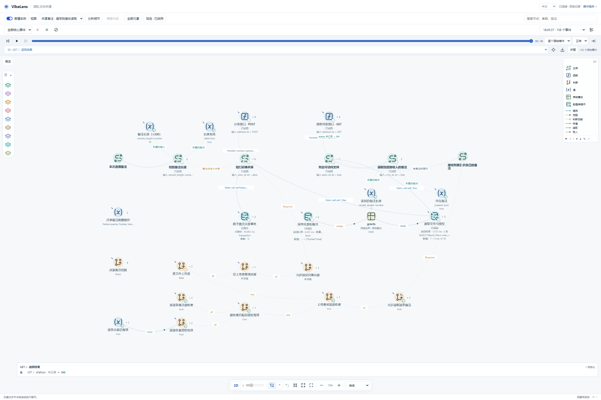
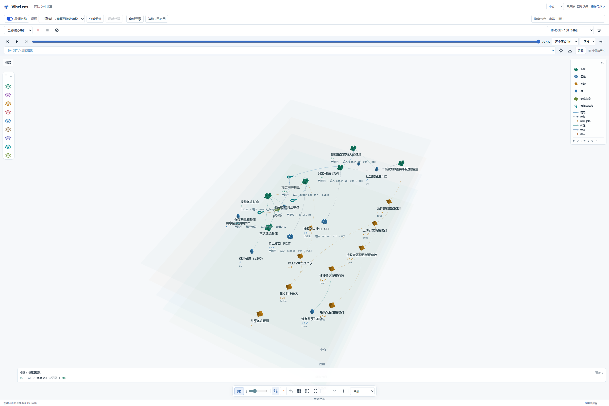
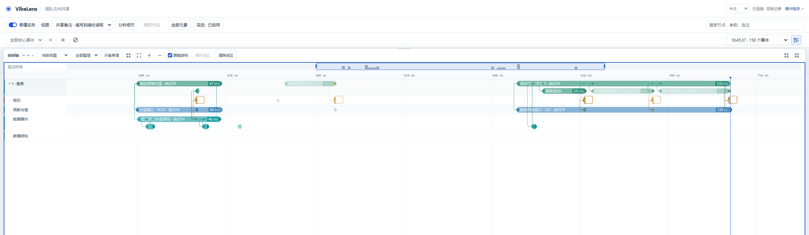
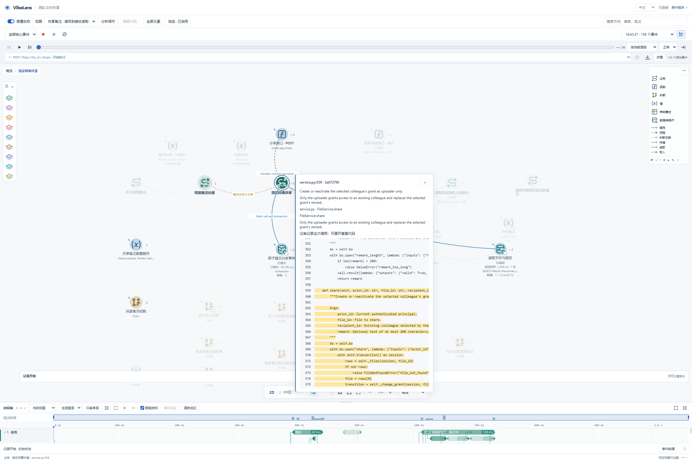
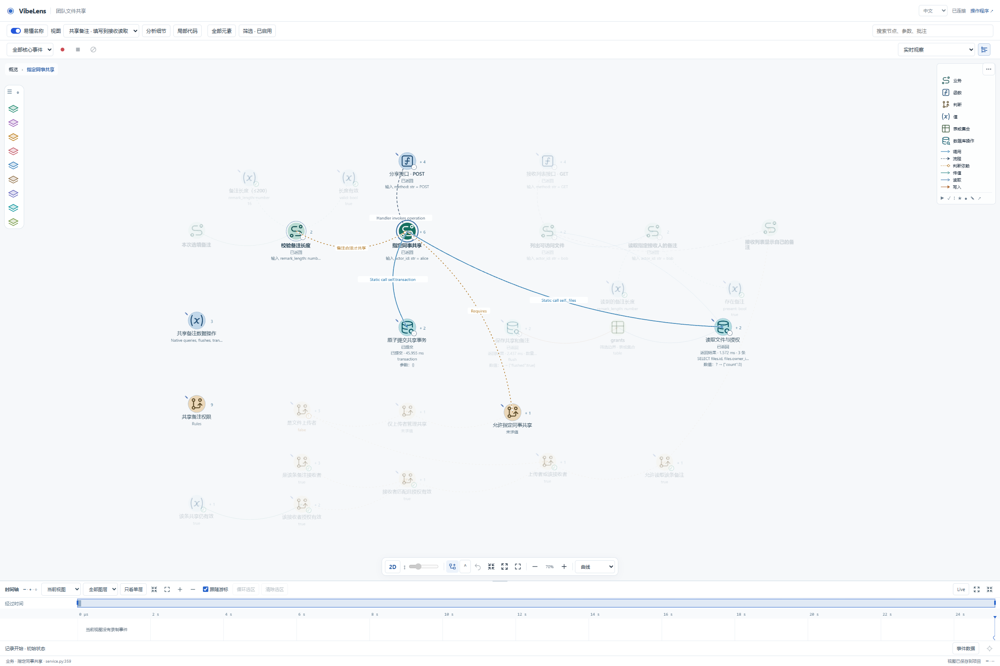

# Managed v0.11.3 trial review

The finite upgrade trial is complete. **The whole turn is not all-passed:** its
first default-layout preservation check failed and the writer remains unknown.
The original failure, before snapshots and later successful scoped measurement
remain separate.

| Evidence | Result |
| --- | --- |
| Business assertions | 126/126 |
| Original negative checks | 13/13 |
| Source-boundary checks | 10/10 |
| Mapping, state rules and project checks | Each passed, reported separately |
| Fresh native current/docs/API/runtime receipts | Matched accepted candidate and current source |
| Real operation recording | 158 events, 0 gaps; 30 selected for replay |
| UI-only recording | 0 before, 0 after, 0 saved; all-mode capture, 0 gaps |
| Producer settlement | Flushed; 290 submitted/completed, 0 pending |
| Current scoped save | Revision 108 → 109 acknowledged; namespace-file consistency checked |
| Default during scoped measurement | Revision 174 and SHA unchanged |
| Initial default preservation | **Failed; not attributed or restored** |

[Summary and original-file hashes](summary.json) accompany the copied strict
receipts. [Independent audit 02](../../observer-v0113-independent-02.md) checks
accepted build, actual saved recordings, captured HTTP statuses and source hashes
without importing the application or making requests. Its sole uncollected field
is raw query identity: the browser receipt had deliberately replaced the local
session namespace in URLs. The actual namespace file, acknowledged revision and
unchanged default are checked separately. This privacy normalization is not an
authentication-key incident.

## Preserved content

Independent byte comparisons confirm 52/52 owned source/contracts, all 21 original
recordings, all 27 earlier acceptance-history files and all 91 previous-upgrade
review files. Of ten private configuration files, only the current conversation's
view file changed. The default view file also changed; the lock file did not.

[Default preservation proof](default-preservation-proof.json) retains the exact
hashes and sample/file times. The earlier d180… default SHA was already c3d… in
the formal before snapshot while the runtime was still v0.11.2, before v0.11.3
apply. This establishes timing, not the writer. The subsequent c3d… → ef37…
147 → 174 revision change remains a failed preservation result. All 48 existing
main and 26 business 2D positions stayed equal. One existing main 3D position,
`active`, changed X/Z; it cannot be dismissed as derived layer-height metadata.
An old helper could address the same default file, but its startup-only logs
contain no access records proving a preference POST or writer.

## Selected views

The synthetic file-sharing application uses AI-simulated user answers. These are
real Chrome captures of a finite scripted test, not a human usability study.

The 2D view separates the sharing/read chain, rule witnesses and data operations.
Several supporting labels are small or truncated; this does not establish general
readability at every graph size.

The camera is genuinely oblique and layers have depth. Central labels still
partly overlap. This is interaction evidence, not a claim that all 3D labeling is
resolved. The screenshot's pending-save indicator is not the later save ACK.

Timeline shows finite business/API/data-operation intervals and call/return
connectors across rows. The selected focus omits unrelated layers; it is not an
all-layers coverage screenshot.

[Retained failures](retained-failures.json) also preserve the first source-load
placeholder check and the corrected wait for actual bound source text.

## Paused animation and UI-only capture

The same selected raw event remains fixed across six actual frames through
2.086 seconds. Independently hashed Timeline images at 1.519 and 1.815 seconds
differ, beyond the old 1.1-second stop. See [frame 3](paused-timeline-3.png) and
[frame 4](paused-timeline-4.png). The real application's graph has animated
transfers. The special case with no Graph transfers is covered separately by
[framework browser regressions](../../../publication/timeline-inspection-0113/summary.json).

Switching views/layers, 2D/3D, opening source, filters and Timeline produced no
business events in the measured all-mode recording. Saved record ID, build,
SHA, empty events/commands, zero gaps, flush completion and save ACK are matched
independently. Raw recording payloads, private preference contents, database and
uploads are not copied into this public packet.

[Completed public dialogue](../../dialogue-v2-upgrade-v0113-completed-01/dialogue.md)
contains 79 visible messages; its privacy receipt retains original-export and
sanitized hashes. Historical exports and original local session files are unchanged.
