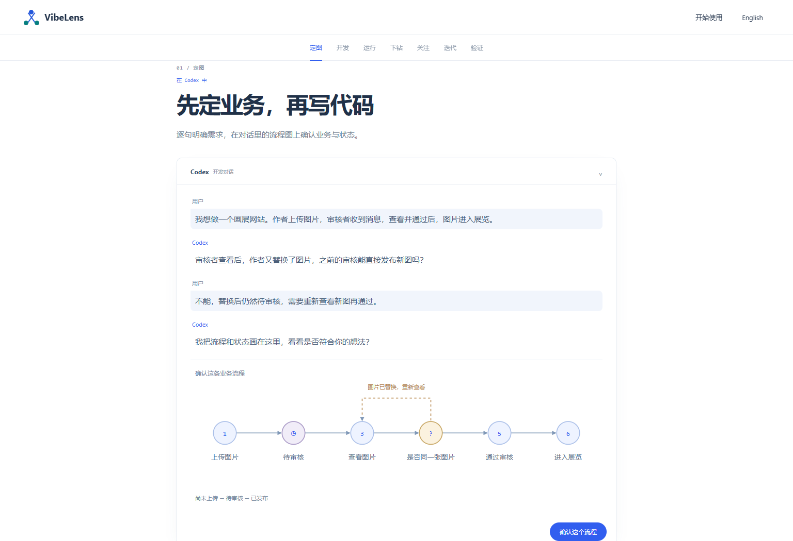
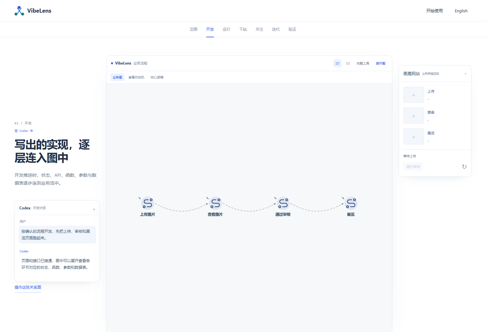
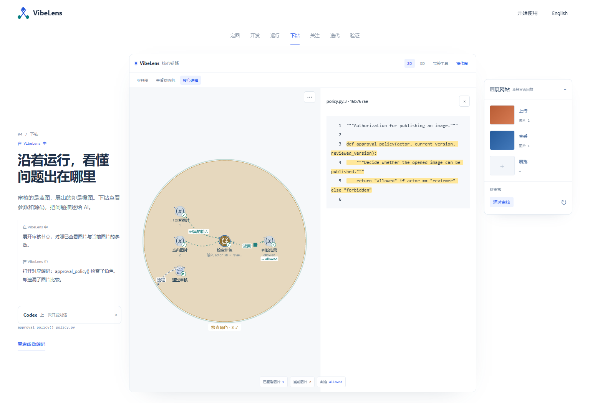
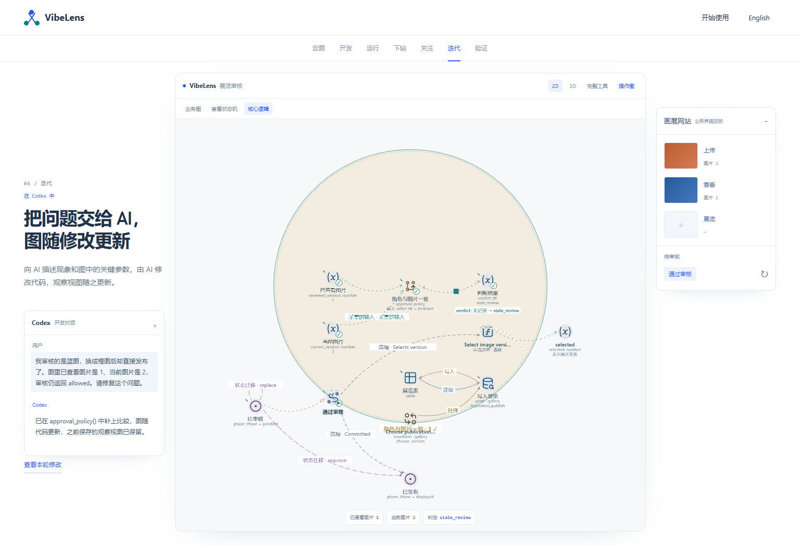
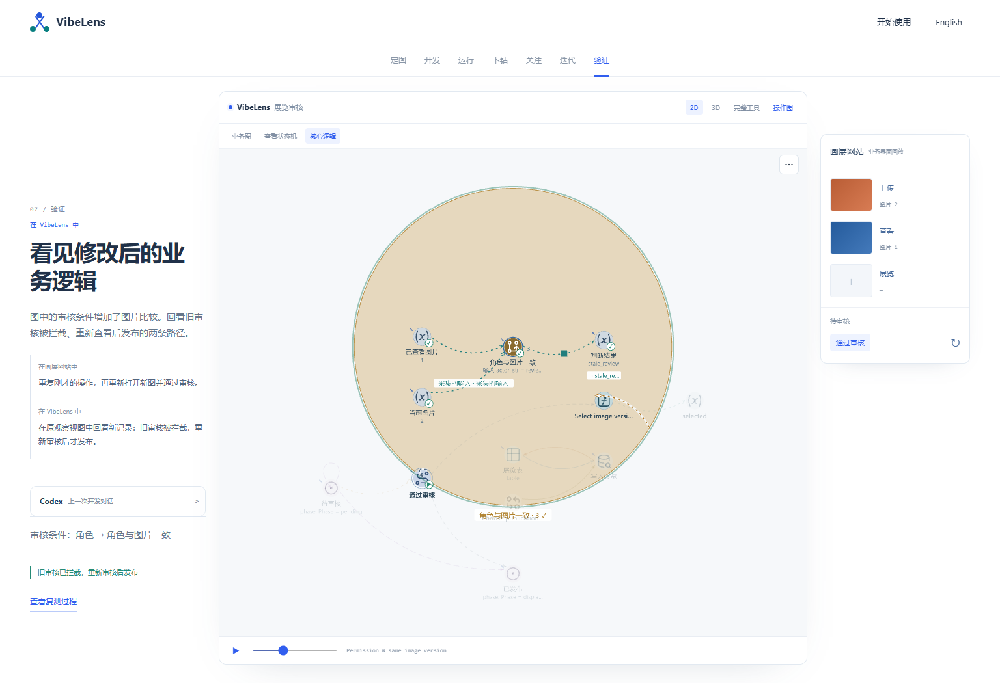
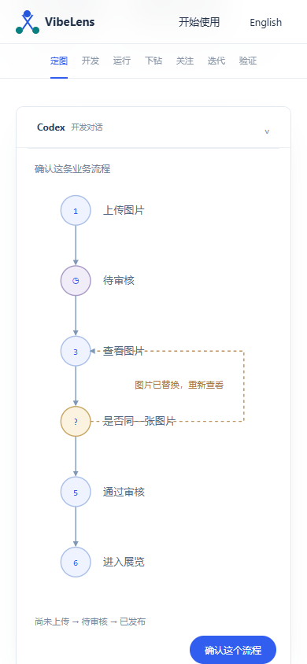

# Guided conversation and a clearer project walkthrough

The opening now describes an image review website: an artist uploads an image, a reviewer opens it and approves it for an exhibition. English and Chinese headings have no sentence-ending full stops. The unexplained project nickname has been removed from the presentation.

## From conversation to the first implementation

The opening advances one reply at a time. Codex asks whether a replacement image needs a fresh review. The developer answers; Codex proposes a small workflow and its states; the developer confirms it before the simulated development begins. The proposed diagram expresses confirmed intent. The running graph below uses the existing captured implementation, including its deliberately missing condition.

After confirmation, the conversation moves to the left, VibeLens occupies the center, and the application preview appears on the right. The browser test checks that neither companion overlaps the graph. On narrow screens they join the active section. Investigation stages retain the previous development conversation in a collapsed panel; their current instructions describe actions in VibeLens or the application.

The first view contains four ordered business nodes. States and core logic are optional views. Inspection opens five relevant nodes; full tools retain all eight presets and eight 3D layers. Native layout preferences provide shorter labels and layered positioning without changing model identities. Playback appears for recording/replay stages and while playback is actually running.

## Investigation, AI repair and verification

The developer reads the recorded inputs and their bound source, then describes the problem to AI: the reviewed image is 1, the current image is 2, and the decision still returned `allowed`. AI changes the code. The demo does not ask the developer to edit the source.

The repaired source checks both role and image identity. Its rule caption changes from **Role check** to **Role + image**, using the same stable rule ID. The browser binds this caption to the actual comparison in `policy.py`. Verification shows the recorded `stale_review` rejection and pending application state, followed by a successful fresh review. This is a changed condition and runtime outcome; the presentation does not invent a new business requirement or graph edge.

## Checks and retained failures

| Check | Result |
| --- | --- |
| [Bilingual demo browser](demo-browser.json) | Seven stages, progressive confirmation, separate companion windows, conditional playback, exact source highlights and application responses |
| Existing graph interactions | Actual edge-flow animation, backward seeking, saved custom views across builds/reload, eight presets/layers, 3D rotate/zoom/pan |
| Mobile and motion | Readable vertical proposed workflow at 390px; language switching; reduced-motion playback remains paused |
| [Bilingual product browser](product-browser.json) | Main introduction, progressive graph depths, interactive tour, practice walkthrough and heading punctuation |
| [Source quality](source-quality.json) | Syntax, lint and formatting; 96 Python and 67 JavaScript modules in the recorded scope |
| Captured artifacts | `node tools/test_case_artifacts.mjs` passes source freshness, red/green results, transformations and stable IDs |
| Documentation | `tests/test_document_links.py`: six checks pass; new review links checked separately |

Two failed runs are retained. [The initial demo failure](failures/demo-resource.json) exposed native preference imports fetching `/api/design` before the static transport was installed. [The diagnostic request list](failures/design-requests.json) identifies those requests. Moving preference imports after transport setup fixes the problem; the test still rejects HTTP failures and browser errors. [The product failure](failures/product-heading.json) caught a remaining full stop in the Chinese installation heading. The source translation was corrected; the heading assertion remains enabled.

Reproduce with `python tools/build_site_viewer.py`, `node tools/test_case_browser.mjs`, `node tools/test_site_browser.mjs` and `node tools/test_case_artifacts.mjs`. Browser tests use Playwright and a Chromium-compatible browser. `BO_SITE_URL` selects a published copy.

These checks exercise the updated presentation over the existing 82-event and 138-event captures. No backend/database execution, renderer performance benchmark or new implementation-coverage claim is added here. The canonical viewer and captured model, source and runtime artifacts are unchanged. Earlier review directories remain historical evidence.

Graph-to-AI context export is tracked separately. The current demo shows a developer describing observations in conversation; it does not advertise an implemented selection-to-chat button.

## Published verification

[Pages run 40333810855](https://github.com/li-bruce/VibeLens/actions/runs/40333810855) deployed commit `9964cea`. The [public demo](https://liblog.vip/VibeLens/demo.html?lang=zh-CN&rev=story-6) and [product introduction](https://liblog.vip/VibeLens/index.html?lang=zh-CN&rev=story-6) pass the complete bilingual browser suites, including the mobile confirmation flow.

[Deployment receipt](deployment.json), [demo results](deployed-demo.json), [product results](deployed-product.json) and [15 matching published assets](published-assets.json) retain the exact deployed revision. [Published three-window view](screens/deployed-three-surfaces.png) and [published rule verification](screens/deployed-verify-logic.png) show the accepted output.
