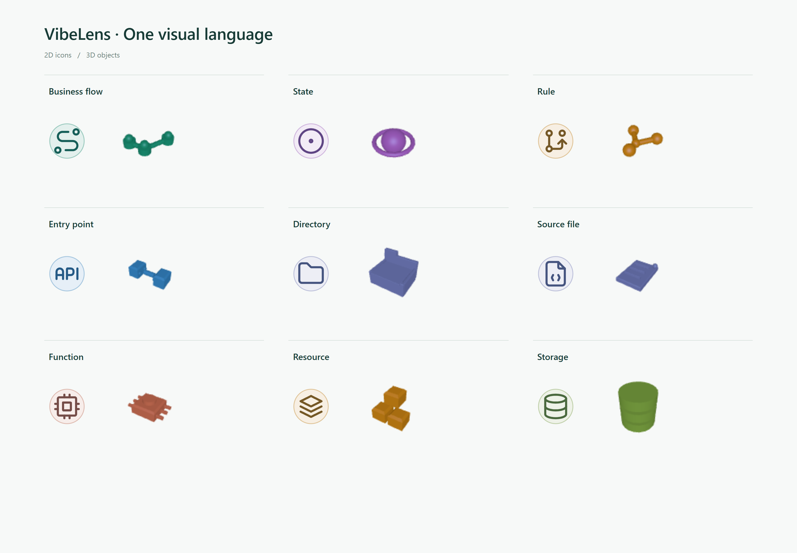

# VibeLens v0.13.0 review

This release adds DeepSeek Harness distribution, refreshes product descriptions,
and updates the viewer's node vocabulary and directional transfer animation.
The native state engine, business contracts, observation protocol and stable graph
identities retain their existing behavior.

## Verification

| Check | Evidence |
|---|---|
| Source syntax, lint and formatting: 166 Python / 113 JavaScript modules | [Source report](checks/source-quality.json) |
| Actual Harness 0.2.2-rc.1 CLI installation, registry and native invocation | [Installed checks](checks/harness-runtime.json), [installation](checks/harness-install.log) |
| User-only invocation, actual chat identity, quote/tool-result rejection and disposal | Same native-host checks; fixture sessions, no LLM application trial |
| Complete, deterministic Skill and Harness packages; catalog decoding and tamper rejection | `tests/test_distribution.py`, [package identities](checks/local-packages.json) |
| Real recorded state transition uses the same edges in 2D and 3D | [Browser report](checks/glyph-browser.json) |
| Bilingual homepage and five-chapter demo: custom views, source, camera and retest | [Product browser report](checks/product-browser.json) |
| Floating change panel, complete disclosure, drag, collapse, 2D/3D and no business writes | [Panel report](checks/compact-changes.json) |
| Managed example upgrades and strict acceptance | [Delivery](checks/delivery-accept.json), [archive](checks/archive-accept.json); full frozen receipts live in each example's `.release/stategraph/harness-distribution-20261105` |
| 1,000 nodes / 4,000 edges and 4,000 nodes / 16,000 edges | [Local GPU benchmark](checks/render-performance.json) |

On the reported Intel Arc GPU, selection took about 11 ms and 24 ms respectively.
The first layout/routing settled in about 1.2 s and 4.8 s. These are local synthetic
rendering measurements, not guarantees for every machine or application.

## Failures, fixes and retests

1. An initial dependency choice used the wrong Cordis major. The real Harness
   peer requirements resolved to Cordis 4.1.0. Dependencies and the lockfile now
   pin the tested host contracts.
2. Manually composed middleware hid the host's real waterfall ordering. The test
   now runs Cordis's actual waterfall. The invocation guard is prepended and
   inspects the native consumer's result; quoted commands stay inactive.
3. A replay visual test initially looked for transfers in a collapsed default
   view. The retest selects a recorded state transition and its state view,
   asserts a visible transfer and requires identical edge IDs in both renderers.
4. The managed delivery graph builder changed its owned file inventory after
   sealing. Architecture validation [correctly failed](failures/delivery-before-reseal.json).
   The regenerated inventory was reviewed, sealed, inspected and fully reverified;
   application/state/probe contracts and exclusion classifications were preserved.
5. Windows sandbox restrictions blocked junction tests and Chromium startup.
   [The failed run is retained](failures/windows-sandbox.log). Tests run outside
   that sandbox use the same assertions and repository-local synthetic fixtures.
6. SkillHub filtered `resources.zip` from the nested upload. The corrected package
   carries the original ZIP as `resources.zip.b64.txt`; the local bootstrap
   decodes it and verifies its checksum and all 355 files. Directory-link
   rejection is tested with actual symlinks/junctions, including Python 3.11. The upload preview
   retained all seven files (4.56 MB). The corruption test uses valid base64 with
   invalid archive bytes so it exercises checksum rejection explicitly.

7. The full suite detected insufficient related/selected contrast in several
   node types. The [original failure](failures/glyph-contrast.log) is retained.
   Darker fill/ink mixing restores the unchanged 4.5:1 threshold for all 24 types
   in all four states. Native browser captures were regenerated. Both examples
   use a second managed change, `.release/stategraph/harness-contrast-20261105`.

## Scope

The existing product regression includes an old narrow-viewport check; no new
mobile adaptation was added. The desktop Web tool remains the development focus.

Harness tests exercise the official registry, invocation consumer, resource paths
and CLI installation. They do not establish a new model-driven application trial.
The previous independent trial's [open findings](../clarity-story-20261105/TRIAL-ASSESSMENT.md)
remain recorded; this release does not relabel them as resolved.

Publication and full-suite results are appended when their final receipts exist.
