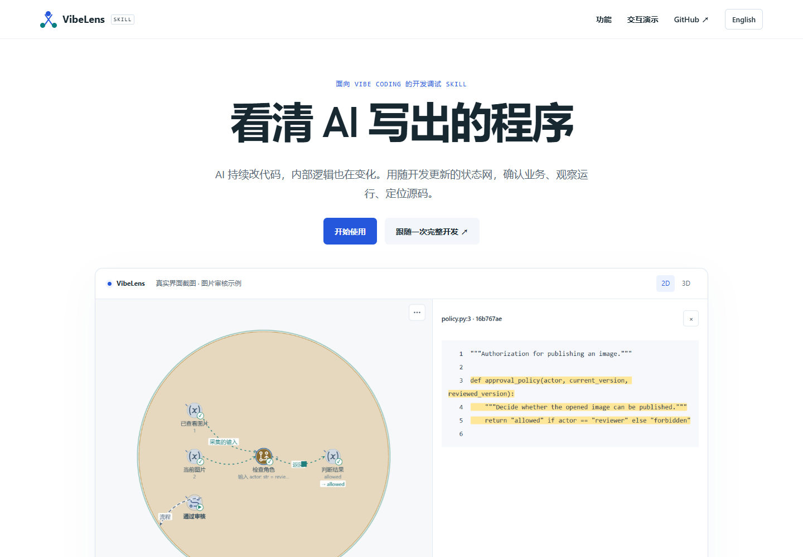
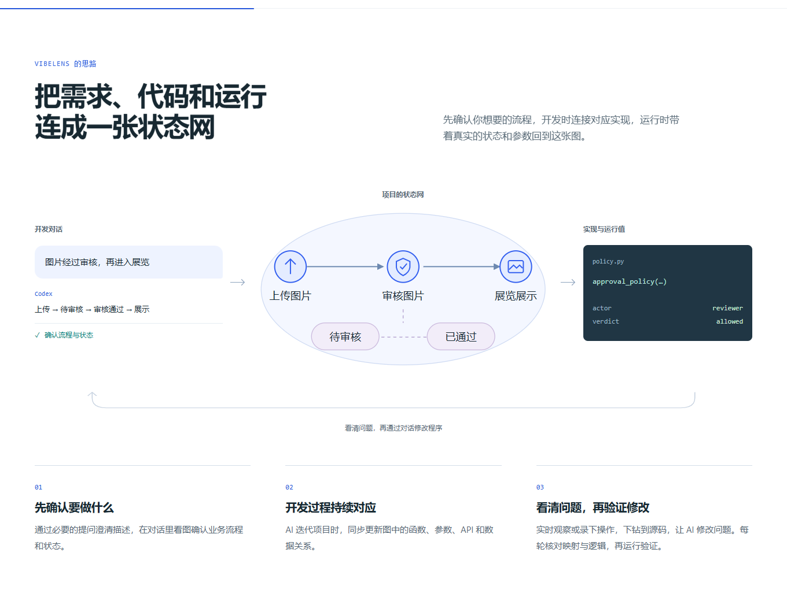
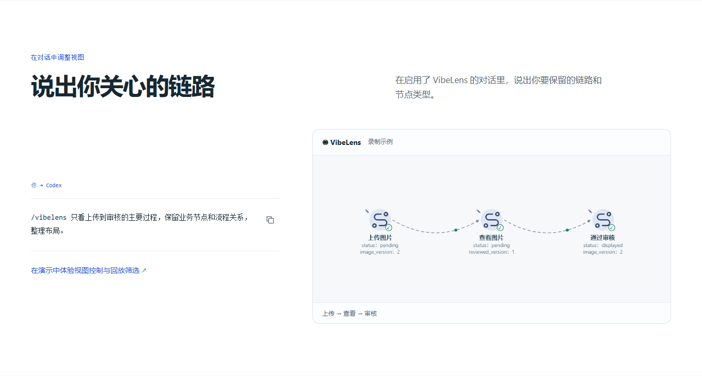

# Homepage clarity

The introduction now explains the visibility problem in AI-assisted development,
then connects a confirmed request, its state graph, implementation and recorded
behavior. Three stages describe confirmation, coding and inspection. The page
retains the drive/observe choice and one conversation-control example.

## Presentation

- Replaced generic node taxonomies and the illustrated viewer animation with a
  concrete request-to-graph drawing and real viewer captures.
- Kept one command and its three-node business path on the homepage. The complete
  view, parameter and replay controls now live in `demo.html#conversation-controls`.
- Used English and Chinese captures from the existing image-review case. They are
  unmodified browser screenshots, not generated mockups. The pictured first-version
  policy has the demonstration's intentional defect; the full demo shows its repair.
- Removed unused `product-story.mjs`, `product-story.css` and `viewer-tour.mjs`.

`tools/capture_product_views.mjs` captures the native viewer through its existing
controls. [Capture provenance](../../site/images/capture-proof.json) identifies the
build, selected nodes, event, camera and image hashes. Artifact checks verify both
locales, dimensions and every image hash against that record.

## Acceptance

| Check | Evidence |
| --- | --- |
| Bilingual homepage, real screenshots, keyboard image switching, one control example, 390px layout and independent recording walkthrough | [Homepage result](home-result.json) |
| Parameter expansion, native 2D/3D, filtered replay, original event preservation, clipboard, mobile language switch and reduced motion | [Control result](controls-result.json) |
| Original seven-stage development story, source inspection, saved views, repair, replay and 3D camera gestures | [Story result](existing-demo.json) |
| Syntax, lint and formatting: 101 Python and 68 JavaScript modules | [Source checks](source-quality.json) |
| Runtime copies and documentation links | [Package log](package.log) |

The first direct link into the demo timed out: asynchronous story construction
shifted the target below the viewport before its lazy preview loaded. The fix
restores that specific anchor after constructing the story. The unchanged control
assertions then passed. See [first failure](deep-link-first.json) and the final
control result above.

Publication checks are added after deployment. Observer runtime and project
business code are unchanged by this presentation update.
