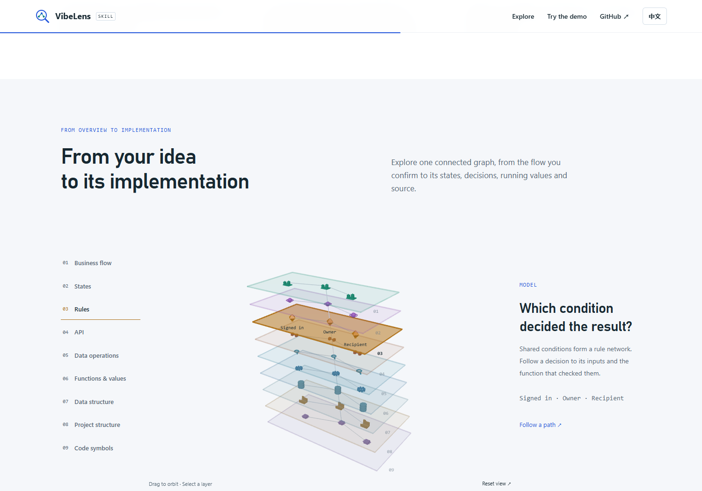
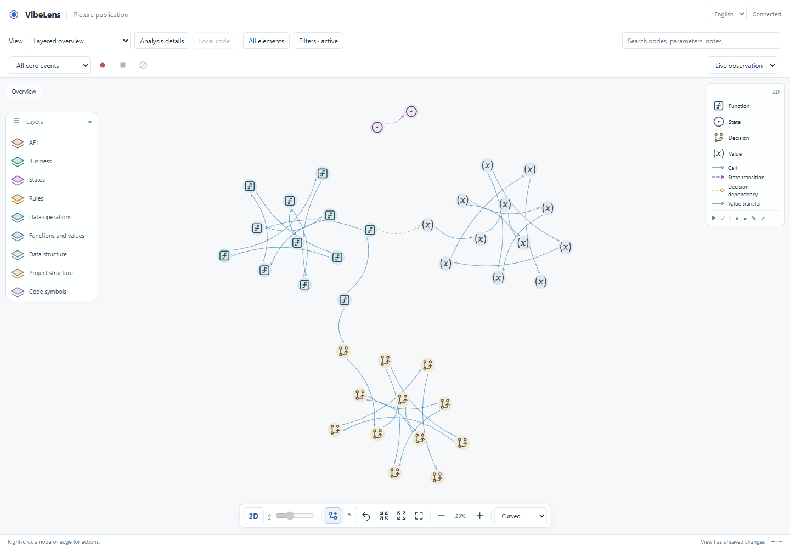

# Layered project, layout and introduction acceptance

[中文审查摘要](README.zh-CN.md)

The round tests a real Python/Flask/SQLAlchemy file-sharing application, improves
type clustering, and introduces the nine connected layers on the product page.
The branch is `feat/layer-experience`, based on engineering-structure commit
`f37e6f2`. This is local acceptance; it does not assert a Pages deployment.

## Review the result

- [Iteration comparison](project/iteration.json): every layer before and after.
- [V1 runtime and business result](project/v1/result.json) and
  [V2 result](project/v2/result.json): actual operations, values and snapshots.
- [Detected missing mappings](project/unmapped-iteration.txt) and
  [reconciled implementation](project/mapped-iteration.json).
- [Updated runnable source](project/updated-project.zip), including the current
  observer and viewer. Databases, session secrets and caches are excluded.
- [Browser layout checks](layout/browser.json), [demo](demo/result.json),
  [introduction](site/explorer.json) and [scroll frames](site/transitions.json).
- [Managed example acceptance](examples.json) and [source checks](source-quality.json).
- [Final validation](validation.json), [full suite log](full-verify.txt) and
  [clean Git export](clean-export.json). The full suite passed; one Windows
  filesystem-symlink case was skipped for missing host privilege.



## Project scenario and independent checks

V1 signs in, uploads an owned file, shares it with a named user, downloads the
same bytes, rejects unrelated access, revokes one recipient, rejects the next
download from the unrefreshed page, retains the owner's access, and shares again.
V2 adds owner-only file renaming. The cases cover both private and shared files,
recipient denial, invalid names, unchanged content/grants and actual SQL results.
The native executor's declaration is compared with the observed graph. Old-build
events are rejected. Policy proofs and required data-operation cases use the
canonical validators, rather than expected-success mock events.

The project is a new disposable extraction of the repaired source retained in
`docs/review/file-sharing-demo/materials/green.zip`. Its public source archive
omits conversation documents, so the harness supplies an explicit automated
scenario ledger. This is a repeatable implementation/runtime acceptance, not a
new human conversation study. The original trial and archived sources are intact.

| Layer | Checked against the implementation | Iteration expectation |
|---|---|---|
| Business | Login, upload, sharing, metadata, download and revocation handlers | Add rename and its business links |
| State | Native states, guards, transitions, materialized revisions and snapshots | Add private/shared rename transitions; retain three states |
| Rules | Executed shared policy, source predicates and recorded evaluations | Reuse the owner/session condition for rename |
| API | Scanned Flask routes, handlers and source links | Add the rename endpoint and handler |
| Data operations | Actual queries, transformations, transactions and affected rows | Add the rename transaction/write and execution evidence |
| Functions and values | Declared function bindings, parameters and safe recorded fields | Add actor/file/name inputs and the actual committed result |
| Data structure | ORM export and real SQLite metadata, constraints and relations | Schema stays unchanged |
| Project structure | Scoped directory/file inventory, imports, declarations and source hashes | Keep file membership; refresh changed files and dependency links |
| Code symbols | AST declarations, parameters, calls, endpoint links and boundaries | Discover the new method, route, parameters and calls |

The complete unfiltered inventory is checked before folding or display filters.
Each populated layer must retain relations and cross-layer connections. Declared
parent membership counts as containment even when drawn as a surrounding region.
The layer receipts include generated capture-field nodes; they are not counts of
distinct business actions.

The final V1 recording contains 586 events, 12 state snapshots and 31 policy
evaluations. V2 contains 694 events, 15 snapshots and 37 evaluations. Both have
zero recording gaps, observation errors and observer-generated business events.

The first maintenance scan after editing the source reports the two new methods
as unclassified. The simulated coding step then supplies their semantic bindings,
probes, state and shared-policy declarations, and the rescan has zero implementation
gaps. Physical source and data projections refresh through the existing services.
Business meaning continues to depend on the coding agent's explicit mappings;
the test does not claim that AST analysis infers those meanings independently.

Both versions record zero observer-generated business events. Browser checks also
confirm that existing business-node coordinates survive the new build. API entry
nodes are linked through handlers to captured operations; static source and schema
nodes do not acquire invented execution events.
Dynamic or external call targets that static analysis cannot resolve remain
explicit boundaries. This is one Python end-to-end project; other language
adapters are covered separately by the existing full regression suite.

## Layout findings and repair

1. The demo explicitly selected `stress`/`layered`, overriding the viewer's default
   semantic clustering. Its private demonstration preferences now start with
   `cluster`. Existing project preferences remain unchanged.
2. The old solver placed multiple external-facing members on the same rim target.
   Collision forces then pushed some into a neighboring type's cluster. The new
   solver retains the local packing distribution, applies a bounded outward bias,
   increases group separation and reduces cross-type attraction.
   Sparse external links retain their rim positions; the original sparse-bridge
   regression caught that requirement and was preserved unchanged.
3. Initial 3D placement used an independent spiral. Known 2D centers now seed X/Z
   exactly, while height comes from the selected semantic layer. Arrange uses the
   shared subtree/type solver. Saved spatial positions and explicit pins take
   precedence according to the existing incremental/Arrange rules.

[Before/after reproduction](layout/before-after.json) uses the same 90 nodes and
89 cross-type links: 9 nodes were nearer another type's centroid before the fix,
and 0 afterward. This geometric criterion is a regression metric, not a universal
readability score. The actual browser checks cover shared coordinates and pins.

The 4,000-node worker test remained responsive while laying out the graph. Raw
timings and UI heartbeats are in `layout/browser.json`; concurrent acceptance
runs observed roughly 4.3–6.1 seconds for layout. These are not frame-rate or
production-scale latency guarantees. Existing routing/containment checks remain.



## Introduction presentation

Three small modules separate bilingual content, accessible selection and the
WebGL scene: `layer-content.mjs`, `layer-explorer.mjs` and `layer-scene.mjs`.
The scene reuses the maintained Three.js bundle and native node geometries.
It loads when visible, suspends offscreen rendering and preserves page scrolling.
Tabs provide keyboard navigation and readable content if WebGL is unavailable.
The browser receipt verifies both languages, actual orbit interaction, all nine
explanations, mobile overflow and reduced-motion operation.

References used: [Three.js interactive transformations](https://threejs.org/examples/css3d_periodictable),
[D3 position forces](https://d3js.org/d3-force/position) and
[D3 collision forces](https://d3js.org/d3-force/collide). The project already vendors
the underlying open-source rendering/layout tools; this change adds no production
package dependency.

## Failure and retest trail

`failures/` retains actual unsuccessful acceptance output. Distinguish the causes:

- The dense-cluster reproduction identifies the layout defect above.
- The demo's old assertion expected eight layers. It now checks the exact nine
  layer identities, including project structure.
- The first full-suite run caught a sparse-bridge regression in the new solver.
  The repaired solver distinguishes sparse and dense external membership; both
  the unchanged original assertion and the new dense regression pass.
- Early harness attempts lacked intentionally omitted archive contracts, compiler
  dependencies or installed viewer assets; they failed visibly and were corrected.
- One trial attempt reused a synthetic database; each build now has a fresh store.
- A test port belonged to another service; the clustering test now accepts an
  explicit dedicated port. Other services were left running.

These setup failures are not represented as application bugs. Final passing
receipts and original failed logs are retained separately. No existing validator,
business assertion, observer exclusion or frozen historical approval was relaxed.

## Reproduce

From the repository root, with the development dependencies installed:

```powershell
.venv/Scripts/python -B -X utf8 tools/test_layered_project.py --out .validation/my-layer-trial
node tools/test_shared_layout.mjs
.venv/Scripts/python -B -X utf8 tools/test_layer_explorer.py --browser C:/path/to/chrome.exe
.venv/Scripts/python -B -X utf8 tools/verify.py --database
```

Pass `--browser C:/path/to/chrome.exe` to the project trial to repeat its real
viewer screenshots and saved-layout checks. It requires a new output directory
and retains earlier evidence. The full database verification includes the
non-browser project trial. Browser suites remain separate because Chromium is a
development dependency.
