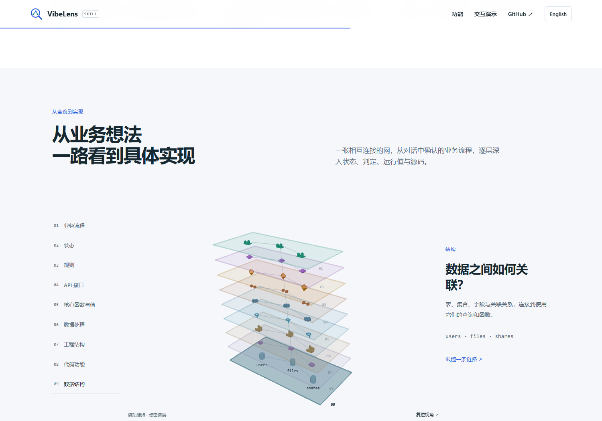

# Layer reading order

[中文](README.zh-CN.md)

The introduction and native viewer now read from intent to implementation:

**Business → States → Rules → API → Functions and values → Data operations →
Project structure → Code symbols → Data structure.**

States and rules describe the same behavior from different perspectives. The
display order is not an execution sequence. Core function anchors precede their
queries and data effects; the scanned project tree precedes detailed code symbols,
with physical data structure at the bottom as the storage foundation.
Existing cross-layer relations, classification, captures and recorded facts retain
their identities and meaning.

## Upgrade and interaction

Exact old eight/nine-layer defaults migrate to the recommended order. Other saved
orders remain custom. Reordering with a drag or keyboard records `orderMode: custom`,
including a deliberate return to a previous default. Visibility, gaps, coordinates,
pins, notes and saved views retain their existing storage and behavior.

The canvas ruler and its accessible action tree follow the same saved order.
Dragging also updates keyboard focus to the moved layer. Hidden/empty layers
continue to leave no unused height slots.

## Evidence

- [Introduction](site-final/result.json): exact order in both languages, real WebGL
  rotation, keyboard navigation, mobile layout and reduced motion.
- [Native interaction](ruler-final/result.json): actual pointer drag, custom-order
  persistence on reload, keyboard reordering and existing 2D/3D replay checks.
- [Full demo](demo-final/summary.json): all nine native layers plus the complete
  file-sharing walkthrough, source exploration and recorded playback.
- [Managed examples](examples-final.json): new candidate-bound verify/accept/check
  records; unchanged application sources retain their independent checks.
- [Source quality](source-quality-final.json) and [final checks](validation.json).
- [Clean Git export](clean-export.json), [package check](package-check.txt) and
  [documentation links](document-links.txt).
- [Module regressions](regressions.json): nine targeted layer, layout, projection,
  persistence and product-copy checks.

The initial `site/`, `ruler/`, `demo/` and `examples.json` receipts preserve the
earlier local draft before the user clarified that storage belongs at the bottom.
The `*-final` receipts check the revised order.

An early package check ran before the pending review reports were written and
reported two missing documentation links. Its [failure](failures/link-readiness.txt)
is retained; the final package check runs after the reports exist. Checks were not
relaxed. This presentation-only round uses targeted regressions and managed-example
verification; it does not claim a new run of the complete optional database suite.

Regression entrypoints are `node tools/test_layer_order.mjs`,
`node tools/test_ruler_controls.mjs`, `node tools/test_ruler_browser.mjs`,
`python tools/test_layer_explorer.py --browser <chromium> --out <new-output>`,
and `node tools/test_case_browser.mjs`. The order contract also runs in the normal
`python tools/verify.py` gate.

Earlier acceptance records remain unchanged. This round is local to
`feat/layer-experience`; it does not claim a GitHub push or Pages deployment.

