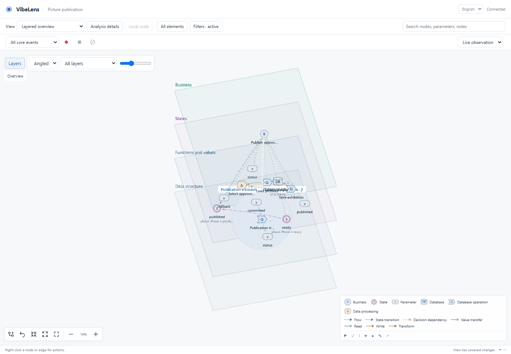
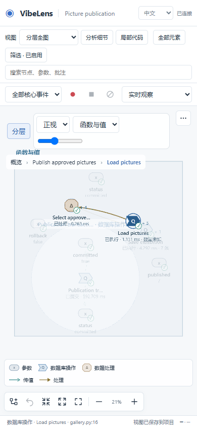
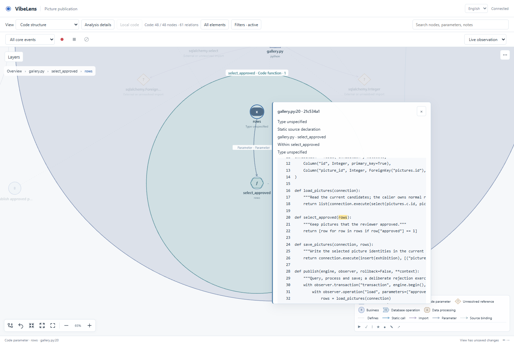
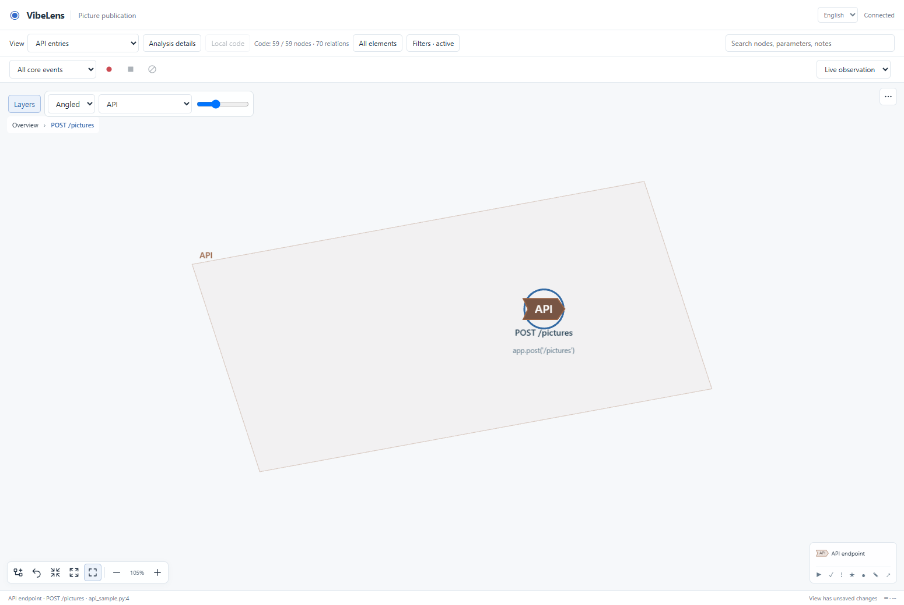

# Graph clarity, layered viewing and source navigation

Work branch: `feature/layered-graph`, based on `24bf23f`.

This iteration addresses the developer's ability to follow an implementation from
business action through state, source and data operations. It also adds an optional
spatial projection of the same graph.

## Changes and causes

| Reported issue | Cause | Result |
| --- | --- | --- |
| Repeated database verification prose | Every store, dataset and field rendered catalog origin, coverage and comparison status | Canvas captions retain native types and constraints; provenance is available in node details |
| A transaction expands into many apparent variables | Every event capture field was projected as a parameter/return, including adapter metadata | Diagnostic fields require Analysis details; nested business values expand by their actual payload path |
| A captured value cannot be found in the source | Source navigation fell back to the collection owner without explaining the fallback | Details name the event path and collection owner; adapter fields never receive guessed variable highlights |
| Edge patterns do not match meaning | Pattern selection distinguished many relation types without consistently separating transfer from association | Concrete calls and transfers use solid strokes; logic, containment, mappings and captured-field membership use dashed strokes |
| Publication states are isolated | The fixture declared the transition but omitted action/state association edges | Explicit, evidenced ready/action/published relations are present; matching labels alone never create edges |
| API entrypoints are absent | Adapters retained some registrations, but the code projection discarded them | Literal Python/JavaScript routes become API nodes linked to their handlers; an API entries view and spatial layer are available |
| Opening source requires another file action | Code bindings carried no snippet, and the viewer awaited Complete file | Opening source fetches the complete bound file, highlights the declaration/parameter and scrolls to it |

The previous `Q / Publication transaction` expansion contained 18 capture fields.
Its default expansion now shows `status` and `committed`. Fields such as
`duration_ms`, `transaction_id` and target-resolution information remain available
under Analysis details. These describe an observed operation; they are not
automatically source variables or arguments passed between functions.

## Spatial view

Select **Layers**, then choose an angle, layer, or separation. The viewer separates
API entries, business actions, states, rules/resources, functions/values, data
structure, and source structure when those facts exist. Cross-layer containment
uses an explicit dashed relation once a common enclosure is separated. Switching
back to 2D restores the original layout; dragging is converted back to persistent
layout coordinates. Existing filtering, expansion, notes and recording remain in
the same graph.

This is an orthographic pseudo-3D projection with readable screen-facing labels
and camera presets. It does not provide unrestricted orbit navigation or claim
that spatial separation always improves a large graph. Layer selection and local
code remain useful for dense regions.

The implementation reuses the bundled MIT-licensed PixiJS renderer and avoids a
second WebGL context. The design was compared against
[PixiJS render layers](https://pixijs.com/8.x/guides/concepts/render-layers),
[Three.js orthographic cameras](https://threejs.org/docs/pages/OrthographicCamera.html)
and [transparent rendering](https://threejs.org/manual/pages/transparency.html).
No extra renderer package, shader dependency or CDN is required.

## Source and API evidence

Full files are requested only when source is opened. A file cache is keyed by
its bound revision. Graph data carries source locations rather than complete
code files. Python byte offsets are converted to UTF-16 columns; JavaScript and
Vue parser ranges use those same browser units. Source responses retain scope,
revision and hash checks. Historical recording source continues to use its bound
version.

API nodes describe recognized source registrations. Method defaults, dynamic
paths, framework mounting/prefixes and middleware dispatch are not guessed. The
API entries view covers recognized incoming route declarations. Outbound HTTP calls and dynamically assembled targets need explicit project bindings. The API entries view is a static source view; current source views are disabled during
historical replay. Application request captures still require actual project
bindings/probes. Observer routes are excluded. The database fixture has no
independent application API declaration; API presentation was exercised with a
separate source fixture in the code browser test.

## Verification records

- [Focused unit checks](../../../tools/test_layered_view.mjs): payload paths,
  diagnostic disclosure, edge semantics, unchanged 2D data, inverse dragging and
  layer filtering.
- [Source tests](../../../tests/test_code_graph.py): independent source refresh,
  literal Python/JavaScript routes, handler links, observer exclusion, Unicode
  parameter positions and Vue offsets.
- [Full-source browser run](full-source-final/browser-result.json): complete file,
  exact parameter highlight, source revisions, live additions/deletions/errors,
  annotations and recording isolation.
- [On-demand source retest](lazy-source-retest/browser-result.json): source loading
  starts on opening a node rather than constructing the graph.
- [Layered browser run](full-source-layers/result.json): actual pointer drag,
  persistence/reload, 2D round trip, state links, recording/replay, English/Chinese
  and a 390-pixel viewport.
- [Database browser run](database-browser/database-browser-results.json): real SQLite
  reads/transforms/writes, commit/rollback, schema/source refresh and observer
  operation exclusion.
- [Controls browser run](controls-final/result.json): context menus,
  saved annotations, recordings, language, dismissal and mobile interaction.
- [Strict example and repository phases](verification-summary.json): execution
  status and durations; each phase has its complete log next to this document.

Mapping, state constraints, business rules and project checks remain separate
reports. No previous expected business outcomes or validation rules were relaxed.

The strict example reports record 201 required value witnesses and 303 projection
checks for delivery, and 480 witnesses with 1,113 projection checks for archive.
Their independent business assertion totals are 96/96 and 189/189 respectively.

## Failures retained

1. `browser-first/result.json`: the fixture initially used `transition` as an
   authored v3 edge type, which the strict contract rejected. The action/state
   association now uses the existing supported `flow` type; machine transition
   validation was preserved.
2. `browser-retest1/result.json`: the new test selected an obsolete menu ID.
   It now uses the actual `node-expand` menu item.
3. `source-excerpt-final/browser-result.json`: the earlier snippet experiment
   still displayed the complete file. This was superseded by the user's explicit
   full-file/highlight requirement; the final test verifies that behavior directly.
4. A JavaScript parameter test initially counted an unresolved method reference as
   a parameter. The assertion now targets parser-classified parameter nodes while
   retaining that unresolved reference in the graph.
5. Starting an example change with already-edited canonical tools was rejected
   because its accepted tool fingerprint differed. The change was begun using the
   still-installed accepted tool version, then upgraded and reviewed with the new
   tools. Frozen earlier evidence and the original baseline were preserved.

Legacy `business-observer` was found in the active Codex Skill directory and moved
to `C:/Users/Lvi_P/.codex/skill-backups/business-observer-retired-20261024T224213`.
The active VibeLens installation was updated to this validated feature candidate; all 179 portable files match the repository. See [installation receipt](local-installation.json). Archived source and historical
acceptance documents are not active Skill installations.

## Final local result

All four recorded phases completed successfully. Repository verification used
`python -B -X utf8 tools/verify.py --database` and returned exit code 0 in 1,283.4
seconds. Browser checks are additional real Chromium runs, with their screenshots
and results linked above. Earlier frozen evidence and business expectations were
preserved. The live preview is at
[the existing graph address](http://127.0.0.1:8882/graph?lang=zh-CN); its five saved
personal preference entries were restored. [Preview receipt](live-preview.json).

The active local Skill is `~/.codex/skills/vibelens`. Start a new conversation and
invoke `$vibelens` to load this revision. Choose **API entries** for recognized
route/handler structure, **Layers** for spatial viewing, and a node's **Source**
menu for the complete file and precise parameter highlight.
