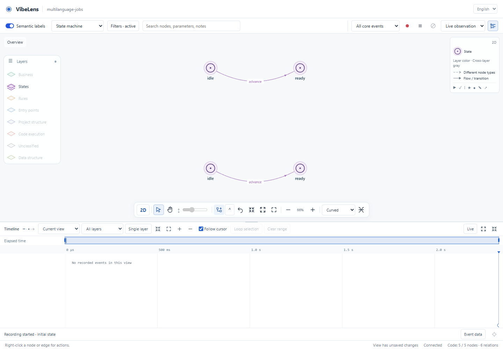
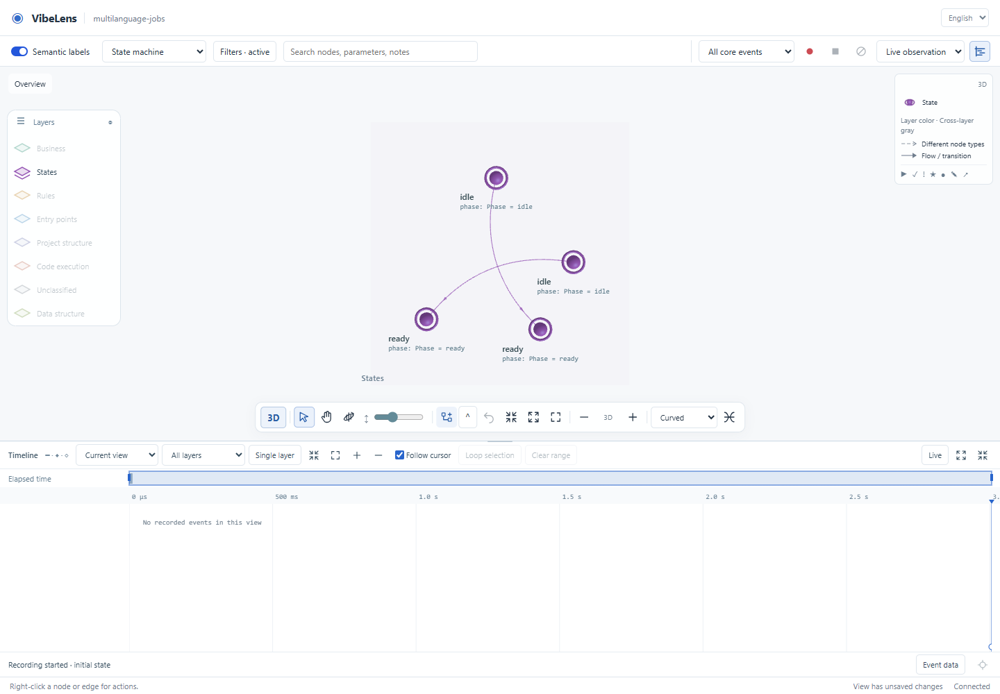
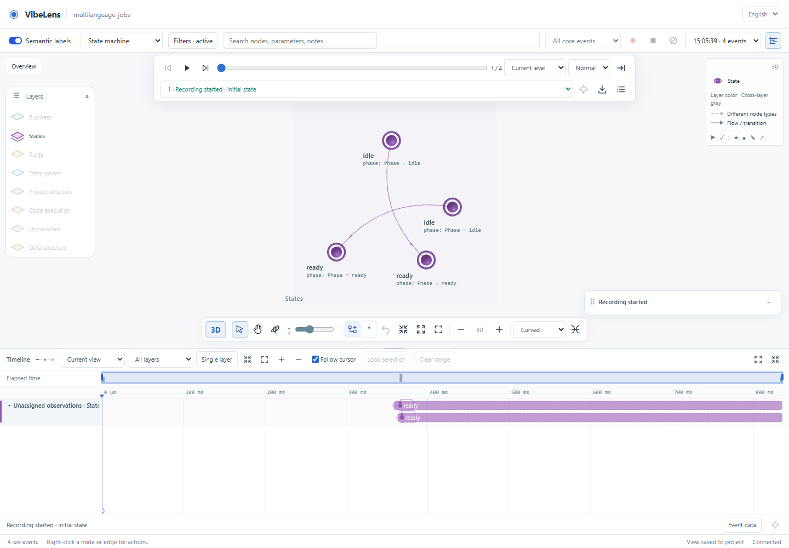
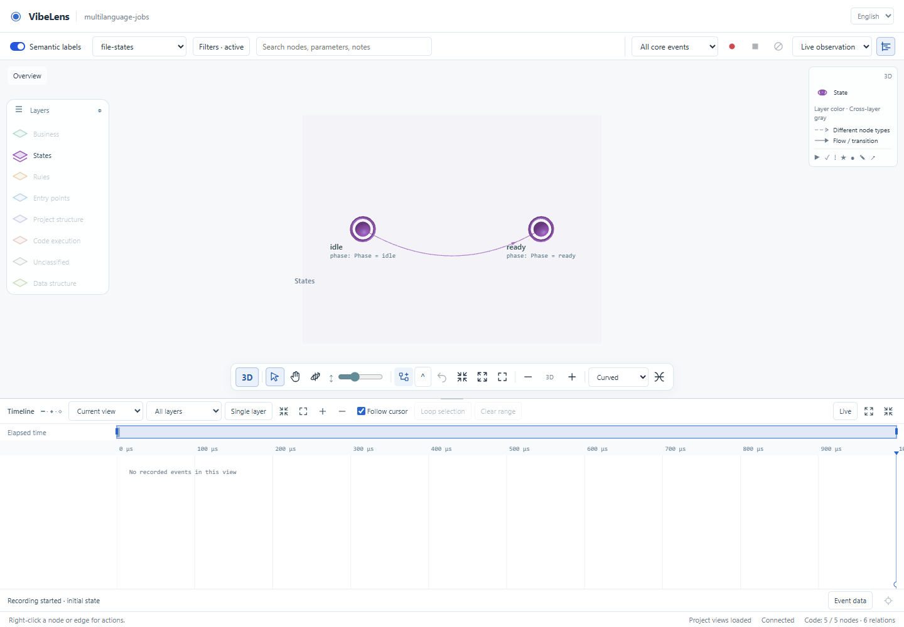

# Multiple model networks

Branch: `feat/model-networks`, base `476d2d93`.

The change replaces the single primary-model binding with an explicit registry.
A layer can contain several independent networks. A native state definition,
a runtime instance and a view membership have separate identities. Existing
single-model projects and recordings keep their original identities.

## What changed

| Area | Result |
| --- | --- |
| Definition | `machines` registers every state model; mixed legacy/new declarations and invalid members fail. `networks` declares overlapping subnets in any layer. |
| Design and binding | Every confirmed state model binds to a native model. Business networks and rule-operation dependency networks remain independently selectable. |
| Native execution | Python and JavaScript register multiple portable executors. The application retains state ownership, guards and side effects. |
| Capture | Snapshot v2 carries the model ID. The collector namespaces model, run and instance IDs and keeps independent revisions and exact frames. |
| Verification | Mapping v2 requires every model to have independent actual-state witnesses and required cases. Dropping a model or weakening coverage fails. |
| Viewer | Shared network selection, layout membership, semantic names and node facts work in 2D and 3D; recording and Timeline retain model identity. |
| Iteration | Recall reports current and prior model inventories. A source/model change is detected, reloaded and checked without removing another model. |
| Integration | Standard project installation contains only small native adapters. Viewer/routing/layout dependencies stay in the local tool installation. |

## Executed checks

| Check | Evidence | Result |
| --- | --- | --- |
| Python model contracts and real Python/Node capture | [15 tests](multi-model-final.log), [JavaScript replay checks](model-networks-js.log) | Passed |
| Lightweight installation, managed upgrade and package imports | [10 tests](integration-package-retest.log) | Passed |
| Real collector and desktop browser | [Results](browser/result.json), [runner](browser-iteration.log) | Six checks passed; no browser errors |
| Watcher cleanup regressions | [32 tests](watcher-cleanup-final.log), [20 tests](assessment-cleanup-retest.log) | Passed |
| Source quality | [Lint and formatting](source-quality-complete.log) | Passed |
| Complete existing suite with database checks | [Prefix](full-check-release.log), [continuation](full-check-continuation.log) | Completed in documented segments; failed watcher suites passed on retest |
| Shipped example upgrade | [Completed upgrade](example-upgrade-complete.log) | Both examples passed |
| Clean staged Git export | [Report](git-export.json) | Both frozen approvals passed without regeneration |

The new JavaScript regression in `tools/test_model_networks.mjs` is part of the
complete suite. It checks namespaced transitions, semantic names, view membership,
exact replay and four state-residence intervals with two same-model links.

Full-suite coverage is recorded in segments. The prefix stopped at the Windows
cleanup failure in `tools/test_assessment_fixes.py`; earlier checks passed. The
two affected suites then passed after using the shared process cleanup helper.
[The continuation recipe](resume_remaining_checks.py) executes every subsequent
statement directly from the unchanged `tools/verify.py` AST, including example
acceptance, core packaging and isolated execution. It records the verifier hash
and does not copy, rewrite or waive any remaining test.

The final continuation exits successfully after both core-package exports. The
archive package independently verifies normal completion, immutable snapshots,
content rejection and cancellation with `observer_modules_loaded: false`.
No maintained application business file changed in either shipped example.

The Python tests execute native application functions and the real collector.
The Node producer sends actual HTTP snapshots to Python. Both models deliberately
reuse `idle`, `ready` and local instance ID `1`; their identities must remain
different. A native cross-model guard reads approval facts before changing a file.
Another test adds an `archived` state, changes the source and reloads the project;
new capture must include that state while preserving the other machine.

The browser checks select each model in 2D and 3D, record actual operations, inspect
the Timeline, add a network to the project declaration, wait for automatic catalog
refresh, and reload a saved model view. This is an executable synthetic project
test, not a new human/AI dialogue or a claim of exhaustive application correctness.

### Screenshots

## Failures, corrections and retests

All initial logs remain in this directory; a failed run is not relabelled as passed.

| Failure | Correction | Retest |
| --- | --- | --- |
| The initial new fixture omitted required graph edges/overview. | Add actual action-to-state relations and an overview. Keep strict validation. | Model contract suite passed. |
| A misplaced import in `recording_session.py` caused an import error. | Move it to the module header. | Model and legacy recording tests passed. |
| Historical/static views had no `view.model` or machine declaration. | Shared model lookup handles empty/static views without choosing an arbitrary machine. | Code-view, lifecycle and recording-atomicity regressions passed. |
| New network options were absent at initial page load. | Refresh the catalog after the actual project view arrives. | Browser menu check passed. |
| Selecting one network still displayed both models. | Include network membership in the shared view-filter gate. | Both models independently filtered in 2D and 3D. |
| Browser default executable was unavailable, sandbox launch was denied, and live polling prevented network-idle completion. | Use the installed Chromium, normal browser permissions and actual viewer readiness. Keep timeouts/error capture. | Final six browser checks passed. |
| One browser startup timed out during an intermediate run. | Preserve the diagnostic screenshot/log; rerun readiness and the subsequent iteration checks. | Diagnostic and final iteration runs passed. |
| Old shipped ownership receipts rejected changed framework files. | Review the managed upgrade, seal its hashes and re-run complete project acceptance. | New acceptance preserves the old baseline and all business assertions. |
| A baseline export was initially compared against the new installed package. | Export the matching base Skill and explicitly select it for baseline checks; then upgrade to the current package. | Original baseline check passed unchanged. |
| Clean exported example tests lacked the ignored `scratch` directory. | Create the test working directory before verification. | Same business/execution tests passed. |
| Two Windows watcher suites left workers holding `watch.log`. | Share `process_cleanup.py`, terminate only each test's own process tree, and wait before fixture cleanup. | All 32 refactor and 20 assessment tests passed. |
| A legacy observer imported as a Python package could not resolve `bo_models`. | Use the established package-relative import with CLI fallback in projection, explanations, runtime frames and semantic names. Add an isolated-process regression without the Skill on `sys.path`. | All ten integration tests passed. |
| The isolated archive example could not load the existing `jsdom` test dependency. | Install the base commit's unmodified npm lockfile in the isolated workspace. | Both example acceptances passed; [installation receipt](example-upgrade-complete/test-dependencies.json). |

`full-check-initial.log`, `full-check-retest.log`, `full-check-final.log`,
`full-check-complete.log`, `acceptance.log`, `full-check-upgrade.log` and
`full-check-final-acceptance.log` preserve
the intermediate full-suite stops. Browser logs likewise preserve failed setup
and filtering attempts. The repeated Miniforge launcher warning is retained as
raw environment output; the command exit status determines the recorded result.

## Upgrade evidence

[The acceptance recipe](revalidate_examples.py) exports base commit `476d2d93`,
restores its frozen approval, verifies that unchanged baseline, and begins a new
change before copying the current reviewed runtime. The recipe preserves prior
classifications only for byte-identical application source. New verification,
acceptance and frozen release artifacts follow the existing commands.

Failed verification's individual commands are preserved under
`example-upgrade-retest/delivery/failed-checks/` and
`example-upgrade-package/*/prior-checks/`, with later attempts under
`example-upgrade-complete/*/prior-checks/`. Historical accepted changes are
retained in the examples; no baseline or business assertion is rewritten to make
the upgrade pass. A separate staged Git-export check verifies distribution bytes.

## Deliberate boundaries

- Multiple registrations do not add new execution semantics. The portable
  Python/JS executors still accept the strict flat subset. Supported native
  adapters are needed for hierarchy, concurrency and resource coordination.
- Inter-model relations are explicit references or actual causal evidence.
  Registration alone supplies neither a distributed transaction nor exhaustive
  cross-model invariant checking.
- Shared physical declarations keep one ID and may belong to multiple networks.
  Independent networks need no invented connecting edge.
- Viewer dependencies remain bundled for offline use in this branch. Pinned
  setup downloads are possible; no universal Skill postinstall is assumed.
  Third-party license and upstream Wasm rebuild qualifications remain unchanged.
