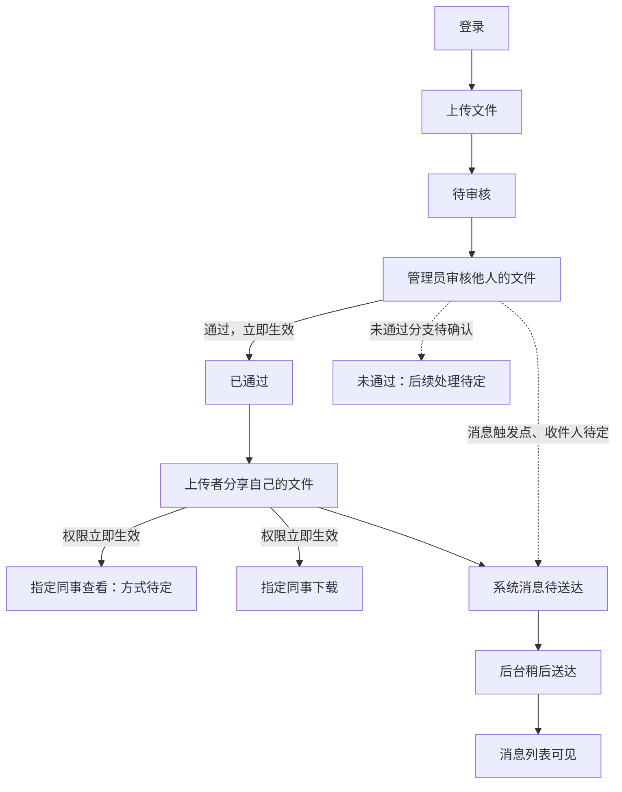
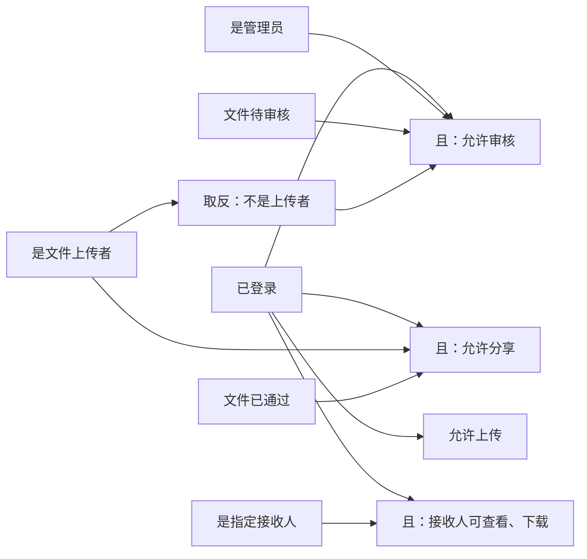
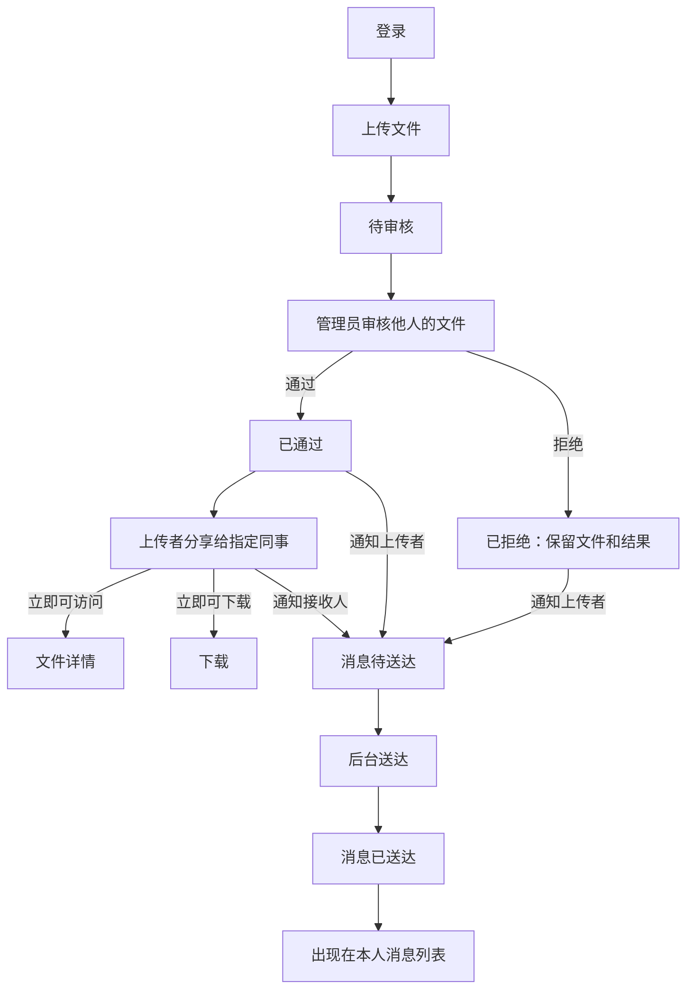
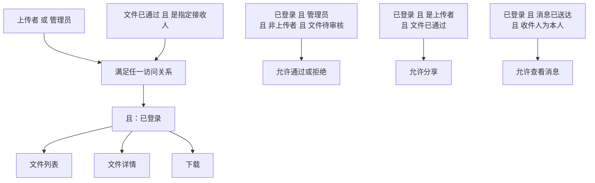

# VibeLens OTel file-sharing trial 01

Trial prompts and follow-ups delivered by the coordinating AI are scripted-user records. They are not independent human usability evidence.

Local paths are normalized as listed in dialogue.json. Original trial answers and checks are archived separately.

## 01 · scripted-user · 2026-10-31T23:40:54.012Z

使用 $vibelens，读取 C:/Users/Lvi_P/Documents/Work/CF/平台软著/SoftwareStatusObserverSkill/skills/vibelens/SKILL.md 及它需要的参考文件，以这个本地分支版本为准。本次在独立目录 WORKSPACE 中开发，先读该目录的 AGENTS.md。

我想做一个小型团队文件共享网页。大家登录后可以上传文件，管理员审核；通过的文件可以分享给指定同事，同事能查看和下载。共享和审核的消息放在系统消息里，稍后由后台任务送达。界面简单，文件列表、审核列表、消息列表能用就行。

先和我把业务流程、状态和权限中的歧义说清楚，在对话里画出图让我确认，再开始开发。技术上先用 Python，数据用 SQLite，前端简单就好。

## 02 · assistant · 2026-10-31T23:40:56.247Z

我会先读独立目录的 `AGENTS.md` 和本地 `$vibelens` 技能，梳理需要确认的业务流程、状态和权限，再在对话里画图；确认前先不开发。

## 03 · assistant-question · 2026-10-31T23:41:22.820Z

{"questions":[{"title":"VibeLens 有两种运行方式：drive 让程序按状态声明执行；observe 保留应用自己的业务逻辑，用图观察实际执行。两种都维护图和监测。这个项目选哪一种？","options":["observe：应用自己执行，图负责观察","drive：按状态声明执行"]},{"title":"权限是否按“上传者分享自己已通过的文件，管理员审核，指定接收人只能查看和下载、不能转分享”理解？另外，管理员能否审核自己上传的文件？"},{"title":"共享和审核的系统消息由后台稍后送达：业务结果是否立即生效，消息只是通知；还是接收人必须等共享消息送达后才能访问？","options":["业务立即生效，消息稍后通知","共享消息送达后才允许访问"]}]}

## 04 · assistant · 2026-10-31T23:41:46.108Z

当前本地分支是 `feat/otel-provenance`，独立目录里只有试验约束。我正在整理业务草图，重点区分文件审核状态、共享权限和消息送达状态；它们之间的依赖会按你的回答确定。

## 05 · assistant · 2026-10-31T23:44:02.974Z

草图记录已通过格式检查，业务规则仍标为待确认。网页检查时发现，这个地址显示了另一项试验的内容；我会先排查端口和页面来源，换到独立地址后再给你链接。

## 06 · scripted-user · 2026-10-31T23:45:14.539Z

选 drive，按状态声明来开发。权限就按你说的：上传者分享自己审核通过的文件，接收人可以查看和下载，不能再分享。管理员也不能审核自己上传的文件。审核和共享的结果立即生效，消息稍后送达只是通知，不用等消息到了才能访问。

先把这个理解画成业务图和规则关系让我看一下，我确认图后再开始写程序。

## 07 · assistant · 2026-10-31T23:45:18.513Z

已收到：采用 `drive`；上传者只能分享自己已通过审核的文件，接收人不能转分享，管理员不能审核自己的文件；审核和共享结果立即生效，消息延后通知。我会把这些规则更新到同一张图里，等你确认图后再写程序。

## 08 · assistant · 2026-10-31T23:48:25.790Z

已按你的回答更新为 **drive 模式**。目前只有设计草图，尚未开始业务开发。

业务流程如下；“待定”部分还没有作为规则采纳：

规则中的“且”表示必须同时满足；“是上传者”均针对当前文件：

接收人身份不授予转分享权限。**消息是否送达，不参与审核结果或共享权限的生效判断。**

[打开交互业务图与规则网络](http://127.0.0.1:59263/graph)，已核验为本试验的设计页面。

请先确认这两张图是否准确。查看方式、待审及未通过文件的访问范围、未通过后的处理、消息触发点与收件人仍保留待讨论，开发前继续澄清。

网页规则图截图

规则网络截图 (`/WORKSPACE/review/design-rules.png`)

<oai-mem-citation>
<citation_entries>
MEMORY.md:76-83|note=[reused dialogue evidence conventions and valid discovery enums only]
</citation_entries>
<rollout_ids>
01a18332-cb51-7471-83f8-990d88886b9d
</rollout_ids>
</oai-mem-citation>

## 09 · scripted-user · 2026-10-31T23:51:05.720Z

这两张图的主干符合我的意思。再把这些细节定下来：

查看先做文件详情和下载，详情有文件名、上传者、审核结果就够了。待审核和被拒绝的文件，只有上传者和管理员能查看、下载，不能分享。通过后，上传者和管理员仍然能访问，指定的接收人也可以访问；其他人看不到。

管理员可以通过或拒绝，拒绝后保留文件和审核结果，先不做修改后重审。通过、拒绝都给上传者发一条消息；分享时给接收人发一条消息。消息由后台送达后，才出现在各自的消息列表里，大家只看自己的消息。

先准备两名管理员和两名普通用户的测试账号，不做账号注册。按这些更新图，如果还有影响实现的歧义再问我。

## 10 · assistant · 2026-10-31T23:51:08.309Z

我会按这些细节更新原来的业务图和权限网络，保留你的原话作为确认依据，再检查是否还有影响实现的歧义。本轮先完成设计更新。

## 11 · assistant · 2026-10-31T23:53:18.178Z

文件权限已统一为一条规则，供文件列表、详情和下载共用：上传者和管理员可访问所有审核状态的文件；指定接收人只可访问已通过的文件。消息列表则只显示“收件人是本人且已送达”的消息。原先记录的待讨论项均已由你的回答解决，接下来核对网页图是否同步。

## 12 · assistant · 2026-10-31T23:54:58.931Z

已更新两张图，当前没有需要继续追问的关键业务歧义。

权限关系如下，“且”表示同时满足：

文件详情仅包含**文件名、上传者、审核结果**。拒绝后没有修改、重审流程；接收人不能转分享。管理员也只能看自己的消息。

已准备四个测试账号定义：`admin_one`、`admin_two`、`member_one`、`member_two`，开发时初始化，不提供注册。

[打开更新后的交互图](http://127.0.0.1:59263/graph)。设计记录校验通过，目前尚未写业务程序。

更新后的网页截图

更新后的业务与规则图 (`/WORKSPACE/review/design-answer-02.png`)

<oai-mem-citation>
<citation_entries>
MEMORY.md:76-77|note=[preserved design-first dialogue and independent review evidence conventions]
</citation_entries>
<rollout_ids>
01a18332-cb51-7471-83f8-990d88886b9d
</rollout_ids>
</oai-mem-citation>

## 13 · scripted-user · 2026-11-01T00:01:06.110Z

图确认了，就按这版做。可以开始实现，把应用和 VibeLens 一起运行起来。界面保持简单，完成后我再操作一轮。

## 14 · assistant · 2026-11-01T00:01:09.123Z

我会按已确认的图实现，保持文件列表、审核列表和消息列表三个界面，并把应用与 VibeLens 一起启动。完成前会验证权限拒绝、审核结果立即生效、消息延后送达，以及应用操作的实际观测记录。

## 15 · assistant · 2026-11-01T00:01:30.007Z

我会同时用文件规划技能记录实现、验证和启动进度，方便保留这次独立试验的检查结果。业务范围已经确认，不再增加功能或重复询问。

## 16 · assistant · 2026-11-01T00:04:48.036Z

独立 Python 环境和本地 VibeLens 运行时已准备好。实现会让审核和消息送达都读取状态声明；SQLite 负责在同一事务中保存审核结果、共享权限和待送达消息，后台任务只负责稍后送达通知。

## 17 · scripted-user · 2026-11-01T00:13:50.024Z

本地 feat/otel-provenance 分支的这一轮适配器修改已经整理好了。这个项目使用的 VibeLens 也请更新到该分支当前版本，再完成验证和启动。业务图和已经确认的业务范围保持原样。

## 18 · assistant · 2026-11-01T00:13:56.576Z

收到。我会把本项目的 VibeLens 运行时更新到该本地分支的当前版本，保留原有变更基线和已确认的业务范围，再继续验证和启动。

## 19 · assistant · 2026-11-01T00:17:37.459Z

核心业务和三个页面已写好，正在接入检查流程。接下来会用独立测试数据库走完整操作链，重点确认普通用户直接访问受限地址、管理员审核自己的文件、接收人转分享时，服务端都会拒绝；也会检查消息送达前，共享权限是否已经生效。

## 20 · assistant · 2026-11-01T00:23:13.626Z

业务测试已通过：完整网页流程、两个管理员竞争审核，以及通知写入失败时的事务回滚。VibeLens 验证还在进行；目前发现并修复的是本项目接入代码中的连接释放和追踪安装顺序问题，没有修改共享校验器或放宽检查。

## 21 · assistant · 2026-11-01T00:27:51.245Z

上一轮真实操作已录到 2,710 条事件，录制停止时没有缺口。完整校验还指出，权限求值报告没有随验证结果提交，以及上传提交事件与所属调用的对象身份不一致；这两处已在项目接入代码中修正，现在重新跑完整检查。

## 22 · assistant · 2026-11-01T00:33:02.459Z

四类完整校验已通过：实现映射、状态约束、业务规则和项目测试。补充检查也确认，缺失提交观测、错误状态、遗漏实例和未同步源码都会被拒绝；聚焦录制能排空队列，录制控制没有改写业务数据。接下来启动应用和观察器，做浏览器操作检查。

## 23 · scripted-user · 2026-11-01T00:44:14.399Z

这轮验收发现一个观察信息问题，请先保留当前实现，暂不继续修复或接受基线：app/domain.py 的 authenticate 在校验凭据之前，把输入的 username 通过 provenance() 填入 actor；这个字段的定义是原生已认证操作者，未通过验证时不能据此认定用户身份。

请用真实应用接口和独立测试数据复现一次“账号不存在或密码错误”的登录，保留原生认证结果、原始采集事件及对应源码快照到 review/actor-scope-reproduction。业务拒绝与观察信息准确性分别记录。不要修改共享 SDK 或把问题隐藏掉；我会先修复通用采集/校验能力和 Skill，再开新对话复测。完成这个重现后停在此处。

## 24 · user · 2026-11-01T00:44:31.930Z

<send_user_message_question_reply>
[{"questionItemId":"[\"request_user_input_async\",\"call_7d02f6632afc4205876955bd888f03cf\",0]","question":"VibeLens 有两种运行方式：drive 让程序按状态声明执行；observe 保留应用自己的业务逻辑，用图观察实际执行。两种都维护图和监测。这个项目选哪一种？","answer":"drive：按状态声明执行"},{"questionItemId":"[\"request_user_input_async\",\"call_7d02f6632afc4205876955bd888f03cf\",1]","question":"权限是否按“上传者分享自己已通过的文件，管理员审核，指定接收人只能查看和下载、不能转分享”理解？另外，管理员能否审核自己上传的文件？","answer":"是"},{"questionItemId":"[\"request_user_input_async\",\"call_7d02f6632afc4205876955bd888f03cf\",2]","question":"共享和审核的系统消息由后台稍后送达：业务结果是否立即生效，消息只是通知；还是接收人必须等共享消息送达后才能访问？","answer":"共享消息送达后才允许访问"}]
</send_user_message_question_reply>

## 25 · assistant · 2026-11-01T00:44:49.474Z

我会停止后续交付验证，保留现有实现，只复现失败登录的 actor 信息问题，并分别记录业务拒绝结果与观察信息准确性；不修改应用或共享 SDK。

此前已生成一次本地 `accept/check` 记录，我会保留它，并注明这项新发现尚未被原检查覆盖，不把它当作本轮验收通过。

## 26 · assistant · 2026-11-01T00:47:37.019Z

已通过真实登录接口复现：不存在的账号被拒绝，返回 HTTP 401；随后访问文件页也被重定向到登录页。但原始 `sign_in` 的 `enter`、`error` 两条事件仍把该输入账号记为 `actor`。

我正在整理源码快照和证据索引；应用与共享 SDK 保持原样，完成归档后停止。

## 27 · assistant · 2026-11-01T00:48:12.427Z

已复现并按要求停止：

- **业务拒绝正常**：不存在的账号登录返回 HTTP 401，未获得文件页访问权限。
- **观察信息错误**：`sign_in` 的 `enter`、`error` 两条原始事件都将该输入账号记为 `actor`。

复现证据与源码快照索引 (`WORKSPACE/review/actor-scope-reproduction/README.md`)

应用和共享 SDK 均未修改，未继续接受基线。补充问卷答复已归档，留待后续核对。

<oai-mem-citation>
<citation_entries>
MEMORY.md:76-77|note=[preserved independent trial and dialogue evidence conventions]
</citation_entries>
<rollout_ids>
01a18332-cb51-7471-83f8-990d88886b9d
</rollout_ids>
</oai-mem-citation>
