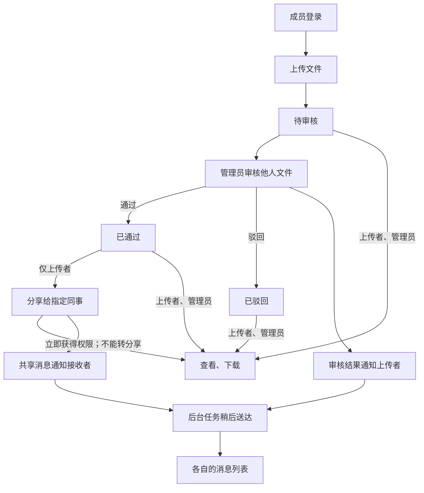

# VibeLens OTel file-sharing trial 02

Trial prompts and follow-ups delivered by the coordinating AI are scripted-user records. They are not independent human usability evidence.

Local paths are normalized as listed in dialogue.json. Original trial answers and checks are archived separately.

## 01 · scripted-user · 2026-11-01T00:48:11.002Z

请使用 $vibelens，明确读取 C:/Users/Lvi_P/Documents/Work/CF/平台软著/SoftwareStatusObserverSkill/skills/vibelens/SKILL.md（当前 feat/otel-provenance 分支），在新的独立目录 WORKSPACE 中开发，先读该目录 AGENTS.md。不要读取或复制其他试用项目的实现。

我想做一个小型团队文件共享网页。成员登录后上传文件，管理员审核；通过后，上传者可以分享给指定同事，对方能查看和下载。审核结果和共享消息由后台任务稍后送到消息列表。界面简单一些，有文件、审核和消息列表就够了。用 Python、SQLite 和简单前端，接入这次分支的 OpenTelemetry 采集。请先和我确认必要的业务细节，在对话中画出业务图让我确认，再开始实现。

## 02 · assistant · 2026-11-01T00:48:13.702Z

我会先读取独立目录的 `AGENTS.md` 和指定的 VibeLens 技能文件，确认本次试用约束，再梳理需要你决定的业务规则并画出业务图。

## 03 · assistant · 2026-11-01T00:48:47.608Z

已确认指定仓库当前在 `feat/otel-provenance` 分支，独立目录目前只有 `AGENTS.md`。我会使用这份 VibeLens 技能，先建立标有待确认项的业务图；确认后再编写业务代码。

## 04 · assistant-question · 2026-11-01T00:48:51.167Z

{"questions":[{"title":"VibeLens 的运行方式选哪一种？drive：程序按状态声明执行；observe：程序自己执行业务逻辑，图负责观察。两者都维护业务图和监控。","options":["observe：程序执行业务，图负责观察","drive：按状态声明驱动程序"]},{"title":"文件权限需要确认：待审核或被驳回时，上传者和管理员分别能查看、下载吗？通过后，管理员是否仍能查看、下载？（指定同事在获分享后可查看、下载，其他同事不可访问。）"},{"title":"分享成功后，同事立即获得访问权，还是等后台消息送达后才获得？审核结果消息是否发给上传者，共享消息是否发给被指定的同事？"}]}

## 05 · scripted-user · 2026-11-01T00:49:17.941Z

用 drive，按确定的状态来开发。待审核和驳回的文件，上传者和管理员都能查看、下载；通过后管理员也保留这些权限。只有上传者可以把自己的已通过文件分享给指定同事，对方不能继续转分享。管理员不能审核自己上传的文件。分享完成就立即有权限，后台消息只是通知，不影响共享结果。审核结果发给上传者，共享消息发给被指定的同事。

## 06 · assistant · 2026-11-01T00:49:35.165Z

已记录：采用 **drive**；上传者和管理员在各审核状态下都可查看、下载；管理员不能审核自己的文件；只有上传者能分享自己的已通过文件，接收者不能转分享。分享立即生效，后台只负责通知上传者或接收者。

我会把这些规则放入同一张业务图，供你确认后开始实现。

## 07 · assistant · 2026-11-01T00:51:56.820Z

业务图和权限草稿已通过结构校验。当前页面连接超时，我正在检查本机服务是否可达；图中仍保留“待确认”，尚未编写业务功能。

## 08 · assistant · 2026-11-01T00:53:50.038Z

已按 **drive** 整理业务图，尚未开始业务实现。

权限规则同步维护在图中：

| 操作 | 条件 |
|---|---|
| 审核 | 管理员，且不是该文件的上传者 |
| 分享 | 本人上传，且文件已通过审核 |
| 查看、下载 | 上传者、管理员，或已获分享的指定同事 |
| 消息送达 | 只负责通知，不影响审核状态和共享权限 |

[打开完整交互业务图](http://127.0.0.1:62546/graph)，已核验可访问。当前页面明确标注“设计声明 · 尚未实现”。

业务图页面 (`WORKSPACE/review/design-browser.png`)

**这张图和权限规则是否准确？确认后，我就开始实现 Python、SQLite、简单前端及 OpenTelemetry 采集。**

此处等待确认，依据你“让我确认，再开始实现”的要求，以及 VibeLens 技能 (`C:/Users/Lvi_P/Documents/Work/CF/平台软著/SoftwareStatusObserverSkill/skills/vibelens/SKILL.md`) 中的 “continue once that scope is confirmed”。

<oai-mem-citation>
<citation_entries>
MEMORY.md:83-83|note=[schema pitfalls rechecked against current skill]
</citation_entries>
<rollout_ids>
01a18332-cb51-7471-83f8-990d88886b9d
</rollout_ids>
</oai-mem-citation>

## 09 · scripted-user · 2026-11-01T00:55:13.790Z

图和规则是对的，就按这个做。文件页显示文件名、上传者、审核结果即可，不用预览。驳回后保留文件和原因，这一版不做修改后重新提交；消息只出现在收件人自己的列表里。先准备两个管理员、两个普通成员供试用，不做注册。开始实现吧，把应用和 VibeLens 一起跑起来，完成后我想在图里查看登录、审核、共享和后台消息的实际过程。

## 10 · assistant · 2026-11-01T00:55:17.172Z

确认已收到。我会按这张图开始实现，补入“保留驳回原因、不做重新提交、四个预置账号、消息仅收件人可见”，并接通登录、审核、共享和后台通知的真实采集与录制。

## 11 · assistant · 2026-11-01T00:56:25.073Z

实现会保留三个文件状态：待审核、已通过、已驳回。共享权限单独保存，通知进入持久队列，所以后台暂未送达时，接收者也能立即下载。接下来先冻结需求和验收基线，再编写业务与采集代码。

## 12 · assistant · 2026-11-01T01:00:07.996Z

文件、审核、共享和后台通知的业务代码已写出。审核结果与通知任务在同一事务提交；共享权限与共享通知也一起提交；后台投递时再把消息和任务完成状态一起提交。接下来连接真实采集，并验证越权、重复审核和延迟通知这些路径。

## 13 · assistant · 2026-11-01T01:09:33.492Z

首轮业务测试已通过：覆盖了各状态下的下载权限、管理员自审拒绝、接收者转分享拒绝、驳回原因保留、消息隔离，以及重复审核和重复投递。现在在核对采集中的操作者、文件和消息任务是否与原生会话及 SQLite 记录一致。

## 14 · scripted-user · 2026-11-01T01:17:41.331Z

我看源码时有三个疑点，请在这一版交付前核对并保留验证过程。
1. sign_out 的返回采集写了 actor:null，但 dispatch 是在 service.sign_out 返回后才 session.clear；observe.py 又直接按“退出完成”填了 null。请核对采集发生的那个时点，别用最终会话结果代替它。当时实际执行操作的人也要说得通。
2. service.py 的 principal、identity 看起来只在拼观察信息，jobs.carrier 也只用于追踪。这些观察辅助内容请按隔离和命名约定整理，让我读业务源码时容易分清。
3. 再测一次真实入口出现未处理异常、框架实际返回 HTTP 500 的情况，确认业务异常和实际返回码都记录到了。现在的 HTTP span 在 dispatch 里面，可能比 Flask 生成 500 响应更早结束；优先用成熟的框架采集，不要补写一个猜出来的响应。
这些先作为源码审查疑点，不算已经跑出的失败。请先留证，再判断是应用接入还是共享框架的问题；共享运行时仍只读，别改复制的校验器。

## 15 · assistant · 2026-11-01T01:18:00.231Z

这三个疑点会纳入交付前验证，我先保存审查记录。退出时序我此前已调整为在 `sign_out` 的采集区间内清除会话，但还需要核对该时点的原生会话；观察辅助代码也会按 `bo_` 约定整理。HTTP 500 会通过真实 Flask 入口触发，并优先使用框架采集取得实际返回码。共享运行时保持只读。

## 16 · assistant · 2026-11-01T01:21:18.664Z

真实复现已保存：Flask 确实返回了 **500**，原生异常为 `OperationalError`，审核事务已回滚；但现有图里的 HTTP 返回码和业务异常字段都是空的。这确认了当前应用接入的采集缺口。

官方 Flask 采集器把边界延伸到框架实际写出响应的位置。我会据此调整接入，再比较原生 500、异常类型和图中的记录。

## 17 · assistant · 2026-11-01T01:25:17.151Z

复核后的结果已留证：

- 退出采集入口处，原生会话仍是 `member1`；返回采集处，会话已经清除。图中保留发起人的输入 ID，并用该时点的原生会话核验返回处的 `actor:null`。
- 观察辅助函数已移入隔离接口并改为 `bo_` 命名；队列字段改为 `bo_carrier`，正在验证迁移是否保留原任务。
- 改用官方 Flask 采集后，图中已记录实际 **HTTP 500** 和 `OperationalError`，审核状态仍为待审核；这次采集错误数和丢弃数均为零。

接下来跑完整校验，再把应用和可回放的业务过程一起交付。

## 18 · scripted-user · 2026-11-01T01:26:15.348Z

请先停在本轮复现/修复证据阶段，不要 accept 或继续交付。你已复现的 500 很有价值：HTTP 边界是应用接入问题；实际异常类型被通用 span 当成普通 outputs.error 过滤，则需要主仓库统一补齐追踪事实。主会话会先修共享采集接口，不改状态机和原生执行。请保留当前 500 的原生响应、回滚、原始事件、源码快照；如果官方 Flask 接入的修复测试已完成，也保留独立结果。核实退出时点和观察辅助隔离的结果后结束本轮，不改复制的共享 SDK、不接受新基线。之后会启动全新对话测试稳定版本。

## 19 · assistant · 2026-11-01T01:26:32.316Z

收到。我会停在复现与修复证据阶段，**不执行 `accept`，不接受新基线，也不继续交付**。

当前 500 的原生响应、回滚状态、原始事件和修复前源码已保存；官方 Flask 接入后的独立结果也会保留。我会再核对退出时点、观察辅助隔离和共享文件未改动，然后结束本轮。

## 20 · assistant · 2026-11-01T01:29:47.135Z

已停在证据阶段，**未执行 `accept`、未接受新基线，未修改复制的共享 SDK**。

- **500**：保留原始事件、回滚和源码快照；官方 Flask 接入后记录到真实 500。统一异常追踪事实仍待主仓库补齐。
- **退出时点**：原生会话在入口为 `member1`，返回时已清除；采集与对应时点一致，发起人 ID 仍保留。
- **观察隔离**：辅助函数已移入隔离接口，字段改为 `bo_carrier`；迁移前后任务数据一致。

完整验收与交付未继续。复现证据及停止报告 (`WORKSPACE/review/REPRODUCTION-AND-STOP.md`)
