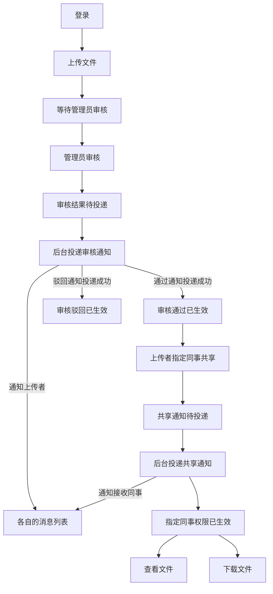

# VibeLens OTel dialogue 03: initial acceptance and browser findings

Trial prompts and follow-ups delivered by the coordinating AI are scripted-user records. They are not independent human usability evidence.

Local paths are normalized as listed in dialogue.json. Original trial answers and checks are archived separately.

## 01 · scripted-user · 2026-11-01T01:36:31.312Z

请使用 $vibelens，明确读取 C:/Users/Lvi_P/Documents/Work/CF/平台软著/SoftwareStatusObserverSkill/skills/vibelens/SKILL.md（当前 feat/otel-provenance 分支），在全新的独立目录 WORKSPACE 中开发，先读其中 AGENTS.md。不要读取或复制其他试用项目的实现。

我想做一个小型团队文件共享网页。成员登录后上传文件，管理员审核；通过后，上传者可以分享给指定同事，对方能查看和下载。审核结果和共享消息由后台任务稍后送到各自的消息列表。我想在 VibeLens 里看懂登录、审核、共享，还有后台等待与投递的实际过程。界面简单一些，有文件、审核和消息列表就够了。用 Python、SQLite 和简单前端，接入这个分支的 OpenTelemetry 采集。先和我确认必要的业务细节，在对话中画出业务图让我确认，再开始实现。

## 02 · assistant · 2026-11-01T01:36:34.180Z

我会先读取指定的 VibeLens 技能和新目录中的 AGENTS.md，确认业务边界及采集要求，再提出必要问题并画出业务图供你确认。

## 03 · assistant · 2026-11-01T01:37:08.100Z

已确认 VibeLens 仓库位于 `feat/otel-provenance` 分支，试用目录目前只有 AGENTS.md。我会按该技能准备设计草图；登录身份、文件权限和后台任务的身份会分别呈现，凭据不会进入采集内容。

## 04 · assistant-question · 2026-11-01T01:37:12.567Z

{"questions":[{"title":"VibeLens 的开发方式选哪一种？drive：程序按状态声明执行，图与程序共用状态规则；observe：程序自行实现业务逻辑，图观察实际执行。两种都会维护业务图并接入 OpenTelemetry。","options":["drive：按状态声明执行","observe：观察程序自身逻辑"]},{"title":"文件未通过审核时，上传者和管理员各能做什么？这里也决定管理员审核时能否打开或下载文件。","options":["上传者、管理员均可查看和下载；其他成员不可访问","上传者可查看和下载；管理员只看文件信息并审核","上传者、管理员只看文件信息；通过后才能下载"]},{"title":"审核或共享提交成功后，结果与访问权限何时生效？","options":["提交时立即生效；后台稍后投递通知","通知投递成功后才生效"]}]}

## 05 · user · 2026-11-01T01:37:45.361Z

<send_user_message_question_reply>
[{"questionItemId":"[\"request_user_input_async\",\"call_03d9ba875378427d85e8cf99eeba6366\",0]","question":"VibeLens 的开发方式选哪一种？drive：程序按状态声明执行，图与程序共用状态规则；observe：程序自行实现业务逻辑，图观察实际执行。两种都会维护业务图并接入 OpenTelemetry。","answer":"drive：按状态声明执行"},{"questionItemId":"[\"request_user_input_async\",\"call_03d9ba875378427d85e8cf99eeba6366\",1]","question":"文件未通过审核时，上传者和管理员各能做什么？这里也决定管理员审核时能否打开或下载文件。","answer":"上传者、管理员均可查看和下载；其他成员不可访问"},{"questionItemId":"[\"request_user_input_async\",\"call_03d9ba875378427d85e8cf99eeba6366\",2]","question":"审核或共享提交成功后，结果与访问权限何时生效？","answer":"通知投递成功后才生效"}]
</send_user_message_question_reply>

## 06 · assistant · 2026-11-01T01:38:01.945Z

已记录：选择 drive 模式；未通过审核的文件仅上传者和管理员可查看、下载；审核结果及共享权限要等通知投递成功后才生效。

最后一条会直接影响流程：审核通过的通知投递前，文件还不能分享；共享通知投递前，指定同事还不能访问。我会把这两段等待画出来供你确认。

## 07 · assistant · 2026-11-01T01:39:45.386Z

业务草图和原始问答已保存在独立目录中。草图把审核通知、共享通知的等待与投递分开，并明确了上传者、管理员及指定同事的访问条件。接下来我会检查图页面，再请你确认这套流程。

## 08 · assistant · 2026-11-01T01:40:00.420Z

检查时发现候选端口返回了另一个项目的页面。我正在改用系统分配的空闲端口，并核对本项目标识后再提供链接。其他服务会保持原样。

## 09 · assistant · 2026-11-01T01:42:37.167Z

本项目的图页面已打开，HTTP、项目标识和浏览器显示均已核对通过；页面标明“设计声明 · 尚未实现”。

草图已表达两条关键限制：审核通知投递成功后才能分享，共享通知投递成功后指定同事才能访问。业务代码会在你确认这张图后开始编写。

## 10 · assistant · 2026-11-01T01:43:10.553Z

已记录你的三项选择：**drive 模式、上传者与管理员可访问未通过审核的文件、通知投递成功后结果及权限才生效**。

[打开 VibeLens 业务草图](http://127.0.0.1:53754/graph)（已核对项目标识和浏览器显示，当前仅有设计声明）。

权限图共用以下条件：已登录的管理员审核；已登录的上传者在审核通过生效后共享；文件查看、下载允许上传者、管理员或权限已生效的指定同事。

这里将“投递成功”具体解释为：**后台把消息写入对应消息列表，并在同一次 SQLite 事务中让审核结果或共享权限生效。**

**请确认这张业务图及上述投递含义是否正确，或指出需要修改的地方。** 确认后开始实现。

按你的要求及 VibeLens 技能 (`/C:/Users/Lvi_P/Documents/Work/CF/平台软著/SoftwareStatusObserverSkill/skills/vibelens/SKILL.md`) 的“Proceed with behavior implementation after confirmation of that scope”，当前尚未编写业务代码。

<oai-mem-citation>
<citation_entries>
MEMORY.md:83-83|note=[checked discovery record shape against current skill]
MEMORY.md:89-90|note=[verified project identity and isolated server ownership]
</citation_entries>
<rollout_ids>
01a18332-cb51-7471-83f8-990d88886b9d
</rollout_ids>
</oai-mem-citation>

## 11 · scripted-user · 2026-11-01T01:44:05.115Z

对，就按这张图。消息写进收件人的列表算投递成功，和审核结果或共享权限生效放在同一个事务里；没投递成功就保持等待，不提前生效。上传者和管理员在所有文件状态下都能查看、下载，但管理员不能审核自己的文件。只有上传者能分享自己的已生效文件，接收者不能转分享。审核消息发给上传者，共享消息发给指定同事，消息只能各自查看。驳回保留文件和原因，这一版不做重新提交；文件信息和下载就够了，不做预览。先准备两个管理员、两个普通成员供试用，不做注册。开始实现吧，把应用和 VibeLens 一起跑起来。

## 12 · assistant · 2026-11-01T01:44:08.654Z

我会把这些补充规则写入已确认业务图和独立验收条件，再开始实现。应用会预置两个管理员和两个普通成员；后台投递与结果生效共用事务，并接入该分支的 OpenTelemetry。

## 13 · assistant · 2026-11-01T01:44:35.396Z

这轮还会使用文件规划技能，把实现、采集和验收进度保存在本项目内。验收会重点覆盖：管理员不能审核自己的文件、通知投递前权限不生效、消息只能本人读取，以及后台事务失败后继续等待。

## 14 · assistant · 2026-11-01T01:48:46.665Z

已冻结初始需求、业务断言和验证基线，并安装了本项目自己的 VibeLens 运行时与完整查看器。现在开始写业务代码：文件内容存入 SQLite；审核和共享先进入待投递状态，后台提交消息时才激活对应结果。

## 15 · assistant · 2026-11-01T01:55:09.646Z

核心业务和三类列表页面已写好，正在进入实际验证。共享检查会在每次请求时读取当前权限；后台任务先写消息，再在同一事务中更新文件或共享状态。接下来会用独立 HTTP 场景检查拒绝路径、事务回滚和重复投递。

## 16 · assistant · 2026-11-01T02:00:18.272Z

第一轮 8 组 HTTP 业务场景已通过，包括自审拒绝、普通成员审核拒绝、接收者转分享拒绝、消息隔离、投递失败回滚和并发重复投递。

目前正在分别运行采集开启、关闭和传输故障三种模式，检查业务结果是否一致。登录、上传的首轮 OpenTelemetry 记录已收到，采集与丢弃错误计数均为 0。

## 17 · assistant · 2026-11-01T02:06:09.531Z

三种采集模式下的业务结果一致，开启采集的 8 组场景也都没有丢弃或采集错误。为了让试用页面保持简单，界面会采用服务器渲染的表单和列表；后台投递后，页面自动刷新消息及状态。

## 18 · assistant · 2026-11-01T02:16:26.227Z

SQLite 的实际表结构已读取并与声明核对通过，读写、事务提交/回滚和文件信息转换也已接入采集。现在正在补齐逐次调用的独立核对，确保图里的登录身份、文件、任务和消息标识来自当时的实际会话及数据库结果。

## 19 · scripted-user · 2026-11-01T02:25:00.413Z

主仓库完成了两项 SDK 内部修复：自动调用改用完整 trace/span 组合标识；合法的旧构建队列上下文保留为带 source_build_id 的追踪连接，舍弃旧图归属，严格模式仍拒绝。状态机、业务图定义和业务代码接口不变，29 项 Python SDK 回归及 Node 回归通过。
请在本次初始验收前，使用规范的管理式升级工具把 observer_runtime 更新到指定仓库当前版本，保留现有需求、最初基线和检查，别手工改复制的 SDK。完整重启你自己启动的应用/观察器进程后再做本次验收，并记录这是一次协调的工具升级；它不算后续普通业务迭代中的自动维护证明。之后仍按已确认的需求继续完成业务、采集、图、录制和浏览器验收。

## 20 · assistant · 2026-11-01T02:25:21.422Z

收到。我会用管理式升级工具更新本项目的 `observer_runtime`，保留最初基线和现有检查，并单独记录这次协调升级。

当前业务、状态约束和项目测试已通过；映射检查还发现了两类证据问题：逐次规则求值报告尚未汇总，以及同一数据库节点混合了调用内外的身份上下文。我会保留失败记录并修正证据边界，再重启本项目进程，继续录制和浏览器验收。

## 21 · assistant · 2026-11-01T02:42:33.396Z

管理式升级已完成，更新的 4 个运行时文件与主仓库当前版本一致。实际上传的全量录制和聚焦录制已通过；停止录制时，队列中的事件完整排空，没有录制缺口。

原始录制和失败报告均已保留。现在继续核对旧构建队列的追踪连接和整体映射，随后启动应用与 VibeLens，检查浏览器中的完整流程。

## 22 · scripted-user · 2026-11-01T02:45:41.571Z

主仓库已通过完整验收（host-04）。观察到你项目的 iteration-recall.json 中 context_mapping 摘要重复完整计划，单该字段约29万字符；已在公共 CLI 修复为12条预览、总数和省略数，完整 mapping_contract 和验证内容均保留，新增2000行回归通过。你完成当前初版验收时，可通过已有管理式升级流程同步这一处 CLI 文件并核对。当前采集 SDK、状态机、协议和业务定义没有改变。继续完成初版映射与实际浏览器验收，请保留完整失败、修复、复测证据，完成后汇报实际应用与图地址。

## 23 · assistant · 2026-11-01T02:47:36.998Z

旧构建队列的实测已通过：严格模式拒绝旧上下文；正常投递保留带 `source_build_id` 的追踪连接，并以当前后台服务身份执行，消息与权限同事务生效。

完整映射检查仍有两处证据组织问题：用例把完整 API 边界裁成了部分边界，重启后的服务实例也尚未接入独立核对。我正在修正这两处，保留原始事件。CLI 的精简召回输出也会通过管理式升级同步。

## 24 · scripted-user · 2026-11-01T02:47:57.335Z

独立查看到最新 verify 报告的159项主要是 partial_boundary_in_complete_run。observe.py 的 native_call_scope 对原始祖先事件调用 minimal_boundary，而严格完整验收禁止把完整观测变成 context_only。请保留这个公共严格检查，完整验收使用真实原始祖先事实，不把它改成局部录制验收；局部录制另测。当前新增 context_fields 只有 case/node/phase 选择能力，若多次调用的独立原始事实确实不同，无法合理表达，请给出最小反例、原始事实和所需绑定，不要靠切碎运行或覆盖旧计划过关；我会先修公共框架。继续检查当前证据边界，保留失败文件。

## 25 · assistant · 2026-11-01T02:50:05.780Z

先前按调用分组的结果不能证明完整场景的上下文映射。接下来我会保留完整场景、旧计划和公共严格检查，不再通过裁剪事件或覆盖计划来取得通过。

我会用“同一文件先被上传者本人审核、再被另一管理员审核”做最小反例：保留两次 HTTP 调用、原始祖先事件、会话事实和 SDK 标识，说明当前选择器为何无法分别绑定两位审核者。

## 26 · assistant · 2026-11-01T02:52:50.242Z

最小反例已复现，并保留了 93 条原始事件，`context_only` 为 0：

| 同一 `case/node/phase` 下的调用 | 独立会话身份 | HTTP 结果 |
|---|---|---|
| 上传者本人审核 | `admin-1` | 403 |
| 另一管理员审核 | `admin-2` | 200 |

原始事件中的身份分别正确。但公共检查会把每条期望应用到这两个事件上，因此 4 次比较出现 2 次误配。需要在同一完整用例内，按独立读取的 SDK `trace_id + span_id` 或其他原生调用键选择事件，再绑定对应原始事实。

反例说明 (`/WORKSPACE/review/framework-gap-context-selector/28fb2714/README.md`) · 原始事实与检查结果 (`/WORKSPACE/review/framework-gap-context-selector/28fb2714/report.json`)。这份复现没有改动验证器、项目映射计划或最初基线。

## 27 · scripted-user · 2026-11-01T02:56:31.890Z

已为公共选择器不足建立回归，正在增加可选 each 绑定，保留旧行原语义与全部严格检查。拟定结构：context_fields 某行新增 each:{collection:["native_calls","review_file","enter"],actual_key:[["trace_id"],["span_id"]],mapped_key:[["trace","trace_id"],["trace","span_id"]]}。该行 actual 路径相对于每一条独立原生记录，例如 ["actor"]；mapped 路径仍相对于事件。按完整 SDK 身份连接，不按顺序/名称/时间猜测；原生键重复、任一侧缺失、映射不符均失败。请继续完成最小反例并保留完整场景，准备按原生函数/会话/DB事实形成 phase 对应原生记录集合，用独立SDK上下文作键。公共实现通过后我会通知升级；不要修改安装的校验器。

## 28 · scripted-user · 2026-11-01T02:56:31.894Z

公共 each 绑定已实现并同步，结构与上条消息一致，参考 canonical skills/vibelens/references/telemetry.md 新增示例。新增正例/反例和旧行共10项通过：同一span_id不同trace、乱序两位调用者精确匹配；丢任一侧、重复原生键、未知事件、错误actor均失败。完整调用闭合、全部metadata覆盖和原来投影/业务检查保留。请先保留最小反例，然后管理式升级这一 mapping_contract.py，使用完整场景和原始祖先事实进行独立原生集合绑定，完成初版验收；如发现该接口自身失败，请保存最小事实交给主仓库处理。

## 29 · assistant · 2026-11-01T02:57:37.430Z

收到公共 `each` 绑定的更新。最小反例及两次失败报告已经保留；我会先通过管理式工具升级，再按新接口用独立的原生记录集合和 SDK 身份绑定完整场景。公共严格检查和原始祖先事件会继续保留。

## 30 · scripted-user · 2026-11-01T02:57:43.996Z

已独立复制并复测你保存的 two_reviewers 真实反例：原始93条事件和native-facts完全不改，公共 each 接口正确完成两位审核者的2次匹配；故意改actor、删除原生记录都被拒绝。主仓库证据 docs/review/otel-provenance-20261101/dialogue-03-context-reproduction/joined-retest.json，复测脚本 retest_context_join.py。这只是选择器专项通过，不替代你的完整初版验收。继续当前公共接口的管理升级和完整场景检查即可。

## 31 · scripted-user · 2026-11-01T03:11:47.556Z

独立源码检查补充两处需在初版验收前核对的现有约束：app/domain.py 的 TeamFiles.provenance 只格式化观测元数据，却无 bo_ 标记且留在业务类；jobs.carrier 是观察专用字段却无 bo_ 或独立metadata envelope。这重复了 references/source-isolation.md 已明确的规则，请按规则隔离并记录迁移，保留原生业务字段和旧队列数据。另 tests/native_audit.py 的登录读取调用 service.principal，后者默认走带采集的 store.read；原生核对自身应走 observe=False 的独立读取，测试该核对不新增业务采集。以上是源码审查发现，尚未把它们声称为实测运行失败；请分别验证后修复，完整映射的公共规则不放宽。

## 32 · scripted-user · 2026-11-01T03:11:47.560Z

请先简短更新当前具体进展或阻塞，再继续实现。已观察到管理式 each 升级完成，但后续核对源码尚未落盘。当前仅需完成已确认的初版和实际验收；遇到原生绑定无法独立表达的地方，保存一个最小失败并反馈即可，不需要为了收集完备而扩大程序业务或重建整套框架。

## 33 · assistant · 2026-11-01T03:11:51.273Z

`each` 的管理式升级已完成，完整八个场景的原生事实采集也已补入；正式映射验收尚未通过。我会先核对并修复观测代码隔离和登录核对的两处问题，再用完整事件运行验收，不拆分场景或删减祖先事件。

## 34 · assistant · 2026-11-01T03:13:11.220Z

观测元数据格式化已移入适配器；队列字段也已迁移为 `bo_carrier`，保留原值。登录原生核对改用了独立数据库读取。完整审批场景首次采集得到 169 条原始事件，探针和数据采集错误均为 0；接下来核对逐调用映射是否完整。

## 35 · assistant · 2026-11-01T03:14:56.622Z

八个完整场景的开启、关闭、传输故障三种模式已采集完成，共 24 次运行。新的公共校验器完成了 975 项原生上下文比较，差异和覆盖缺口均为 0。原始基线未改，早先失败记录也已保留；现在开始完整正式验收。

## 36 · assistant · 2026-11-01T03:16:32.265Z

上下文映射已通过独立核对，完整正式验证仍在运行。文档和一键启动、停止入口已备好。验证结束后，我会启动本项目业务与图服务，在浏览器中实际走一遍上传、审核、共享和录制回放。

## 37 · assistant · 2026-11-01T03:17:48.041Z

正式验收中的映射、状态规则和业务检查均已通过；项目测试命令返回了失败，但主报告没有保留具体断言。我正在单独复跑该命令以定位原因，目前还不能标记为验收完成。

## 38 · assistant · 2026-11-01T03:18:58.375Z

失败已定位：刚才移动观测格式化代码时，通知完成路径仍读取了空的观测字段，导致独立运行业务时出错。我已将这段格式化也移入适配器，正在复跑业务与观测测试，确认关闭观测后仍能正常完成通知和状态提交。

## 39 · scripted-user · 2026-11-01T03:19:00.371Z

独立真实 HTTP 测试又复现身份边界遗漏：同一客户端先 admin1 登录成功，再 member1 登录成功；第二次登录前 native session=admin-1，sign_in.enter 却仍 actor:null（源码原先硬编码匿名）。主仓库 docs/review/otel-provenance-20261101/dialogue-03-reauthentication/result.json 和 raw-events.json 保留18条实际事件，采集错误/丢弃为0，复现无项目源码补丁。已先补充共享 telemetry.md 的确认/测试指导：不能从login端点名称推断匿名，覆盖新会话、同会话重认证、已有身份下凭据失败，按实际边界从适配器获取调用者身份，和认证结果分开；读取本身不采集。请将这类通用场景纳入保护测试和 each 原生核对，修复来源映射，不改验证器或业务登录行为；完成初版后再统一验收。

## 40 · assistant · 2026-11-01T03:19:43.155Z

原生业务测试已恢复通过。另一个独立复现确认了登录身份遗漏：同一会话重新登录时，入口不能一律记为匿名。我已让适配器读取登录前的真实会话身份，并加入“新会话登录、重认证成功、已有身份下凭据失败”三类保护测试，现正统一复验。

## 41 · assistant · 2026-11-01T03:21:11.037Z

负向检查已确认：错误身份、缺失调用、删减覆盖、源码过期和数据库结构漂移都会被拒绝。完整验收正在复跑；后续浏览器试用将使用单独的业务数据库，测试采集记录会归档保留，避免混入现场录制。

## 42 · scripted-user · 2026-11-01T03:23:59.144Z

更正我刚才的重认证复现判定：源码 app/web.py api_request 在调用 sign_in 前执行 session.clear()。我的脚本读的是 HTTP 请求之前的身份，却拿它当 sign_in 函数入口身份，边界取错；不能据此认定 actor:null 错误。请保持原登录行为，不引入“错误重认证后保留旧登录”业务规则。我看到最新 verify 有 login-identity_after_failure expected member-2、actual null，这是我误判引出的未经确认断言，应记录原因后撤销该新增期望（原 baseline 登录义务不动），改为在真实 sign_in 调用边界读取原生会话进行映射比较。已写的 bo_authentication_provenance 可继续用于如实读取各调用边界。请保留这次外部审查误判与更正过程，重新统一验收。我会修正独立脚本和共享指引的边界表述。

## 43 · assistant · 2026-11-01T03:24:10.762Z

已核实：现有登录处理会先清空会话，再调用 `sign_in`，因此该函数入口记录匿名是准确的。外部审查刚才也更正了这一边界判断。我会保留现有登录行为，撤销未经确认的“失败后保留旧身份”期望，并在真实函数入口核对原生会话身份。

## 44 · assistant · 2026-11-01T03:26:19.102Z

旧版本队列检查已通过：正常重试保留旧追踪链接，旧图的归属信息不会沿用；严格模式会拒绝旧构建载荷。队列迁移也保留了原值。当前仍需完成统一验收，以及浏览器中的实际操作和回放验证。

## 45 · assistant · 2026-11-01T03:27:06.644Z

统一验收已全部通过：映射、状态规则、业务、项目检查四项均为通过，`verify → accept → check` 也已完成，原始基线哈希未变。现在启动业务与图服务，进行最后的浏览器操作、下载和录制回放验证。

## 46 · scripted-user · 2026-11-01T05:52:26.824Z

独立更正后的同会话重认证复测已通过：改为在真实 sign_in 入口用只读测试包装器读取会话/原生user行，保留更早HTTP身份作区分。18条实际事件、2次精确匹配、探针错误0；记录的源码/模型/manifest前后哈希稳定。证据主仓库 docs/review/otel-provenance-20261101/dialogue-03-reauthentication-corrected-boundary/result.json。初始两份误判原始文件及说明均保留。看到四类完整门禁已通过、基线未改；继续你当前实际Web验收即可，无需再扩大初版业务。

## 47 · assistant · 2026-11-01T05:52:40.502Z

浏览器文件选择操作出现了异常长的等待。服务仍在运行，正式门禁已通过，独立重认证复测也确认映射准确。我正在核实文件是否已被选中，再继续共享和回放验收；尚未把刚才的操作计为上传成功。

## 48 · assistant · 2026-11-01T05:54:24.330Z

现场已看到“审核结果待投递”和“共享消息待投递”，随后真实后台任务完成投递，上传者也收到了审核消息。文件通过真实 HTTP 上传成功；浏览器文件选择器未成功选中文件，因此这一项仍保留为未通过，不能算作浏览器上传验收完成。

## 49 · scripted-user · 2026-11-01T06:27:04.189Z

审批已由真实用户处理。Cua 文件选择 API 失败应保留为工具失败，实际浏览器上传仍需完成。可改用 webapp-testing 的标准 Playwright：对真实 input[type=file] 执行 setInputFiles，再点页面提交，检查DOM与实际下载，不用HTTP上传替代此项。主仓库已验证的本机环境：NODE_PATH=C:/Users/Lvi_P/.cache/codex-runtimes/codex-primary-runtime/dependencies/node/node_modules，Chromium=C:/Users/Lvi_P/AppData/Local/ms-playwright/chromium-1234/chrome-win64/chrome.exe；必要时用 host 执行真实浏览器测试，沙箱启动限制保留单独证据。你可参考主仓库 tools/test_trace_lifecycle_browser.mjs 的浏览器启动方式，只改本项目测试文件。继续完成初版浏览器验收，截图和结果写 review/，四类既有门禁及原始基线保留。

## 50 · scripted-user · 2026-11-01T06:27:04.197Z

独立 Playwright 已完成真实文件输入上传、审核等待、共享等待和接收者下载，字节一致且页面无脚本错误，证据在主仓库 docs/review/otel-provenance-20261101/independent-browser-02。发现需在初版收尾前修复的观察缺口：/command/review、/command/share 的真实响应是 HTTP 303，而 api_command return 的 outputs 为空。BOIntegration.attach_flask 只采集 /api/，所以真实前端表单入口的框架响应没有采集。业务行为与原始状态机应保持现状。共享 Skill 的 telemetry.md 和 observation-continuity.md 已补充基于前端实际使用路线的 HTTP 覆盖要求，主仓库新增真实 Flask command 303/403/500 回归。请在你的项目修正这一通用集成缺口，覆盖实际表单、文件信息、下载等项目入口的真实框架响应并将正常/拒绝/异常/重定向的原生比较加入受保护的映射案例，保留原有检查及初始 baseline。手工 handler return 不能冒充框架最终 HTTP 状态，不要改业务流程。新观察器/静态流量保持排除。浏览器请使用独立 Python Playwright 脚本，不再使用 Cua 文件选择或写磁盘操作；之前 Cua 上传失败属于工具流程。保留全部失败/修复/复测，完成初版完整验收后告知，普通业务迭代尚未开始。

## 51 · scripted-user · 2026-11-01T06:27:04.205Z

此试用现场请停止后续修改和浏览器操作，保留当前证据与源文件，不再修补原项目。父会话已从已验收的初版源文件建立完全独立的 04 目录，由新对话接续 HTTP 表单响应覆盖修复与普通业务迭代。独立浏览器已完成本项目真实上传、审核等待、共享等待及字节一致下载。原会话的工具审批与 Cua 问题会作为测试过程记录，当前仍不能宣称整体完整验收。审批解除后只整理现有过程/结果、关闭本会话自己创建的浏览器页面即可，无需再执行业务或源码变更。

## 52 · assistant · 2026-11-01T06:27:23.372Z

按最新要求，我会停止原项目的源码修改和业务操作，保留现有证据，并关闭本会话创建的浏览器页面。当前四类门禁通过，但实际表单入口的框架 HTTP 响应采集仍有缺口，因此不能宣称整体完整验收；后续由独立的 04 项目接续。

## 53 · assistant · 2026-11-01T06:28:09.562Z

页面清理遇到自动审批阻断：获取图页面以关闭它的操作被拒绝，理由是停止指示后不能再次访问该地址。我不会重试。剩余图页面请手动关闭；如需我代为关闭，请仅授权这一步。

## 54 · assistant · 2026-11-01T06:28:47.809Z

已停止原项目修改，源码与证据已保留。过程记录 (`WORKSPACE/review/closeout.json`)

四类门禁通过，原始基线未变；整体验收仍未完成，尚缺实际表单入口的最终 HTTP 响应采集，由独立 04 项目接续。

剩余图页面请手动关闭；如需我代关，请仅授权这一步。

自动审批拒绝了获取图页面进行关闭的操作，理由是停止指示后不可再次访问该地址；未再尝试。

<oai-mem-citation>
<citation_entries>
MEMORY.md:83-83|note=[checked discovery record shape against current skill]
MEMORY.md:89-90|note=[verified project identity and isolated server ownership]
</citation_entries>
<rollout_ids>
01a18332-cb51-7471-83f8-990d88886b9d
</rollout_ids>
</oai-mem-citation>
