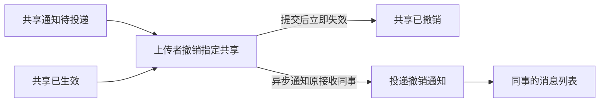

# VibeLens OTel - continuation and ordinary iteration

Trial prompts and follow-ups delivered by the coordinating AI are scripted-user records. They are not independent human usability evidence.

Local paths are normalized as listed in dialogue.json. Original trial answers and checks are archived separately.

## 01 · scripted-user · 2026-11-01T06:16:21.181Z

使用本地开发版 VibeLens，接续文件共享应用的真实试用验收。Skill 入口：C:/Users/Lvi_P/Documents/Work/CF/平台软著/SoftwareStatusObserverSkill/skills/vibelens/SKILL.md。

你的唯一可修改项目目录是 WORKSPACE。先进入这个目录，读取其 AGENTS.md、discovery/intent/behavior/implementation/mapping/whitebox/sync 等当前记录，按 Skill 恢复当前义务。主仓库只读，不修改或发布共享 Skill。该目录是上一轮已验收初版的源文件隔离副本，来源和哈希在 review/continuation-origin.json；没有复制业务数据库、会话密钥或活动录制。原对话 01a194c0-3fb4-7910-98fb-672dc11e70b6 在工具审批处停住，不要访问或操作原项目及其服务。

业务已经确认：drive 模式；上传者和管理员能查看、下载；管理员不能审核自己的文件；审核结果与审核通知原子生效；上传者仅能将已通过文件共享给指定同事，共享与通知原子生效；通知未送达则等待，真实后台投递后生效；接收者不能转共享；只看自己的消息；驳回保留文件和原因；两个管理员、两个普通成员，无注册与预览。沿用现有源代码和已确认规则。

当前只修复并验收一个观察缺口：真实网页 /command/upload、/command/review、/command/share 等表单操作已在独立 Playwright 通过，业务行为正确，但 api_command 的 return outputs 为空，遗漏框架真实 HTTP 303；BOIntegration.attach_flask 的排除表达式只允许 /api/，原有 API 检查因此漏掉前端路径。证据位于主仓库 docs/review/otel-provenance-20261101/independent-browser-02/flow-result.json、flow-events.json 和 dialogue-03-form-response-finding.md。当前 Skill 的 references/telemetry.md 和 observation-continuity.md 已加强这项要求。

请按当前 Skill 处理：让实际前端入口（表单、文件信息、下载、页面及对应拒绝/异常路径）的框架响应与已有图的 API 节点、父子调用和采集字段完整对应，优先复用上游 Flask instrumentation，真实 status 来自框架响应，不用手工猜测状态。避免重复记录同一 HTTP 请求。业务概念节点仍以用户操作命名。观察器、静态文件和导出流量排除。不要改变原始业务流程与原生状态机。

保留 .stategraph/initial-v1 的原始 baseline、所有既有状态/业务/映射检查；在新变更中加入实际 UI 路由原生 HTTP 比较案例，检查正常、拒绝、异常、重定向、source/API覆盖、trace父子关系、on/off/fault、采集健康和生命周期闭合，完成 managed verify/accept/check。保留失败、修复和复测，不用手工篡改已通过凭据。中文对话，英文源码/标识/注释。父会话会回答真正需要澄清的业务问题。

浏览器部分由父会话独立 Python Playwright 验收，你在此会话完成后端与图的完整验证、启动隔离的本地服务并提供地址/启动命令即可；请不要调用 Cua 或写浏览器工具输出文件。可直接使用主仓库 .venv/Scripts/python.exe，相关依赖已装好。不要提交、推送、合并或启动新的对话。完成本次入口修复和初版验收后汇报，再等普通业务迭代需求。

## 02 · assistant · 2026-11-01T06:16:24.709Z

我会先在隔离副本中读取项目约束、当前记录和 VibeLens Skill，确认恢复后的验收义务，再修复真实网页入口的 HTTP 响应观察并完成后端与状态图验证。

## 03 · assistant · 2026-11-01T06:16:37.379Z

我正在使用指定的本地 VibeLens Skill。现有业务规则和 drive 模式会保持不变；本轮只补齐真实前端路由的框架响应证据，并保留原始 baseline 和既有验收记录。

## 04 · assistant · 2026-11-01T06:17:29.029Z

已经定位到缺口：表单和文件信息页使用手工入口 span，结束时还没有 Flask 最终响应；上游 Flask 采集又排除了 `/api/` 之外的路由。因此业务调用有记录，303 等真实状态却丢失。我会让这些入口统一由 Flask instrumentation 记录响应，同时移除重复的请求 span。

## 05 · assistant · 2026-11-01T06:21:02.945Z

修复前的复现已保存：真实表单上传返回 303，`api_command` 的 return outputs 为空。现在已接入同一条 Flask 请求 span，新增案例会直接比较 WSGI 最终状态，并覆盖页面、表单、文件信息和下载的正常、拒绝及 500 路径。原有业务场景也会全部重跑。

## 06 · assistant · 2026-11-01T06:25:45.417Z

新增的拒绝路径暴露了验收读数器的一个问题：它假定文件一定存在，会在原生 404 返回前抛出 `IndexError`。已修复读数器并保留失败记录；针对性复测的 18 个 HTTP 响应均与观察值一致，采集错误和丢弃数都是 0。接下来完成完整模式矩阵和验收门禁。

## 07 · assistant · 2026-11-01T06:29:39.325Z

第一轮完整采集已跑完 11 个场景、33 组 on/off/fault 运行。新增前端场景的 45 个 HTTP 请求均匹配真实状态和请求参数。现在进入 managed 验收；同时补上了入口时刻的路由参数检查，确保参数、框架响应和父子调用属于同一次请求。

## 08 · assistant · 2026-11-01T06:32:43.244Z

Managed `verify → accept → check` 已通过，mapping、state_rules、business、project_checks 四类结果均通过。原始 `initial-v1` 下的 9 个文件保持原样，复制的 138 个框架文件也没有改动。接下来启动本目录的隔离服务，并检查实际地址和构建身份，供父会话做浏览器验收。

## 09 · assistant · 2026-11-01T06:35:52.300Z

已完成入口修复，`verify / accept / check` 全部通过：33 组运行、45 个前端 HTTP 响应比较、8 项测试通过。业务流程、原生状态机和 `initial-v1` 均保持不变。

- [应用](http://127.0.0.1:50949)
- [VibeLens 图](http://127.0.0.1:50950/graph)
- 验收说明 (`/WORKSPACE/review/http-entry-repair.md`)

服务已启动，构建身份匹配。在本隔离目录运行 `.\Start-Local.ps1` 可重启，`.\Stop-Local.ps1` 可停止。浏览器验收留给父会话；未提交或发布，等待后续业务需求。

<oai-mem-citation>
<citation_entries>
MEMORY.md:125-127|note=[local skill and evidence preservation guidance]
</citation_entries>
<rollout_ids>
01a18332-cb51-7471-83f8-990d88886b9d
</rollout_ids>
</oai-mem-citation>

## 10 · scripted-user · 2026-11-01T06:51:04.747Z

再加一个撤销共享的功能。上传者可以撤销给某位同事的共享，对方要立即不能再下载。还在等待通知的共享也能撤销，旧通知后来送达也不能恢复权限。撤销通知仍然发给这位同事。

## 11 · assistant · 2026-11-01T06:51:09.085Z

我会沿用现有 VibeLens 工作流，先恢复项目约束并检查共享、等待投递和下载权限的实现，再加入撤销共享。撤销会立即阻止后续下载；仍在等待的旧共享任务也不能重新授予权限。

## 12 · assistant-question · 2026-11-01T06:51:35.376Z

{"questions":[{"title":"原有规则允许管理员始终查看、下载文件。如果被撤销共享的同事也是管理员，撤销后是否仍保留其管理员权限？这决定撤销规则与既有管理员权限如何衔接。","options":["保留管理员原有权限，撤销只移除共享授权","对该文件连管理员下载权限也一并禁止"]}]}

## 13 · scripted-user · 2026-11-01T06:54:27.713Z

保留管理员原有权限，撤销只移除给这位同事的共享授权。

## 14 · user · 2026-11-01T06:54:40.893Z

<send_user_message_question_reply>
[{"questionItemId":"[\"request_user_input_async\",\"call_fbe69442c80b42e29e8e57d7e3234872\",0]","question":"原有规则允许管理员始终查看、下载文件。如果被撤销共享的同事也是管理员，撤销后是否仍保留其管理员权限？这决定撤销规则与既有管理员权限如何衔接。","answer":"保留管理员原有权限，撤销只移除共享授权"}]
</send_user_message_question_reply>

## 15 · assistant · 2026-11-01T06:55:13.395Z

已确认：管理员保留原有权限，撤销只移除指定同事的共享授权。本轮按这条流程实现：

撤销事务会同时关闭共享授权、取消待投递的旧共享任务，并创建撤销通知任务。投递程序也会在事务内复查状态，防止已取出的旧任务恢复权限。

## 16 · scripted-user · 2026-11-01T06:59:16.701Z

这张流程图符合我的意思，就按这个做。

## 17 · assistant · 2026-11-01T07:01:05.736Z

撤销入口和状态转换已加入。待投递共享和已生效共享都会进入“已撤销”，撤销通知单独等待后台投递。接下来会重点验证旧任务已被后台取出时的竞争、通知失败后的重试，以及现有数据库升级时的数据保留。

## 18 · assistant · 2026-11-01T07:05:56.009Z

针对性检查已通过：升级保留了所有原有行，注入升级失败后也能完整回滚；原生状态机拒绝从“已撤销”执行授权投递。待投递共享的撤销检查也已通过，通知失败并重试后，接收者仍然无法下载。完整矩阵正在运行，包含真实表单响应、后台竞争和管理员权限边界。

## 19 · assistant · 2026-11-01T07:11:27.189Z

完整业务、状态规则和项目测试已通过，mapping 检查发现一处声明错误：生成器把“投递撤销通知”当成状态变更，要求它输出 `instance_id`，但该操作只发消息，不改变共享状态。我会修正这条声明，保留失败报告后重新执行完整验收。

## 20 · assistant · 2026-11-01T07:13:53.867Z

声明修正后，源码与图的静态检查已通过。此前两轮验收的 18 个凭据文件仍保持原样；当前正在重跑全部 15 个场景的 on/off/fault 三种模式，确认修正后的图与实际执行一致。

## 21 · assistant · 2026-11-01T07:17:54.966Z

第二次验收中，mapping、状态规则和业务检查都已通过。剩下一项项目测试失败：旧版本任务恢复测试选中了新的撤销通知任务，但它只查找审核和共享通知事件。我会让测试按任务的真实种类核对对应事件，保留失败记录，再完成最终验收。

## 22 · assistant · 2026-11-01T07:20:28.827Z

旧任务恢复测试已改为按真实任务种类核对审核、共享和撤销通知，同时保留旧版本上下文拒绝检查和追踪链接检查。最终全量验收仍在运行；通过后会重启原来的本地地址，交给父会话做浏览器验收。

## 23 · assistant · 2026-11-01T07:21:54.934Z

全量采集已进入最后几组观察器故障注入场景。此前的正常和关闭采集场景已完成，接下来核对项目测试结果，并在服务重启后确认运行的确实是验收通过的构建。

## 24 · assistant · 2026-11-01T07:23:05.651Z

最终 `verify → accept → check` 已全部通过，四类结果均为通过：15 个场景、45 组运行，12 项项目测试。两次失败及其修复记录已保留。现在重启本地应用和 VibeLens，并核对实际构建身份。

## 25 · assistant · 2026-11-01T07:27:36.068Z

已加入撤销共享：待投递和已生效的共享都可撤销，提交后立即收回共享授权；旧任务不能恢复权限，撤销通知仍发给原同事。管理员保留原有权限。

`verify / accept / check` 全部通过：15 个场景、45 组运行、12 项测试。

- [应用](http://127.0.0.1:50949)
- [VibeLens](http://127.0.0.1:50950/graph)
- 验收与修复记录 (`WORKSPACE/review/revoke-implementation.md`)

服务已重启。重启命令：`.\Start-Local.ps1 -AppPort 50949 -GraphPort 50950`。浏览器独立验收留给父会话。

<oai-mem-citation>
<citation_entries>
MEMORY.md:125-127|note=[local skill and evidence preservation guidance]
</citation_entries>
<rollout_ids>
01a18332-cb51-7471-83f8-990d88886b9d
</rollout_ids>
</oai-mem-citation>

## 26 · scripted-user · 2026-11-01T07:33:16.964Z

父会话独立复核已冻结本轮业务迭代的已验收源码，234 个旧节点 ID 全部保留，新增 10 个，三项保存的个人配置条目保持原样。普通业务迭代验证已完成阶段性对照。

完整收尾前又复现一个通用观察缺口，证据在主仓库 docs/review/otel-provenance-20261101/dialogue-04-exclusion-reproduction/result.json：同一个应用 listener http://127.0.0.1:50949 上，GET /api/events 返回真实 404 route_not_found，却没有对应 trace 事件；GET /api/unknown-native-operation 同样返回404，有完整2条API事件。原因是 attach_flask 凭路径名字排除 /api/events 等；本项目的真实观察器在另一个 listener 50950，因此应用自身的这种请求不是观察器流量。

共享 Skill 的 telemetry.md 已新增按实际服务/listener 与已注册路由识别观察器的说明；真实 SDK 回归已验证应用 /api/events 应采集，实际 /observer/graph 可排除（30测试通过）。请在新的观察修复变更中修正本项目排除范围，依据真实服务/路由定义而非猜测的公共路径名。把应用上的这些未知请求实际404与观察值比较，并通过真正的观察器 listener 执行 view/events/recordings 等只读操作，证明这些操作不会增加业务采集。静态资源继续排除，域内业务行为与状态机保持原样。

保留现有三个已验收变更、所有原有检查、原始失败及这次复现，补充相应回归后再 verify/accept/check、重启并给出新构建身份。主仓库只读，不改共享框架，不调用 Cua。父会话继续独立进行最终真实 UI、录制、Timeline、2D/3D 和各层检查。

## 27 · assistant · 2026-11-01T07:33:21.340Z

我会新建一个观察修复变更，先保留现有三轮验收凭据和本次复现，再按两个 listener 的真实职责修正排除范围。业务规则、状态机和个人配置保持原样；新增检查会比较应用未知路径的真实 404，并核对观察器只读流量不会增加业务采集。

## 28 · assistant · 2026-11-01T07:36:58.390Z

修复前已在实际 listener 上复现：应用 `/api/events` 返回 404 却没有事件，对照路径返回同样的 404 并产生完整的两条 API 事件。原因是应用监听器错误排除了另一服务所用的路径名。本项目会只排除 Flask 实际注册的静态资源路由，并把这些路径在两个 listener 上的行为都纳入回归。

## 29 · assistant · 2026-11-01T07:41:38.381Z

针对性回归已通过：应用侧 9 个未知路径的 GET、POST 共 18 个真实 404 都有完整响应观察。真正观察器 listener 上的 view/events、recordings、导出和健康读取新增采集数为 0，静态资源仍被排除。另用真实 SDK 在隔离测试应用上重现旧配置，确认检查会拒绝“返回 404 但缺少事件”的情况。现在执行完整验收。

## 30 · assistant · 2026-11-01T07:45:29.568Z

完整矩阵已完成，正在运行项目测试。静态核对确认 244 个节点 ID、业务源码、状态机、规则声明和三项个人配置都保持原样。通过门禁后，我会重启服务，在原端口再次比较应用 404 与观察事件，并报告新构建身份。

## 31 · assistant · 2026-11-01T07:47:36.978Z

`verify → accept → check` 已全部通过：16 个场景、48 组运行，四类结果均为通过。现在恢复原来的两个端口，再做一次实际网络比较，核对修复后的 404、观察器只读流量和新构建身份。

## 32 · assistant · 2026-11-01T07:53:22.905Z

重启后的网络复核已通过：应用侧 9 个真实 404 各有两条 API 事件，观察器及静态读取新增采集仍为 0，新构建身份一致。父会话已开始真实 UI 检查；验收检查点的个人配置哈希一致，随后 `local.json` 出现了新的界面保存。我保留了这次保存，没有用旧配置覆盖它。

## 33 · assistant · 2026-11-01T07:54:09.563Z

观察修复已完成并重启。应用侧 9 个真实 404 均有完整 API 事件；观察器及静态读取新增采集为 0。

`verify / accept / check` 全通过：16 个场景、48 组运行、13 项测试。三轮旧验收凭据、业务状态机及 244 个节点 ID 保留。

新构建：`17a3b812c21253fa465a9df5c2695bc81f0eb44703348e85a0f890b9b6ce7b2d`

[应用](http://127.0.0.1:50949) · [VibeLens](http://127.0.0.1:50950/graph) · 验收记录 (`WORKSPACE/review/listener-exclusion-repair.md`)

父会话正在独立检查 UI；期间新保存的个人视图已保留，未覆盖。

<oai-mem-citation>
<citation_entries>
MEMORY.md:125-127|note=[local skill and evidence preservation guidance]
</citation_entries>
<rollout_ids>
01a18332-cb51-7471-83f8-990d88886b9d
</rollout_ids>
</oai-mem-citation>

## 34 · scripted-user · 2026-11-01T08:16:22.842Z

独立截图复核发现一个共享观察器问题：文件实例 approved 与共享实例 revoked_share 因同一 caller attempt=application 被回放比较成 revoked_share→approved。业务权限行为正确。父会话已先修共享框架：observation/session.py 在视图及帧保留 snapshot_instance（run-qualified）和 native_instance_id，runtime-frames.js/replay-steps.js 按实例比较并跨局部帧保留已观察状态；没有改原生状态机。新的 Python 多实例录制回归、JS 同实例比较以及原始4564事件回归已通过。请先停止当前服务，按当前 Skill 的受管升级流程开启独立修复变更，把根仓库最新 observer/runtime 和 viewer 安装到本试用，保持业务源码、用户确认的规则、旧验收凭据不变，不要自行改业务。执行原有 verify/accept/check 四类别和全部场景，不得弱化检查，并补一个同一 application caller 包含 File/Share 多实例的帧身份检查。完成后用新的端口重启干净进程供父会话真实浏览器验收，告知URL、buildID、修复变更目录、场景/测试数。尽快启动，让父会话最终浏览器记录的上下文不超出保留上限。

## 35 · assistant · 2026-11-01T08:16:27.209Z

我会先停止当前服务，按当前 Skill 的受管升级流程安装最新 runtime 和 viewer，并在独立变更中补查 File／Share 的帧身份。业务源码、确认规则和旧验收凭据会保持不变；完整验收后用新端口启动干净进程，立即交接地址与构建身份。

## 36 · assistant · 2026-11-01T08:18:56.349Z

已确认：撤销只移除共享授权；如果接收人也是管理员，仍保留原有的查看、下载权限。我会保留这条业务规则，继续完成当前的观测运行时升级与验收。

## 37 · assistant · 2026-11-01T08:19:25.119Z

我正在按项目指定的 VibeLens Skill 执行受管升级。业务规则中已包含管理员独立访问权限；这次修复只处理 File 与 Share 实例在录制、回放时混用状态的问题。

## 38 · assistant · 2026-11-01T08:20:44.440Z

升级计划已通过冲突检查，仅更新三个框架文件。原服务已停止，业务源码、四次既有验收材料和当前个人布局已保存哈希；接下来用真实的上传、审批、共享、撤销流程检查帧身份，再运行完整验收。

## 39 · scripted-user · 2026-11-01T08:22:12.555Z

父会话逐层审查还发现 API 分类小缺陷：layer='api' 的运行节点被 graph-layers.js 和 observation_requirements.py 都误归execution，尽管实际HTTP事件已采到。刚已同时修这两个共享模块，新增显式API分类+前后端同义回归。请将这两个最新文件也通过当前受管升级纳入（如果尚未accept，继续当前变更；已accept则新建后续变更），不要改业务或既有API节点声明来绕过。这样最终验收也要确认 api_get/api_post/api_command/api_file_info/api_workspace 在API层。

## 40 · assistant · 2026-11-01T08:22:21.937Z

已收到 API 层分类修复，我会把这两个共享模块一并纳入当前尚未验收的升级。新增帧回归已核对真实 SQLite 状态；正在调整测试脚本的 Node 参数，随后检查五个 API 节点的前后端分类。

## 41 · assistant · 2026-11-01T08:24:10.958Z

两个新增回归已通过：真实录制中的三个业务实例保持独立身份，JavaScript 回放的六次状态变化均与同一实例的原生记录一致；五个 API 节点的前后端分类也都为 API。完整验收正在运行，保留全部 16 个场景、三种观测模式和既有检查。

## 42 · assistant · 2026-11-01T08:25:36.362Z

升级后的完整性检查通过：55 个受保护文件、244 个节点身份和当前个人设置均未变化，232 个受管文件的哈希与安装登记一致。完整验收仍在运行；通过后会立即用新端口启动，并交接地址与构建身份。

## 43 · assistant · 2026-11-01T08:27:59.656Z

当前构建的 48 次场景运行已完成采集，全部成功刷新；122 个原生 HTTP 响应各有状态码和输入对照。现在正在完成项目测试及四类验收报告，随后启动新进程。

## 44 · assistant · 2026-11-01T08:29:22.332Z

四类验收均已通过，canonical verify、accept、check 也已完成。15 项测试通过，原始基线及既有业务材料保持不变。现在启动新服务并核对实际加载的构建身份，随即交接新地址。

## 45 · assistant · 2026-11-01T08:31:02.200Z

已保留管理员原有权限，撤销仅移除共享授权。观测运行时升级及 API 分类修复也已完成。

- [业务页面](http://127.0.0.1:50953/)
- [观测图](http://127.0.0.1:50954/graph)

16 个场景 × 3 种模式、15 项测试及四类验收全部通过，verify／accept／check 完成。业务源码、旧验收材料和个人设置均保留。

Build ID：`2a84d16935506ba30e1071d3a4bbd74fc25c3ac12270cdf023ef79535b7c630b`

修复变更目录 (`WORKSPACE/.stategraph/instance-frame-identity`) · 验收记录 (`WORKSPACE/review/instance-frame-acceptance-summary.json`)

新进程已加载上述构建；真实浏览器、Timeline、2D／3D 验收待父会话继续。

<oai-mem-citation>
<citation_entries>
MEMORY.md:125-127|note=[local skill and evidence preservation guidance]
</citation_entries>
<rollout_ids>
01a18332-cb51-7471-83f8-990d88886b9d
</rollout_ids>
</oai-mem-citation>

## 46 · scripted-user · 2026-11-01T08:35:53.794Z

最终浏览器业务全部通过，但三个业务页面每3秒自动完整刷新，在累计文件数据上继续产生真实读请求；受根示例验收并行负载影响，停止录制的原有2秒flush未排完1141个pending，记录正确标为interrupted并留gap。父会话保留该负载边界，不改采集过滤/超时/检查，也不改你的业务源码。下次有限流程验收会在最后业务动作后关闭业务页面、等待已采事实排完再停止。请仅将当前已验收构建重新启动在新端口、清空进程内历史，保留业务DB/文件/个人配置/所有录制文件；不要再开发或运行额外业务请求。提供新 app/graph URL。

## 47 · assistant · 2026-11-01T08:35:58.398Z

我会停止当前进程，用新端口重启同一已验收构建，清空进程内历史。业务数据、个人配置和全部录制文件都会保留；不再开发或发送额外业务请求。

## 48 · assistant · 2026-11-01T08:37:35.653Z

已在新进程重启同一已验收构建：

- [业务页面](http://127.0.0.1:50957/)
- [观测图](http://127.0.0.1:50958/graph)

进程内事件、帧均为 0。业务 DB／文件、个人配置和全部录制文件保持不变；未发送额外业务请求。PID：`14812`。

<oai-mem-citation>
<citation_entries>
MEMORY.md:127-127|note=[preserve personal configuration during restart]
</citation_entries>
<rollout_ids>
01a18332-cb51-7471-83f8-990d88886b9d
</rollout_ids>
</oai-mem-citation>
