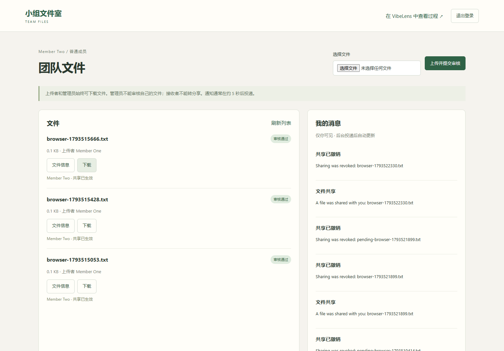
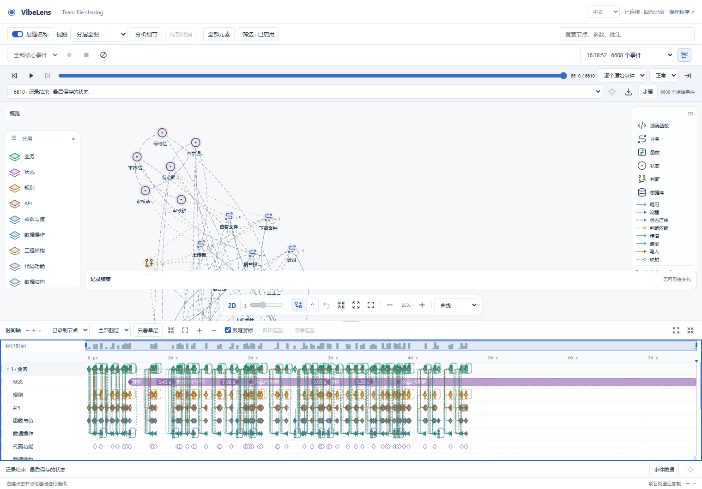
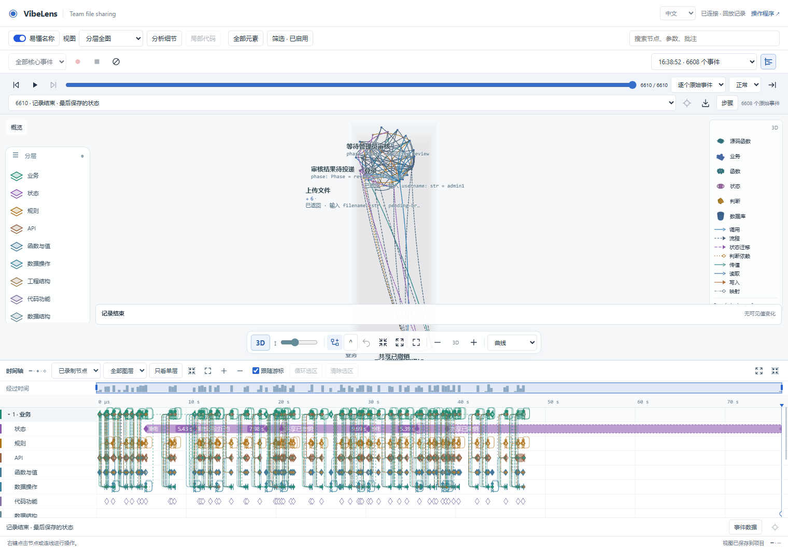

# OTel 接入与溯源验收

本轮在 `feat/otel-provenance` 完成，尚未推送或合并。业务图、状态图的开发引导、原生执行器、独立观察模块，以及驱动／观察两种模式保持原有职责。

OpenTelemetry 接管适合复用的调用身份、异步上下文和框架采集。业务实例、认证用户、文件／共享对象仍由程序的真实值提供。PROV、OCEL 用来收束这些概念，没有引入新的建模模式或本体推理引擎。[设计与资料](architecture-decision.md)

## 验证结果

| 内容 | 结果 |
| --- | --- |
| 完整仓库检查 | 原有检查及新增回归全部通过，[记录](repository-verification-host-08.status.json) |
| 独立对话与迭代 | 16 个场景 × 观测开／关／故障，48 组运行；15 项项目测试；四类验收通过，[凭据](dialogue-04-evidence/instance-frame-acceptance-summary.json) |
| 真实框架响应 | 122 组原生 HTTP 比较；浏览器实际操作的 18 个响应逐一对应采集事件 |
| 最后一次完整记录 | 6,608 条事件、零缺口，生产队列已排完 |
| 状态与回放 | 四个独立状态实例、七次预期变化；没有把共享撤销误接到文件通过 |
| Timeline | 1,734 个生命周期区间、699 条因果流；2D／3D 游标一致，[结果](dialogue-04-browser-v2-replay-final-05/result.json) |
| 分层检查 | 九层均有对应内容；状态来自 11 个真实快照，工程／数据结构来自扫描投影，[逐层结果](dialogue-04-layer-audit-final-02.json) |
| 核心保持 | 六个受保护 Python 模块及原生 JS 执行器与本轮基线一致，[哈希检查](boundary-and-installed-runtime-final-11.json) |

Python 与 Node 的真实 SDK 测试覆盖异步子调用、结束后的因果父调用、并发、跨生产者传递、消息关联、原生异常和观察器流量排除。Python 的完整对话使用真实 Flask／SQLite 应用。React／Vue 浏览器端 OTel 异步接入没有在这轮完成端到端验证。

## 对话与功能迭代

完整过程在[公开对话](dialogue-04/dialogue.md)。模拟用户直接提出“撤销共享”，没有再次提醒维护图或埋点。对话先读取项目中保存的义务，只追问一个会改变含义的问题：管理员是否保留独立权限。回答确认后，更新业务图，再实现和检查。

迭代保留原来的 234 个节点 ID，增加 10 个节点；三份已有个人视图配置保留。严格检查先后拦住缺少类型／来源的边，以及把通知误写成状态变更的声明。代码和图修正后才通过。

## 保留的问题与修复

前几轮分别暴露了错误的用户身份、漏掉真实 500／303、在错误监听器上排除同名路径、状态实例混淆，以及 API 节点分错层。共享框架或引导先修，再受管升级试用项目；原始失败没有覆盖。[全部材料索引](README.md)

浏览器脚本也出现过定位、异步等待、原始事件与视图事件适配、数组类型等错误。它们单独记录为测试脚本问题，没有用修改业务或放宽检查来配合测试。[浏览器复核](dialogue-04-browser-review.md)

持续自动刷新曾使停止录制的两秒排队等待超时。该记录明确保留缺口。最后的有限流程结束业务页面，等已产生的事件收齐后停止，采集范围和检查保持原样。持续负载下的吞吐与停止延迟仍需专项测量。[负载边界](dialogue-04-capture-load-finding.md)

全层图的标签仍较密，继承的相机位置也会影响可读性；本轮没有宣称全图布局已达到最佳效果。代码结构按需展开的切片保留明确的边界与省略数量，没有把静态可能调用当成实际执行。

最终源码：[309 个文件的快照](dialogue-04-v2-final-source.zip)，[逐文件哈希](dialogue-04-v2-final-source.json)。完整过程包含 AI 自主扮演用户的回答，已在导出中标明；它不是独立真人可用性研究。
