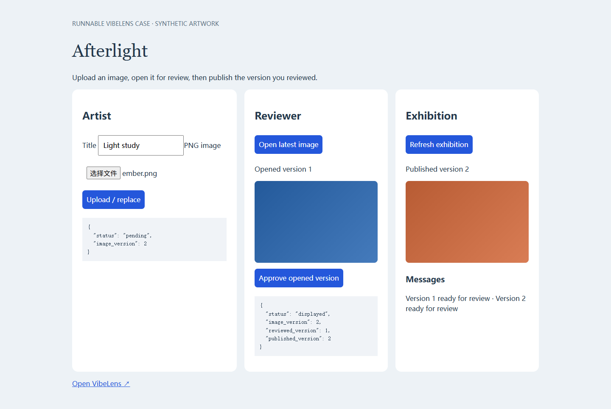
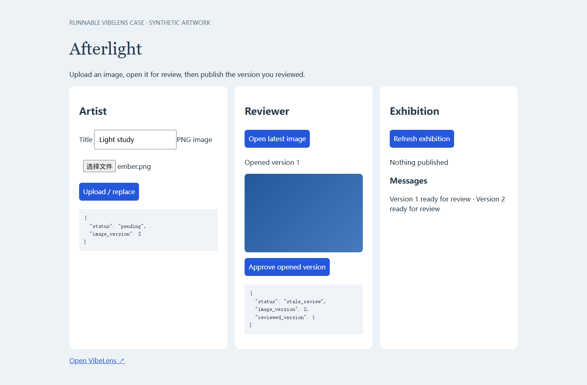
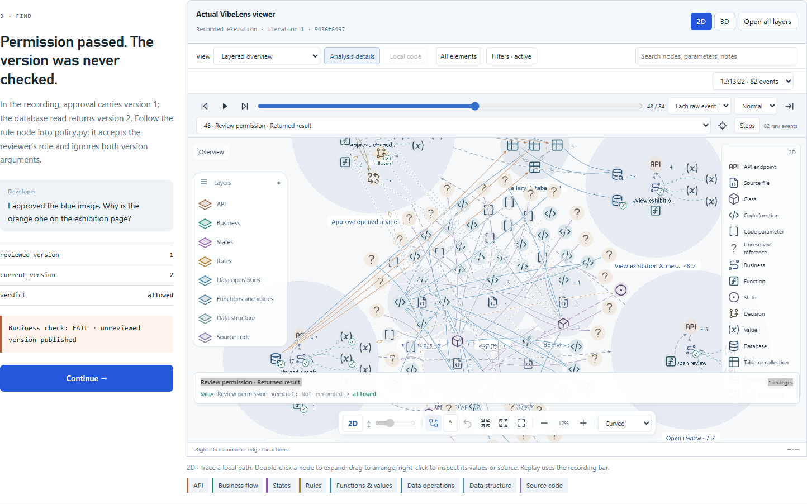
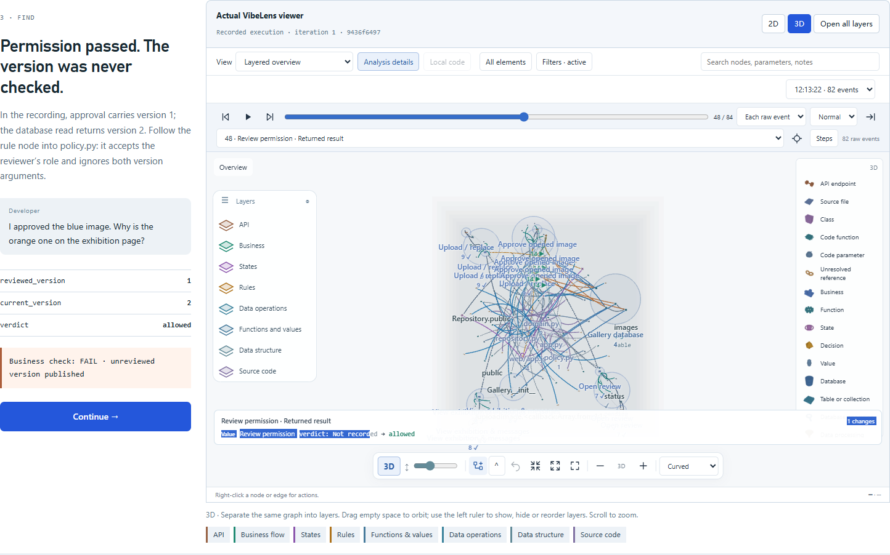
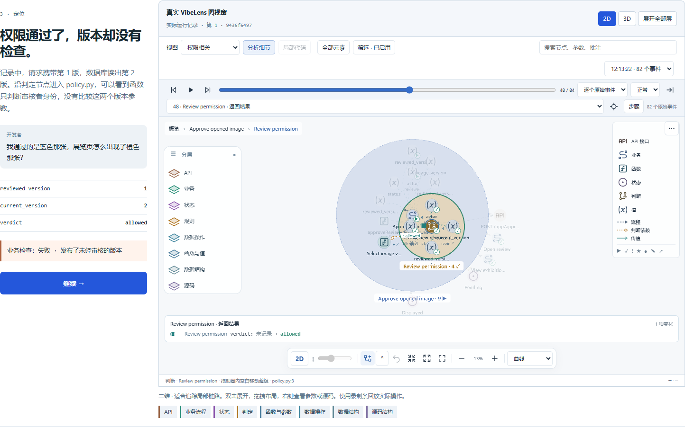

# Pages case review — Afterlight

2026-10-26 · [Project and reproduction](../../../examples/exhibition-review/README.md) · [Scripted dialogue](../../../examples/exhibition-review/review/dialogue.md) · [Published story](https://li-bruce.github.io/VibeLens/demo.html)

## What changed

The primary Pages demo now follows a runnable browser/Python/SQLite project through confirmation, recording, diagnosis, repair and retest. It connects API, business, states, rules, functions/values, data operations, data structure and static source. The old small browser exercise remains available as `practice.html`, with its original recording, scope, iteration and replay assertions retained.

The real maintained Pixi and Three.js viewer is assembled by `tools/build_site_viewer.py`. Its renderer files are copied unchanged; an asset hash proof is generated alongside them. A Pages-only read transport serves real exported observations, source and recordings. It does not run the gallery backend or permit new recordings. The interface labels the captured final state and stores layout preferences in the browser across the two builds.

The dialogue is scripted. The first policy's missing comparison is intentionally seeded. This case demonstrates how evidence can expose an implementation error; it is not evidence of autonomous bug discovery or an independent AI conversation trial.

## Reproduction and result

The browser uploads a valid blue PNG as version 1, opens it for review, uploads an orange replacement as version 2, then approves the old preview.

| Check | First iteration | Repaired iteration |
|---|---|---|
| Opened/current version | 1 / 2 | 1 / 2 |
| Policy result | `allowed` | `stale_review` |
| Exhibition after stale attempt | version 2 | empty |
| Independent stale-review expectation | **FAIL, retained** | **PASS** |
| After opening version 2 | Not needed to expose the failure | publishes version 2 |
| Source/data mapping contract | PASS | PASS |
| Retained events / state frames | 82 / 8 | 138 / 15 |
| Observer requests recorded as business events | 0 | 0 |

The native data evidence validator checks actual SQL targets, transformation values and transaction outcomes. The source check compares the original build manifest and exported source, without rebuilding them during verification. The source index has 250 nodes and 333 edges in each version; unresolved references retain their static status. The demonstrated all-layer projection has 127 nodes and 167 edges, including the bounded local source view. Those counts describe this case, not a large-graph benchmark.

Builds: v1 `9436f649706d2ddcd2f0886d81b083ca0dafa095bff47151d18a6b24fc2936b7`; v2 `c7bffd0dafe6bb73bbda9688990921fda5c5dacf3eb84c8d9554ab4c3ddafb5f`. IDs remain stable; source and recordings remain build-specific.

## Executed checks

- Real browser application sequence, valid PNG decoding, stale rejection, fresh approval, role rejection and invalid-content rejection.
- Canonical event protocol, original source build, native database runtime contract, real selected-version transformation, recording conservation and zero gaps.
- Seven independent business tests with observation absent.
- EN/ZH Pages: five chapters, exact replay location at the mismatched policy call, eight populated 3D planes, actual 2D/3D controls, all eight presets retaining relations, 390px layout and reduced motion. No browser exceptions or failed assets.
- Existing seven-view introduction, language switching, small recording practice and reduced-motion tour.
- Maintained-source lint/format checks and six document-link checks.
- Persistent CI checks reject stale published source, lost runtime evidence, changed red/green outcomes or changed node identities.

These are case-specific and source-quality checks. The unchanged observation engine was not given a new whole-repository or four-database acceptance claim in this task.

## Evidence

- [Actual runtime receipts](receipts/runtime.json), [browser checks](receipts/browser.json), [source quality](receipts/source-quality.json), [existing product checks](receipts/product-browser.json).
- [V1 graph, source and recording](../../site/case-data/v1.json), [V2 graph, source and recording](../../site/case-data/v2.json), [compact receipt](../../site/case-data/receipt.json).
- [Failures, fixes and retests](failures.md).
- [Deployed browser acceptance](receipts/deployed-browser.json) and [Pages deployment/asset verification](receipts/deployment.json): the same EN/ZH desktop/mobile, real 2D/3D and replay checks passed against the public GitHub Pages URL after the loading-order repair.

## Re-run

Use the commands in the [project README](../../../examples/exhibition-review/README.md). `tools/test_exhibition_case.mjs` executes and exports both builds into a new private evidence directory; `tools/check_exhibition_case.py` verifies the original captured build. `tools/test_case_artifacts.mjs` checks published fixture freshness. `tools/test_case_browser.mjs` serves the built site or accepts `BO_SITE_URL` for deployment checks.

The sample has fixed synthetic roles, a narrow PNG header check and SQLite. It does not claim real authentication, production upload hardening, new database support or new renderer performance results.
