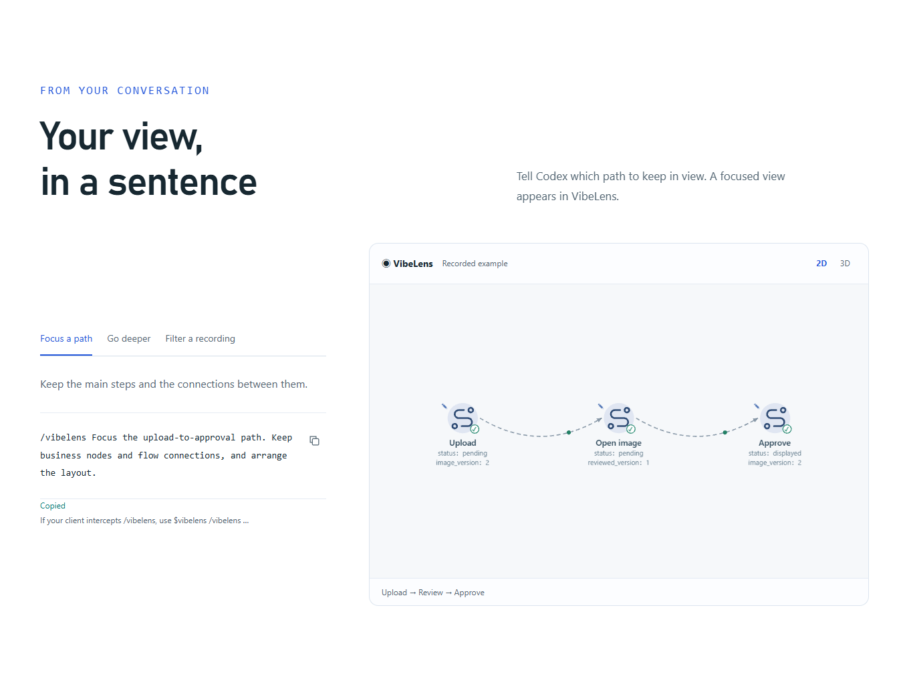
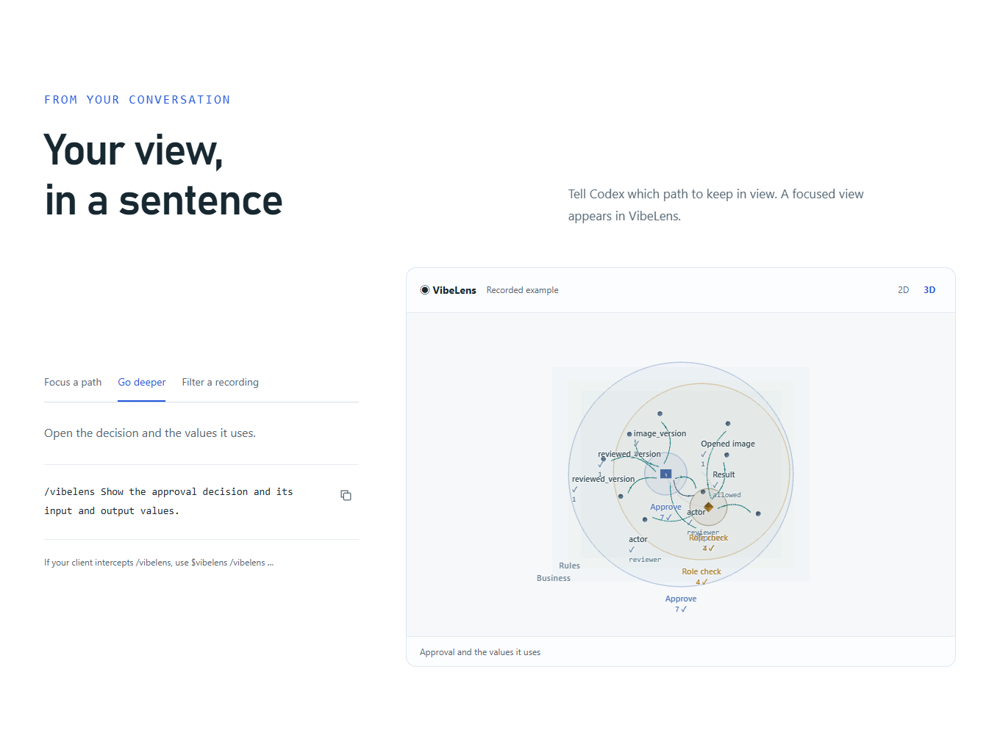
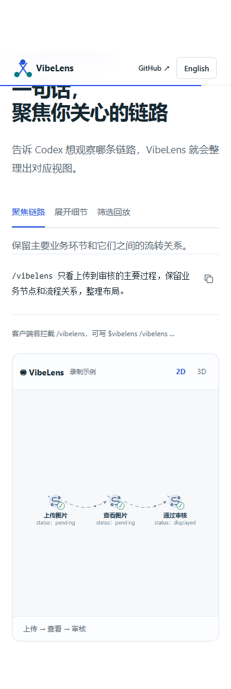

# Pages: conversation-scoped usage

The homepage now explains activation in the current conversation and shows three
view instructions: focus a business path, open a decision's values, and filter a
recording. English and Chinese share the same examples and controls. Installation
includes a copyable prompt beginning with `$vibelens`.

## What the example runs

The embedded canvas uses the shipped VibeLens viewer and its conversation-control
bridge. `tools/build_control_preview.py` exports plans through the Python controller
and rechecks their identities and recording evidence. The source is the existing
`docs/site/case-data/v1.json` capture. The static website chooses among these checked
examples; it does not run Codex or interpret arbitrary text.

The first view retains three original business nodes and two relations. The detail
view includes the owning approval step and its decision. Replay selects six of the
82 original events; the underlying recording remains unchanged. Two-dimensional
and three-dimensional views use the native renderer. Offscreen replay pauses, and
reduced-motion mode requires an explicit playback action.

## Failures and retests

| Attempt | Finding | Change and result |
| --- | --- | --- |
| First browser run | Windows clipboard converted multiline text to CRLF; strict byte comparison failed. | Normalize CRLF in the clipboard assertion only. Prompt content and `$vibelens` checks remain strict. See [first failure](first-failure.json). |
| Narrower detail preview | A single child-node selection after the business-only view produced an empty canvas. | Keep the owning approval node in the preview's explicit selection and verify that the decision and both version inputs are visible. This fixes the website example; a general single-child selection repair is outside this Pages change. See [scope failure](preview-scope-failure.json). |
| Final local browser run | Both languages passed. | Business path, parameters, native 3D, exact recorded events, advancing filtered replay, copying, mobile layout, language switching and reduced motion. See [result](local/result.json). |

The original seven-step demonstration also passed in both languages, including
progressive graph confirmation, user actions in VibeLens, source drill-down, repair,
retained custom views and 3D camera interaction. See [existing demo](existing-demo.json).

Syntax, lint and formatting checks passed for 101 Python and 69 JavaScript modules.
The package check passed for 113 copied runtime modules and documentation links.
The Pages builder also ran with Python site packages disabled, matching its
dependency-free deployment environment. See [source checks](source-quality.json)
and [package result](package.log).

## Review images

## Publication

Merged and pushed to `main` at `603c05c36f86ba1114f4921edeead14e9b5710c9`.
[Pages deployment](https://github.com/li-bruce/VibeLens/actions/runs/40700562853)
completed successfully. The [public usage section](https://liblog.vip/VibeLens/index.html?lang=en#conversation-controls)
passed the same bilingual browser test as the local site. See
[public browser result](public/result.json) and [deployment receipt](publication/ci.json).

[Published-file checks](publication/pages.json) passed: 75 exact byte comparisons
and the complete 66-file digest mapping. The first metadata check compared JSON
bytes and failed because Windows and Linux enumerated directory entries in
different orders; every file digest was identical. The final check compares that
mapping by key and additionally downloads every canonical viewer file except the
rewritten entry HTML, which has its own exact comparison. The
[first receipt](publication/pages-first.json) is retained.

This Pages update does not create a release tag. The repository-wide GitHub
`Checks` workflow was still running when the deployment receipt was captured;
the local checks and public browser results above are complete.
