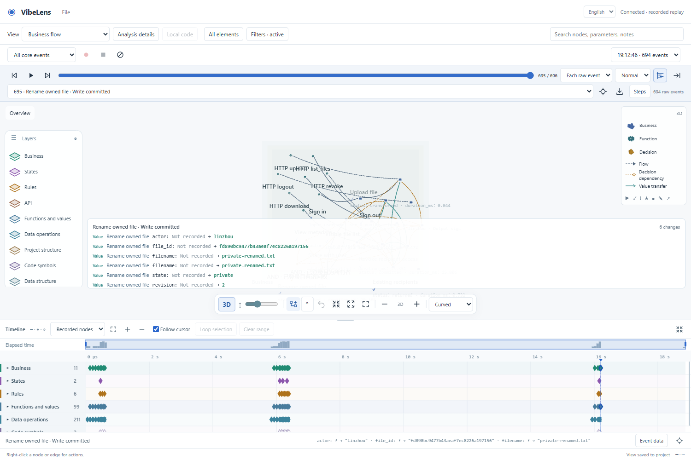

# Execution timeline review

Branch: `feat/recording-timeline`, based on released `v0.10.0`.

The new dock presents a recorded operation across graph layers. Ruler scrubbing,
event selection, playback and loop/skip selection use the graph's existing raw
event ordinal. The same dock works with the Pixi 2D and Three.js 3D views.



## Implementation

The [functional design](../../development/recording-timeline.md) defines gestures,
event semantics and module ownership. The implementation separates invocation
evidence, event indexes, time-window arithmetic, Canvas drawing and interaction.
`viewer.js` adds the shared replay connection and project settings. Existing Python
recording, retention, native state-frame and preference APIs remain authoritative;
the feature adds no second recorder, business endpoint or playback timer.

Calls are paired by scoped identity and occurrence. Open/ambiguous calls retain
unknown completion/duration. Explicit event dependencies may cross runs; reused
parent-call IDs cannot cross producers/entities. Source projections are hollow
and have no inferred duration. A directly instrumented API/code node remains
actual evidence. Invalid clocks use event order; capture gaps stay visible.

## Evidence

| Check | Evidence |
| --- | --- |
| Pairing, clocks, identity isolation, projections and interval navigation | [Semantic tests](unit-final/unit.json) |
| Actual recording: cursor/state/value synchronization in 2D/3D, drag, zoom, overview, range/loop/skip, pause, persistence, Chinese/mobile/touch | [Final browser acceptance](browser-completion/result.json) |
| Nonempty graph animation witness | Final browser acceptance matches the actual database-read transfer ID in graph and timeline |
| Existing layer/range/replay interactions | [Ruler regression retest](ruler-regression-02/result.json) |
| Fresh application and rename iteration | [Final v1 result](real-project-completion/v1-result.json), [v2 result](real-project-completion/v2-result.json), [layer changes](real-project-completion/iteration.json) |
| Component load, 20,000 synthetic events and nine layers | [Final source measurement](performance-final-source/result.json); excludes graph reconstruction and application work |
| Managed example identity, source mapping, state/whitebox/business/project checks | [Final verify/accept/check receipts](examples-final.json) |
| Python/JavaScript formatting and correctness | [Source checks](source-quality.json) |
| Existing bilingual public demonstration | [English/Chinese interactive case regression](site-regression/summary.json) |

The final full suite passed in [round 03](full-verification-03.json), after the
data-transform correction. It includes existing database, multi-language, mapping,
state, business, recording, retention, isolation, installation and observer-free
core-package checks. The [staged export gate](export-check.json) also passed from
a clean Git export with frozen approvals, without regeneration or reapproval.
The [validation manifest](validation-manifest.json) binds the passing receipts to
the exact viewer and test source hashes.

## Failures and corrections

1. Initial lint found duplicate existing Zoom in/out translations. Reused the
   original dictionary entries; lint passed afterward.
2. [Browser round 01](browser-01/result.json) read the scope selector before the
   asynchronous recording load finished. The test now waits for server-saved
   preferences and a visible dock after reload. [Round 02](browser-02/result.json)
   passed without changing the persistence mechanism.
3. Zoomed ticks initially rounded adjacent millisecond values to identical second
   labels. Tick precision now follows the visible interval.
4. The first synthetic load harness used a different host ID/CSS and burst input,
   so frame coalescing produced fewer seeks than the test expected.
   [Failed run](performance-01/result.json) is retained. The corrected harness uses
   the real dock styling and a sustained 20 ms pointer cadence.
5. Review found directly instrumented API/code IDs were omitted by a projection-only
   lookup. Direct observations now retain their own identities and durations;
   source mappings remain distinct. A semantic regression covers both forms.
6. [Existing ruler regression failure](ruler-regression/result.json) exposed a real
   UI collision: the ruler intercepted state-change action buttons after the dock
   reduced canvas height. A ResizeObserver supplies its actual width; change
   actions now reserve that space. The original test passed on retest with real
   pointer clicks and no forced interaction.
7. [Full-suite round 01](full-verification-01.json) exceeded the unchanged 30-second
   probe-drain deadline in the fresh-project test. [Worker output](full-verification-01-worker.log)
   is retained. The same suite passed in the host environment in round 02, without
   increasing the deadline or removing assertions. A failed drain now reports the
   pending queue, errors, dropped count and sender stack. The original run did not
   retain enough diagnostics to establish its underlying cause.
8. The actual recording showed four completed metadata transforms as open calls:
   native adapters emit `change / transformed`, while the initial pairing handled
   returns and commits. The [new failing regression](unit-transform-before/unit.json)
   reproduces this. Pairing now recognizes completion only for a declared data
   transform with the recorded status. An ordinary business value with the same
   text remains nonterminal. [Retest](unit-transform-after/unit.json) and final
   browser acceptance pass. Truly open/ambiguous intervals use faint dashed outlines.

## Reproduce

```bash
node tools/test_recording_timeline.mjs
node tools/test_recording_timeline_browser.mjs
node tools/test_timeline_performance.mjs
python tools/test_layered_project.py --out .validation/timeline-trial --browser /path/to/chromium
python tools/check_source.py --format
python tools/verify.py --database
```

Browser scripts use Playwright; set `BO_BROWSER_EXECUTABLE` for an existing browser
and `BO_TIMELINE_EVIDENCE` for a new evidence directory. The workflow includes a
pinned Playwright browser job. Its GitHub result is not asserted by local evidence.

## Use

Start recording, operate the application, then stop and open the saved recording.
The timeline appears below the graph. Drag its ruler to seek; Ctrl/Command-wheel
zooms; empty tracks pan. Expand a layer for its nodes. Shift-drag selects a range
and **Loop selection** repeats it. **Event data** exposes captured values and
before/after changes. **Current view** follows graph filters; **Recorded nodes**
shows the recording's available inventory. **Step detail** controls navigation
granularity. The toolbar icon hides/restores the dock; project settings retain its
height, scope and expanded layers.
