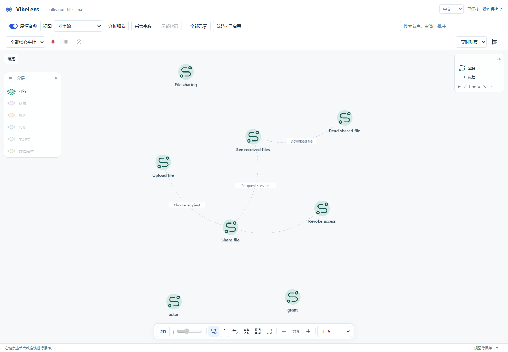
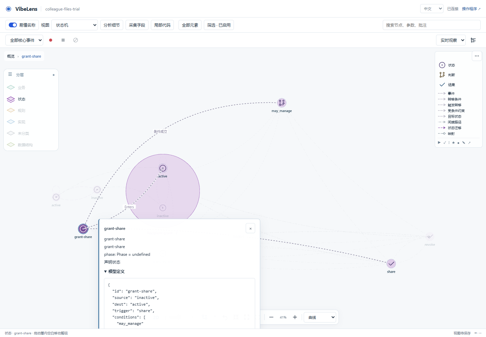
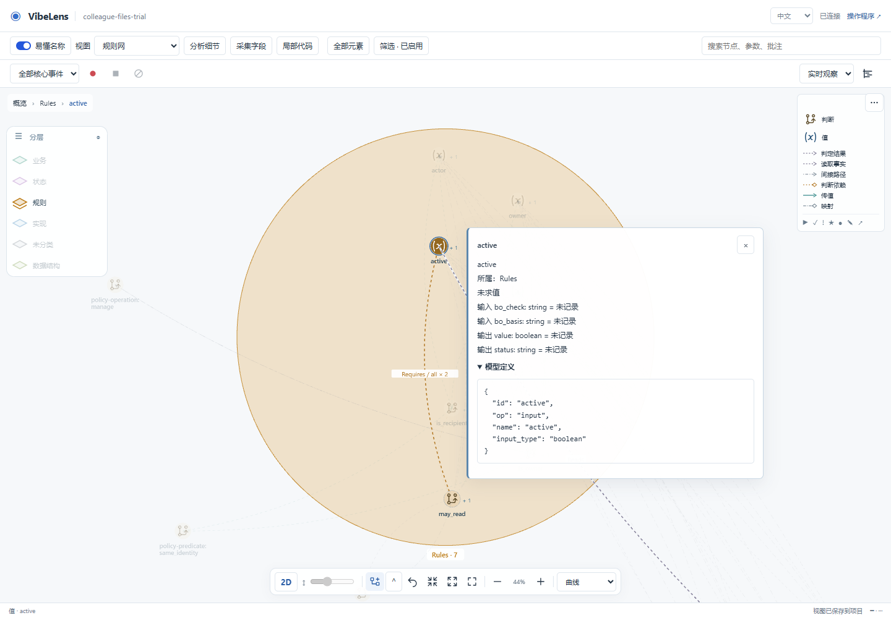
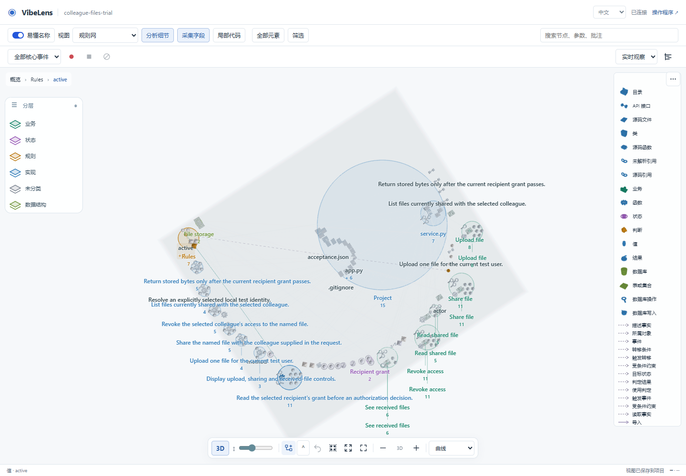
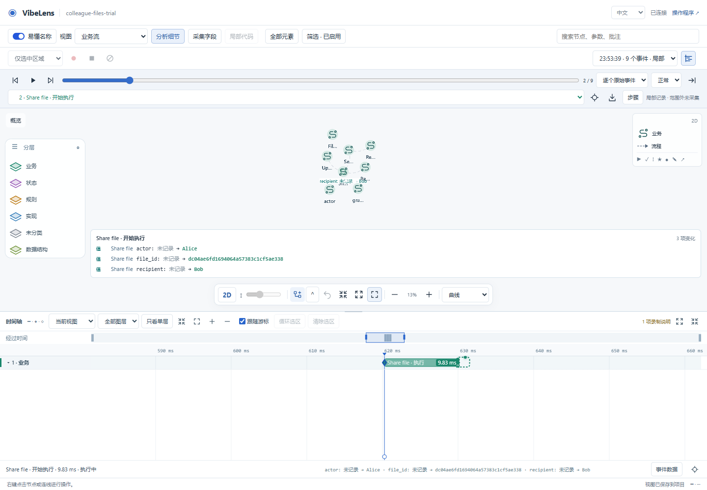

# Concept model browser acceptance

The final run passed on the frozen v0.12.0 candidate. This is a fresh replay of the retained synthetic file-sharing trial, followed by actual application and observer HTTP services and Chrome interactions. It is separate from the new dialogue trial requested for the published release.

## Final evidence

- [Acceptance results](07-final/verify-summary.json): mapping, state/rules, business, concepts and project checks passed. The unchanged fixture exercises five cases with observation on, off and unavailable. [Accept](07-final/accept-summary.json) and [check](07-final/check-summary.json) passed.
- [Browser results](07-final/result.json): seven check groups passed, 34 concepts and 14 implementation mappings; no page errors.
- [Recorded events](07-final/focused-recording.json): real upload and sharing requests, nine retained events, stopped recording and no capture gaps. Original native IDs remain intact.
- [Attempt history](attempts.json): includes failures, harness corrections, the pre-normalization pass and final replay. Historical trial source and its original acceptance were not rewritten.

The browser checks cover business/state/rule presets and definition inspection; concept/native identity; the same graph in 2D and 3D with mouse orbit; a saved custom view; focused concept capture; and a business Timeline interval backed by actual entry/return events. An event definition does not inherit its function's duration. The final sharing call lasted 9.83 ms in this run.

## Screenshots







The last screenshot retains a 13% graph overview, so its node captions are too small for detailed reading. The Timeline interval and captured values are readable. This functional pass does not establish that this saved overview is visually polished.

## Timeout diagnosis

A serial post-normalization run exceeded the existing 180-second observation limit. Profiling found repeated full physical path resolution at each concept freshness check. The correction uses the existing secure source reader with the logical configured path; each admission still checks current bytes, directory attributes and links. Same-size/same-mtime edits, unreadable configuration and an ancestor replaced by an outside junction have regression coverage.

The same local 190-event case changed from 19.79 seconds to 4.88 seconds; a warmed profiled baseline took 10.79 seconds. These are diagnostic measurements, not a general performance claim. The final full verify stage took approximately 62 seconds. No timeout, case, expected result or freshness check was removed. [Diagnosis and logs](06-serial-observation-timeout/diagnosis.json).

## Reproduce

```sh
python tools/test_concept_browser.py
```

Install the normal Skill requirements, `requirements-database.txt`, the retained trial's requirements and the CI Playwright dependencies first. `BO_BROWSER_EXECUTABLE` can select an installed Chrome executable. The runner creates an isolated project, runs ordinary build/scan/verify/accept/check and starts both services on ephemeral local ports. CI runs this entry point and retains its artifacts.
