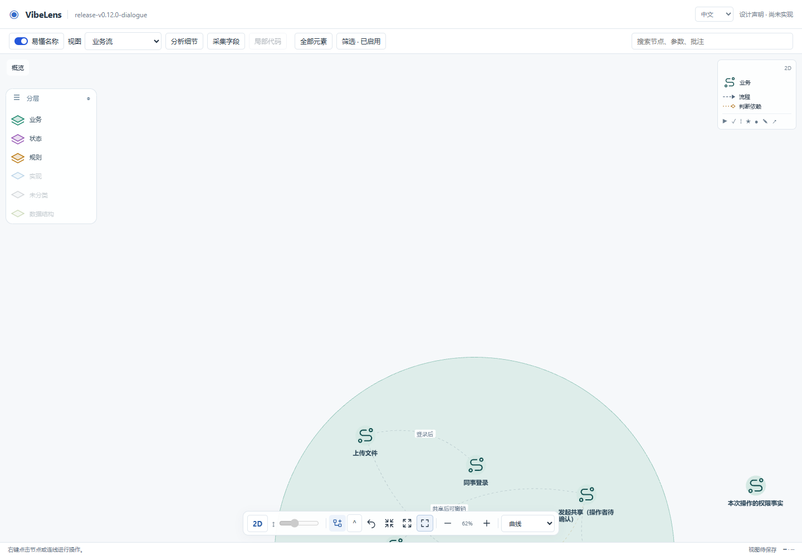
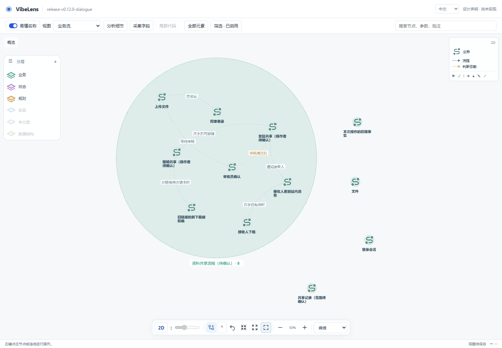

# Source-free design viewer startup

The fresh GitHub-installed v0.12.0 trial found a real viewer failure before implementation. [Original console evidence](round-01-console.json) and [the retained draft](discovery.json) are preserved. The trial installation and project were not patched.

## Cause and correction

The v2 conceptual projection correctly omits runtime presentation metadata. The shared viewer polled that draft and read `model.presentation.subject` unconditionally, before building the displayed graph. Earlier API/design tests checked the JSON; implemented-project browser tests supplied presentation settings, so neither exercised this boundary.

The viewer now reads the optional subject safely and falls back to the existing project identity. No placeholder subject, runtime state, bindings or implementation is added to the declaration.

## Evidence

- [Before](before/result.json): the actual frozen trial draft reproduces the missing `subject` TypeError and the graph never becomes ready.
- [After](after/result.json): the same draft passes five browser checks. Business, state and rule views display nodes and relationships; record/application controls remain hidden; events, bindings and current runtime state remain empty. Viewing does not rewrite the draft or its confirmation content. No browser errors were reported.
- [Shipped v2 fixture](shipped-fixture/result.json): the same checks pass independently using the packaged unconfirmed example.



Visual inspection of that first pass found a second defect: Expand/Arrange/Fit could leave a region partly below the viewport. The earlier reports above remain unchanged. [The geometry correction](fit-regression.md) now recomputes extents from current visible objects. [Actual trial retest](fit-after/result.json) and [shipped draft retest](fit-shipped-fixture/result.json) both pass with additional numerical viewport assertions for every visible glyph and region in all three presets. The actual trial business extent is x=333.55–1106.45, y=69.34–782.66 within a 1440×878 canvas.



## Regression

`tools/test_design_browser.py` creates an isolated source-free project and starts the real design HTTP server with canonical viewer assets. It runs in the browser CI job. To reproduce this particular case:

```sh
python tools/test_design_browser.py --discovery docs/review/release-v0.12.0/dialogue-findings/draft-viewer/discovery.json --out .validation/draft-regression
```

The test supports `--browser` or `BO_BROWSER_EXECUTABLE` for installed Chrome. Full failure details and screenshots remain in the chosen output directory.

## Separate browser CI environment correction

The published tag's browser job also failed before reaching the browser because it installed the retained trial's OpenTelemetry SDK dependency but omitted the instrumentation package imported by the adapter. [Public failure details](../../checks/github-tag-browser-failure-summary.json) show the missing module. The browser job now installs the existing `requirements-telemetry-test.txt`, matching the full test matrix. Product imports remain unchanged. The earlier local browser pass used an environment that already had this dependency; a new public CI run must verify the fresh installation.
