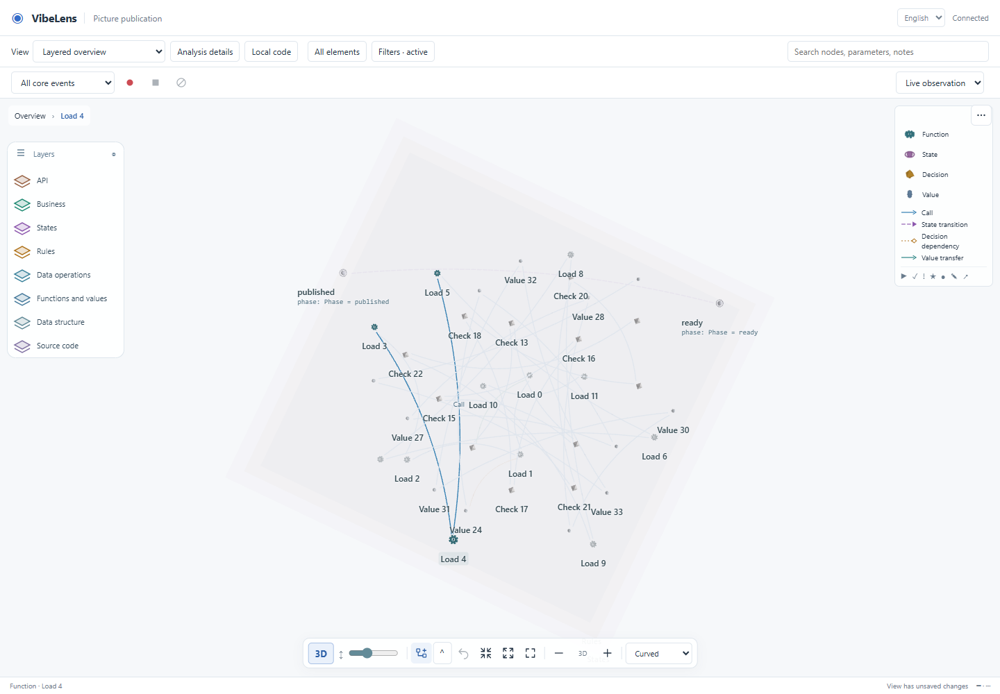
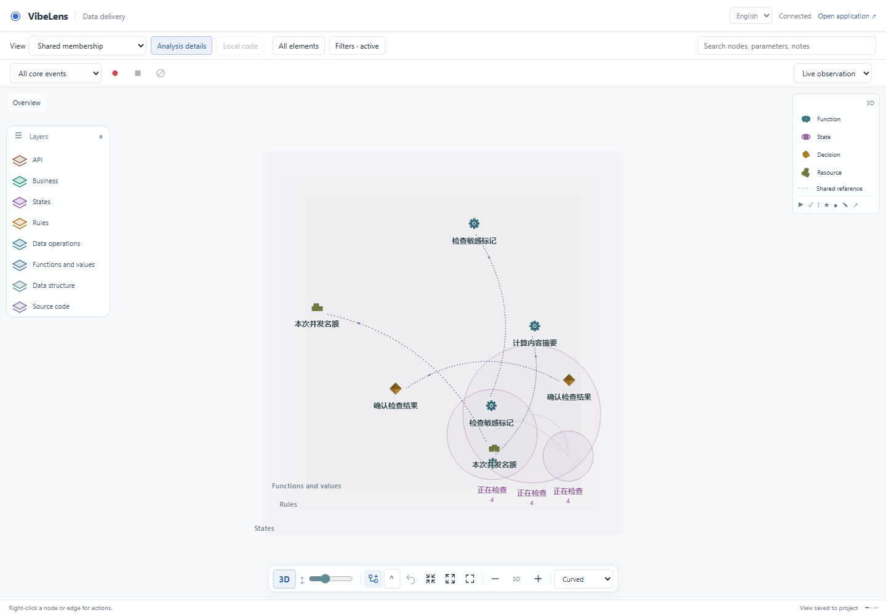
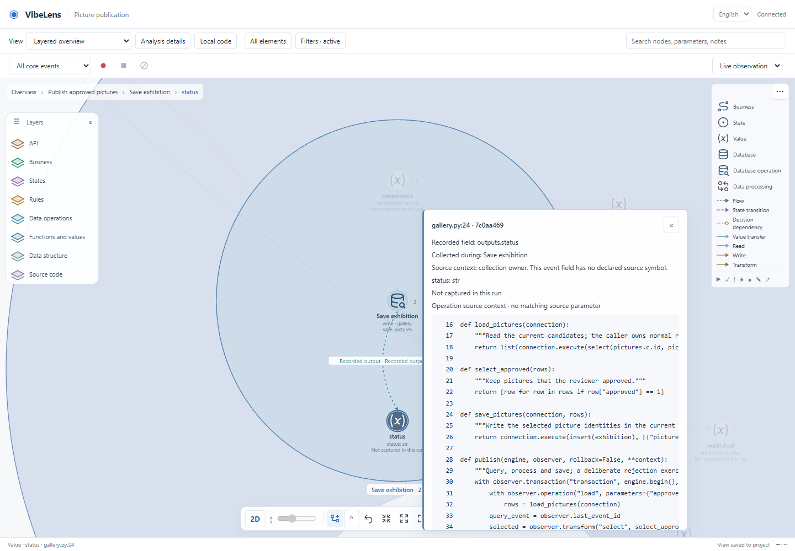

# VibeLens v0.8.0 review

This release consolidates the spatial graph branch and reviews frontend/backend readability. All business examples use synthetic data. Original failure records are retained.

## Source organization

| Area | Change | Review boundary |
|---|---|---|
| HTTP and capture | `service.py` retains transport and request authorization; `observation/session.py` owns graph sessions and event admission. | Public `GraphSession` imports still refer to the same class. Native business execution remains authoritative. |
| Database graph | `schema_compare.py` compares shapes; `projection.py` assembles graph elements. | Comparator reexport retained; schemas and evidence obligations unchanged. |
| Viewer | Dedicated source/value, edge and step-change presenters receive current state and delegate actions to the coordinator. | Model, preferences and recording ownership stay separate. |
| Source loading | Revision-bound full-file cache and obsolete-response rejection. | Actual browser source/highlight checks and an asynchronous regression accompany extraction. |
| Developer checks | One owned-source inventory drives lint, formatting and AST review. | Vendor distributions, generated icons, installed copies and raw evidence are explicitly excluded from rewriting. |

Read the [English](../../source-guide.en.md) or [Chinese](../../source-guide.zh-CN.md) guide for entrypoints, ownership and check commands. [Source sizes](source-size-review.json) are navigation aids, not a quality score. The viewer coordinator remains substantial because it connects shared interaction state; rendering, routing, layout, replay planning and detail presentation have separate modules.

## Checks

- [Final source-quality receipt](source-quality-final.json): 96 Python and 58 JavaScript modules, fatal-name/control-flow lint, duplicate-key/dead-binding checks, and pinned formatting.
- [Quality regressions](quality-test-retest.log): invalid source rejection, stable scope, compatibility imports and refusal to refresh an already-stale fixture.
- [Browser summary](browser/summary.json): 22 graph checks, including actual layered, routing, recording, code and data interactions. Screenshots remain in each test folder.
- [Real database log](database-live.log): PostgreSQL, MongoDB, Redis and Neo4j, Python and Node clients, actual outcomes and observer exclusion.
- [Bilingual site](site/result.json): seven views, language switching, 390px layout, sample recording walkthrough and reduced-motion behavior.
- [Performance](performance/results.json): synthetic 1,000/4,000-node graphs with 4,000/16,000 edges, actual dragging and route styles. At 4,000 nodes, selection measured about 37 ms and rendering P95 about 22 ms. Cold orthogonal routing took about 18.5 seconds in its worker. This is a tested-machine measurement, not a production guarantee.
- [Clean Git export](git-export-final.json) restores frozen approvals without regeneration. [Git byte proof](git-byte-proof.json) checks installed viewer/frozen bytes, 11 mode bindings and the 222-file Skill subtree. [Complete repository retest](repository-result.json) and [full log](repository-verify.log) pass against the final candidates, including the repaired asset adapter, HTTP states, installations, source/graph synchronization, and observer-free exported cores. Strict example verification/acceptance remains separately frozen.

## Failures and repairs

1. [First lint report](source-quality-first.json) found 23 issues, including unused imports/locals and duplicate translation keys. Removed dead bindings and retained the last effective translation for each duplicate. All original behavior gates remain.
2. A new fixture test encountered a sandbox temporary-directory permission failure. [The record](quality-test-first.json) explains the repair: isolate its temporary files under the repository. Its assertions are unchanged; all five quality tests subsequently pass.
3. The final site version edit introduced Windows line endings in eight files. [The failed format receipt](source-quality-site-newlines-failure.json) and [log](source-quality-site-newlines-failure.log) are retained. The pinned formatter restored the required style; the final check passes.
4. [Python](python-ast-review.json) and [JavaScript](javascript-ast-review.json) strict syntax comparisons correctly report module extraction, new modules, dead-binding removal and release metadata as changes. They are not passed off as whole-program equivalence. [The relocation witness](relocation-and-vendor-proof.json) verifies the two moved Python executable bodies and all nine vendor/generated assets; actual integration tests check composition and behavior.

5. The [previous remote CI failure](prior-ci-failure.log) also reproduced in a [clean Git export](git-export-first.json). [Input comparison](git-export-difference.json) isolated one watched test, `tests/test_graph_layout.mjs`, whose CRLF bytes were normalized by Git. A targeted attribute now preserves those fingerprinted bytes; explicitly refreshing the index was also necessary ([the intermediate failure](git-export-index-not-refreshed.json)). The [clean-export retest](git-export-retest.json) passes for both frozen approvals, and the new gate runs before the main CI suite.
6. The [first complete repository run](repository-verify-first.log) reached the HTTP regression but missed a short-lived running/waiting pair. The test now holds real checking tasks at their existing task hook until HTTP observes that pair, then releases them. Native states, callbacks, events and SQLite assertions remain intact. [Targeted retest](runtime-http-barrier-retest.log) passes; the complete suite is rerun below.

7. The legacy delivery adapter returned 404 for newly added viewer modules. [The failing HTTP test](delivery-assets-first.log) is retained. It now builds its asset map from the installed viewer directory and serves WASM with `application/wasm`. [HTTP retest](delivery-assets-retest.log), [actual delivery browser](delivery-browser/result.json), and a separately begun/reviewed/verified/accepted `readability-assets-20261026` change cover the repair. Business assertions are retained. The [earlier full pass](repository-before-assets-result.json) is kept separately from the final full-suite result.
8. Two environment-only attempts during this repair are retained: [missing shared parser configuration](examples/delivery-assets-parser-env-failure.log) and [sandbox-denied Node realpath](delivery-browser-path-env-failure.log). The configured canonical parser was reused; the harness checks its absolute temporary-directory boundary and rejects symbolic links before cleanup. These repairs do not relax business or mapping checks.

## Selected screenshots

## Acceptance meaning

Source lint, graph fidelity, state constraints and application business expectations are separate results. Passing a mapping check does not imply that an application's business requirements are correct. Static source analysis retains unresolved relationships; missing runtime facts remain unknown. No existing assertion, coverage rule or source scope was weakened for this release.
