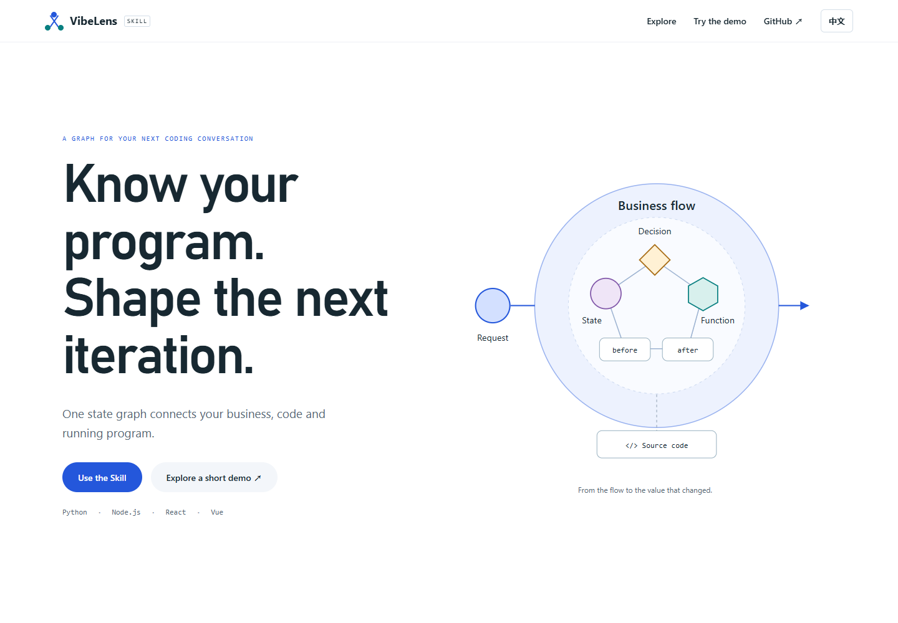
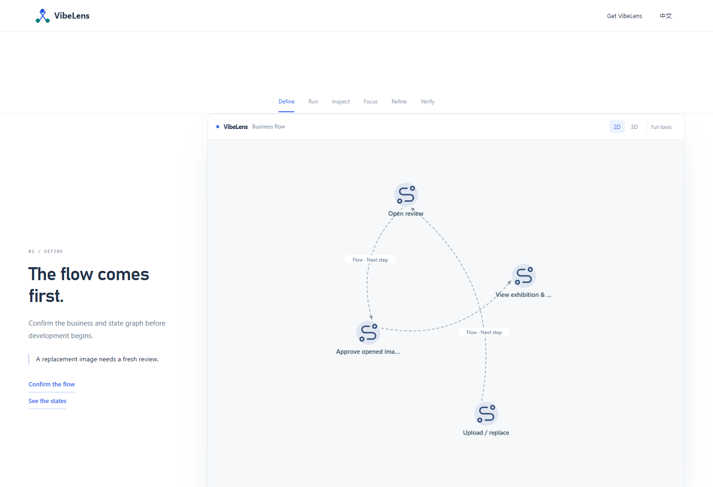
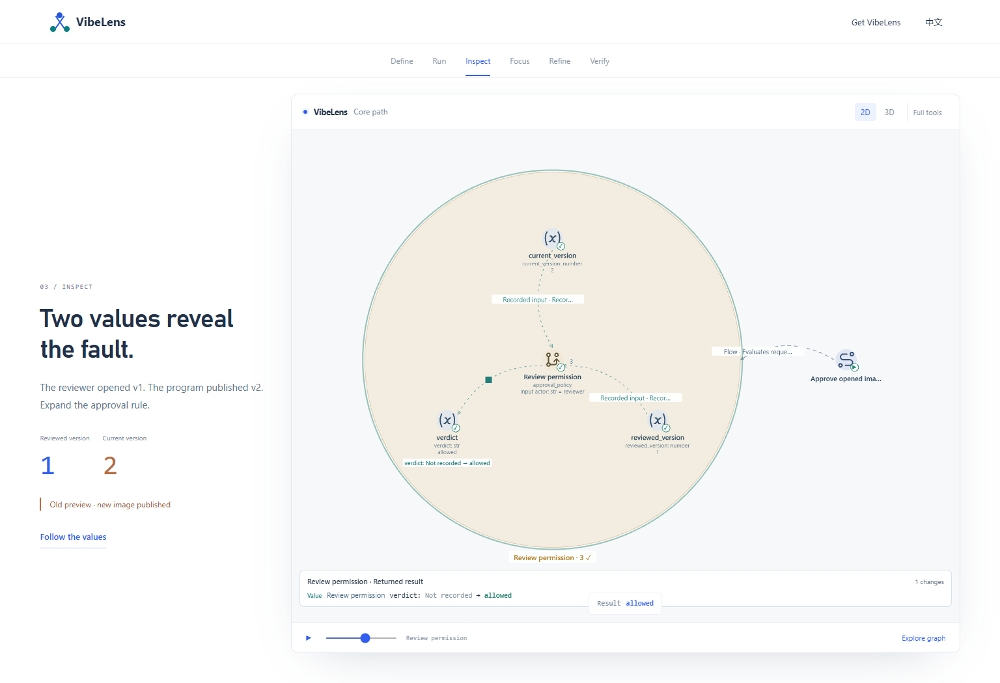
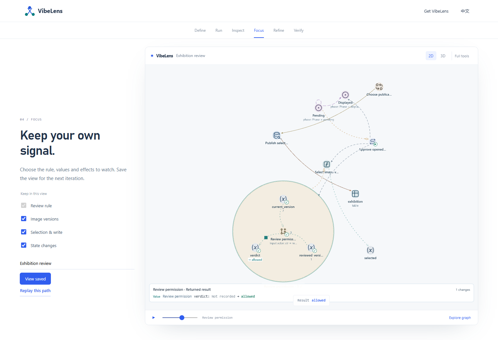
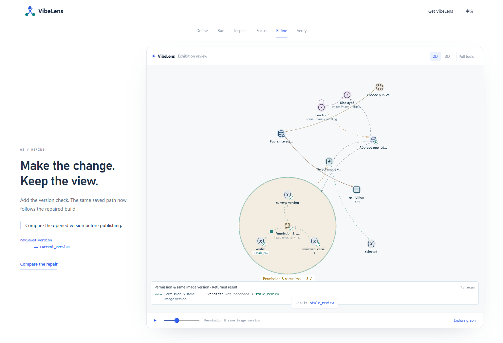
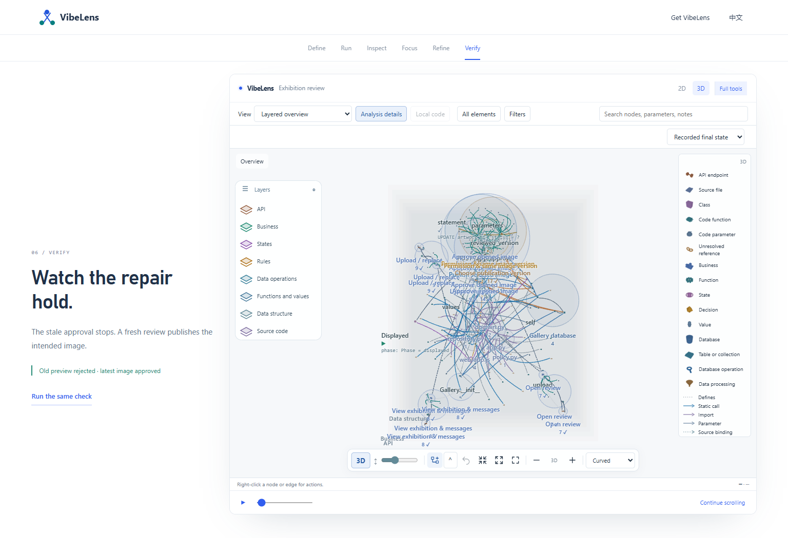

# Scroll presentation review

The product introduction and recorded-project demo now use native vertical scrolling, generous section spacing, restrained transitions and a sticky graph. Each demo scene introduces one step: agree on the flow, replay, inspect a discrepancy, save a focused view, compare the repair and verify it.

## Interaction

- Normal wheel, touch and keyboard input move the page. **Explore graph** enables graph manipulation; **Continue scrolling** returns to page navigation.
- The first graph contains four business actions. Inspection opens the actual rule and recorded version parameters.
- The focus controls use the viewer's native exclusions and custom-view save action. The saved selection survives both a repaired build and a page reload.
- **Full tools** reveals the complete viewer; 2D and 3D use the same graph and recording.
- English and Chinese copy, a 390px mobile layout and reduced-motion preferences are supported.

## Validation

| Check | Result |
| --- | --- |
| Demo browser, English and Chinese | Six scenes; 4 initial business nodes; 5 inspection nodes; 12 selected nodes with states enabled; native replay advances |
| Saved custom view | Same native view ID and nodes after build change and reload |
| Real graph tools | Eight connected presets; eight actual 3D layers |
| Scrolling and display | Wheel over the graph moves the page; keyboard PageDown; 390px layout; reduced-motion playback stays paused |
| Product introduction | Seven connected view previews, translated captions, interactive tour and separate practice recording |
| Source checks | Syntax, lint and formatting pass; see source-quality.json for scope |
| Captured artifacts | Source freshness, actual version mismatch, red/green outcomes, transformations and stable IDs pass |
| Viewer integrity | 65 canonical assets retain their hashes; the Pages HTML alone changes asset paths and entrypoint |

Receipts: [demo browser](demo-browser.json), [product browser](product-browser.json), [source checks](source-quality.json), [viewer hashes](viewer-asset-proof.json). Screenshots show the tested local build; deployed verification is recorded separately after publication.

The existing [execution evidence](../pages-case/README.md) supplies the recorded project. This change preserves its 82-event first build and 138-event repaired build. The demo replays those executions; it does not run a new backend on Pages. No new database throughput or large-graph performance claim is made by this presentation test.

## Failures and fixes

Preserved diagnostic receipts are in [failures](failures/).

| Finding | Resolution and retest |
| --- | --- |
| Business presets retain related boundary nodes | Choose the four introductory actions through native individual visibility controls. Full tools restores broader inspection. |
| Collapsing an ancestor also hides selected parameters | Open the required ancestor path before applying exclusions. Both version inputs are asserted in the inspection test. |
| Flex content widened the mobile page | Constrain section wrappers with width and minimum-width rules. Both pages pass the 390px overflow check. |
| A missing detail-close control stopped scene completion | Use the canonical close-detail action. Scene-ready checks now wait for actual completion. |
| Preference assertions ran before the native save completed | Wait for the saved preference document, then reload and compare the same view ID and node set. |
| The second locale imported an unrelated legacy view | Give the Pages demonstration an initialized, locale-specific preference document. Both languages now retain only their own saved views. |
| A collapsed database group showed no internal relation yet | Expand the native group before asserting its relation structure. No source or captured edge is fabricated. |

## Files

- `scroll-story.mjs` / `scroll-story.css`: shared scroll progression and section presentation.
- `case.mjs` / `case.css`: six-scene narrative and slim controls.
- `case-scene-player.mjs`: native viewer actions and recording transport.
- `case-focus.mjs`: named identities and types used by the focused example.
- `case-viewer.mjs` / `case-canvas.css`: static evidence transport, browser-local preferences and compact presentation.

Run `node tools/test_site_browser.mjs`, `node tools/test_case_browser.mjs`, `node tools/test_case_artifacts.mjs` and `node tools/test_product_demo.mjs`. Browser checks use Playwright and an installed Chromium-compatible browser; build the copied viewer first with `python tools/build_site_viewer.py`.
