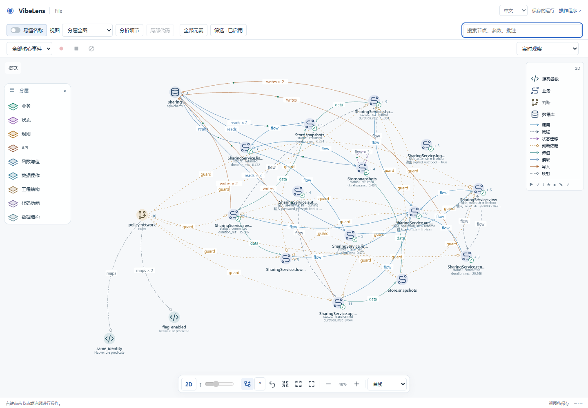
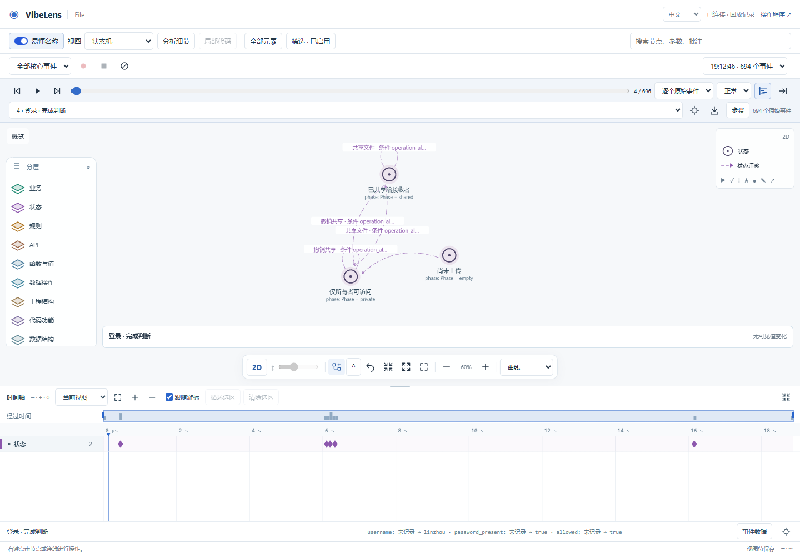
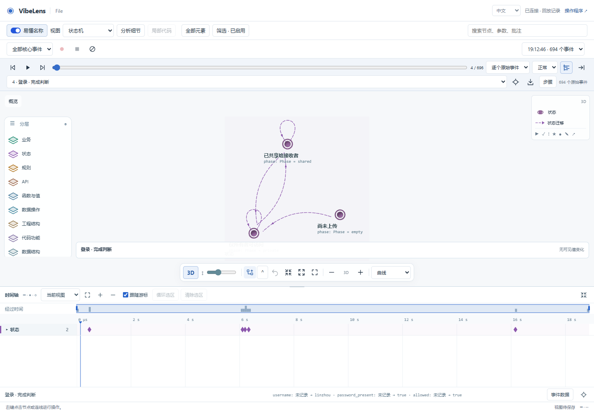

# Source names and AI names

The toolbar now has an **AI names** switch (**易懂名称** in Chinese). Off shows source symbols, field/schema keys, state values and relation types or triggers. On shows concise AI-authored labels. Both use the same unique node and edge IDs, source bindings, endpoints and recorded references. Equal display labels never merge elements.

The setting is saved with project views. Node positions, camera, expansion, annotations, selected event and timeline range remain intact. Graph maintenance stores explanations in optional `presentation.names` maps; toggling does not call a model. Legacy graph labels remain readable. Missing explanations fall back to existing labels or source names.

## Evidence

| Check | Evidence |
|---|---|
| Identity, source binding, duplicate display names, state values, parameter names, source/AI search | [identity-and-names.json](identity-and-names.json), `node tools/test_graph_names.mjs` |
| Invalid metadata and legacy compatibility | [protocol-tests.log](protocol-tests.log), `python -m unittest discover -s tests -p test_graph_names.py` |
| Native 2D/3D switch, reload persistence, unchanged geometry/cursor, bilingual labels and 3D text-cache regression | [browser-complete/result.json](browser-complete/result.json) |
| Existing timeline gestures, actual transfer animation, native transform completion, touch and replay | [timeline-completion/result.json](timeline-completion/result.json) |
| Python/JavaScript formatting and source checks | [source-quality-complete.json](source-quality-complete.json) |
| Original mapping, state, business and project gates for both shipped examples | [examples-completion.json](examples-completion.json) |
| Full repository verification, including database checks, installation and isolated core export | [verification.json](verification.json), [verification.log](verification.log) |
| Clean staged Git export using frozen approvals, with no regeneration | [export-check.json](export-check.json) |

Browser acceptance uses an unchanged real file-sharing recording: 694 events, SHA-256 `71e7032ad7bd4a63520d57332b2b0c2c6a76c6b1832279a0afce15e6af8a3fea`. [preview-names.json](preview-names.json) is an AI-authored display overlay; the test does not replay business commands or replace runtime evidence. Browser checks found no JavaScript errors and issued zero business writes.

## Failure, fix and retest

A parallel-state test first returned `private,shared` instead of applying each state's explanation. [parallel-state-before.log](parallel-state-before.log) retains that failure. State display now maps each active state individually. Captured arrays remain raw values. [parallel-state-after.log](parallel-state-after.log) and the final identity test pass.

The archive example's first baseline attempt could not locate the JavaScript parser. Setting `BO_ADAPTER_HOME` to the existing canonical adapter resolved that prerequisite before baseline creation. Parser and source-completeness checks remain enabled.

The 3D cache originally omitted display text from its content identity. The browser-side cache regression in [cache-before/result.json](cache-before/result.json) demonstrated that replacing only a label left the old text displayed. Node and relation captions now invalidate the text cache independently of topology. [browser-complete/result.json](browser-complete/result.json) confirms that labels refresh and layout is not rerun. This cache check uses the renderer's update lifecycle with stubbed drawing; the switch, state labels, saved preferences and replay checks above use native browser controls.

## Screenshots

Maintainer details: [graph naming](../../development/graph-names.md).
