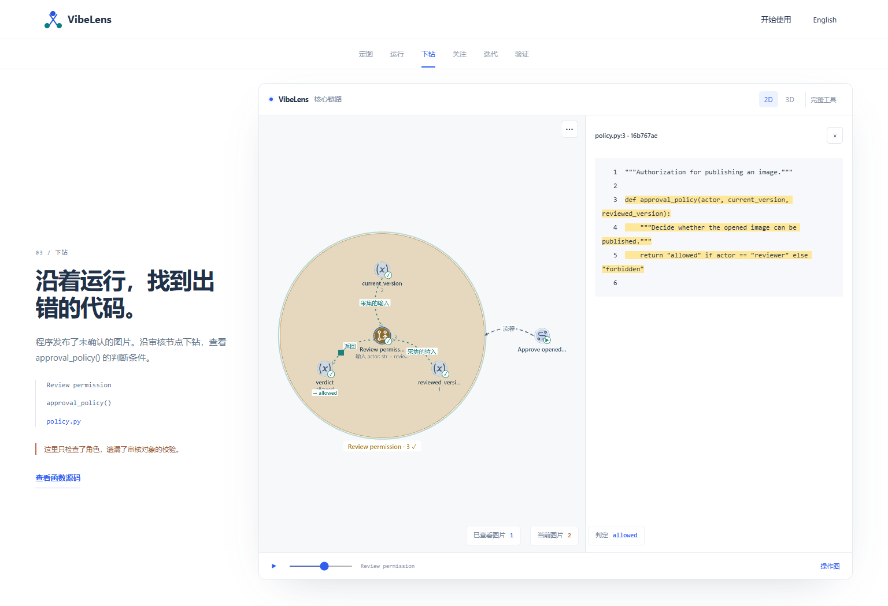
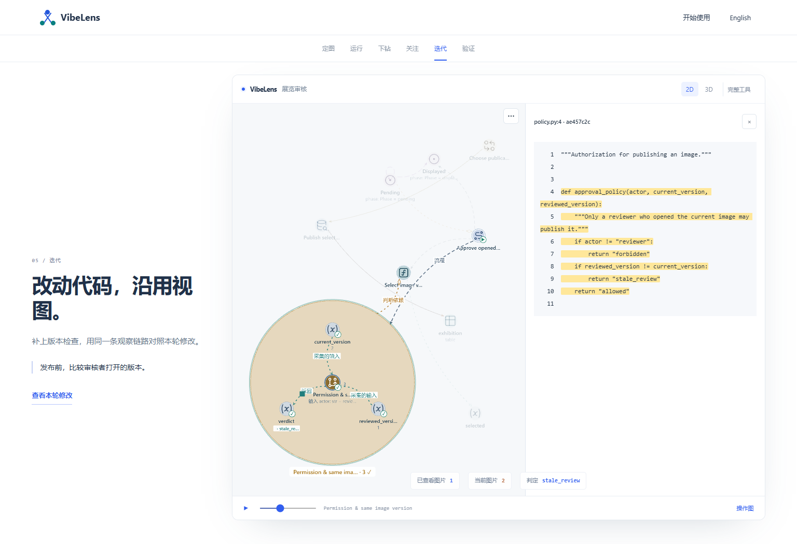
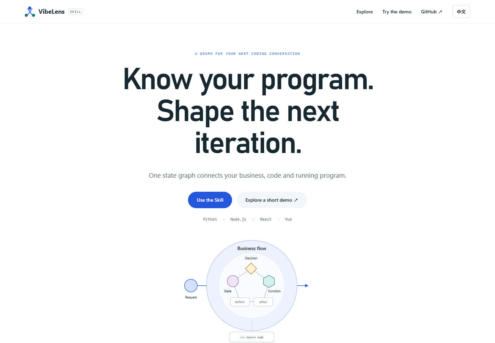
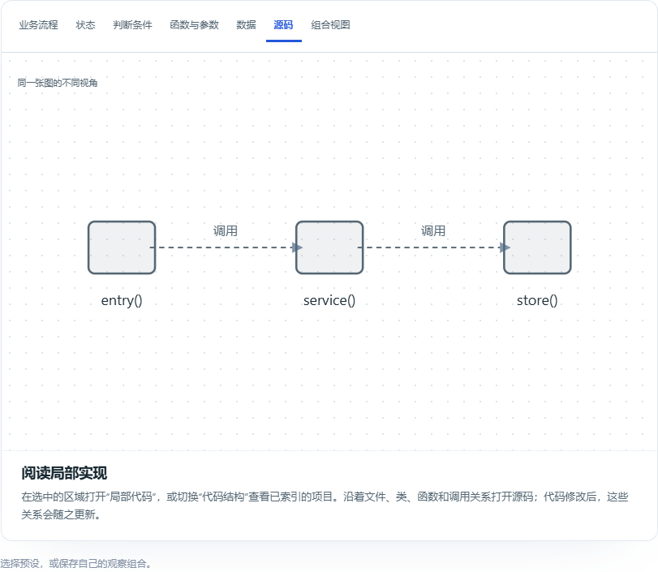

# Source-led demo and product page

The inspection scene now follows the approval node into the actual `approval_policy()` implementation in `policy.py`. The missing condition is visible in the source. The later iteration opens the repaired function with its new condition. Image revision numbers remain captured input values, rather than the subject of the lesson.

The full file is loaded through the native source reader and highlighted using its graph binding. The source panel and canvas occupy separate areas. No source excerpt is handwritten into the narrative.

## Playback

The original example captured individual operations without dependencies between the business steps. Those declared workflow edges correctly had no runtime transfer animation. The previous 300ms playback interval also interrupted the native 650ms animation.

The example adapter now records control dependencies only when two completed steps refer to the same image identity: upload to review, review to approval, and successful publication to exhibition. Chronological proximity is insufficient. The shared viewer recognizes that recorded control dependency on its matching business-flow edge. Playback uses 900ms steps, allowing each transfer to complete.

The business view skips unchanging internal function calls. Expanding a function restores its calls, while raw replay retains every original event and state/resource changes remain eligible. Unit regressions cover all three cases.

Two actual canvas frames are retained: [first frame](screens/zh-CN-flow-motion.png), [later frame](screens/zh-CN-flow-motion-next.png). The browser test requires witnessed flow edges and different rendered pixels, then opens the source and verifies its highlighted function and repaired condition.

## Product introduction

The main page now has a centered opening, a visual business foundation and one sticky graph that follows four scroll depths: business, state/decision, functions/data, and source. Manual presets remain available. Recording and the interactive viewer tour share a single section. English, Chinese, mobile layout and reduced-motion behavior remain covered.

## Checks

| Scope | Evidence |
| --- | --- |
| Fresh real frontend/Python/SQLite executions | [runtime.json](runtime.json): first implementation deliberately fails the stale-review expectation; repair passes; 82/138 events and 8/15 state frames; zero observer operations captured |
| Native source, moving transfers, saved views, mobile and 2D/3D | [demo-browser.json](demo-browser.json), asserted by `tools/test_case_browser.mjs` |
| Main-page scroll depths, manual presets and translated tour | [product-browser.json](product-browser.json) |
| Existing exact-frame 2D/3D replay | [replay-regression.json](replay-regression.json) |
| Syntax, lint and formatting | [source-quality.json](source-quality.json) |
| Canonical viewer copies | [viewer-assets.json](viewer-assets.json): 65 source hashes; HTML entrypoint adapted for Pages |

Additional passing checks: seven observer-free domain tests, six document-link tests, source-panel response isolation, actual artifact freshness, dependency-backed transfer tests, replay owner/grain tests, recorded-view semantics, preset coverage, spatial workspace and view continuity. The first implementation remains a disclosed teaching defect. These checks add no claims about other databases or large-graph throughput.

## Failures retained

- [Invalid dependency type](failures/invalid-dependency-type.txt): the strict protocol rejected `flow`. The adapter was corrected to the existing `control` type; the protocol was not relaxed.
- [First browser attempt](failures/browser-01.json): the test expected an original edge ID, while the visible edge had a summary ID. It now recognizes the displayed flow relation.
- [Second browser attempt](failures/browser-02.json): a screenshot targeted the hidden renderer-status element. The test now captures the actual canvas and compares frames.
- Visual inspection found source-panel overlap caused by flex sizing. The canvas now has an explicit flex basis; the browser asserts that its bounds end before the source panel.

The earlier [scroll-presentation review](../scroll-story/README.md) and [original execution review](../pages-case/README.md) remain historical records. This directory contains the fresh execution and presentation checks for the current change.
