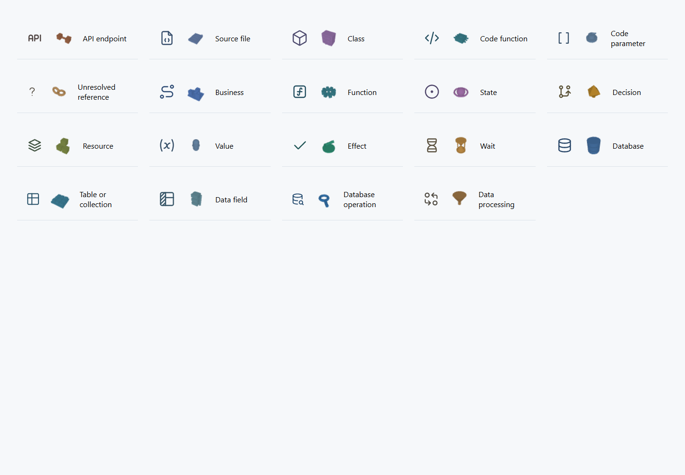
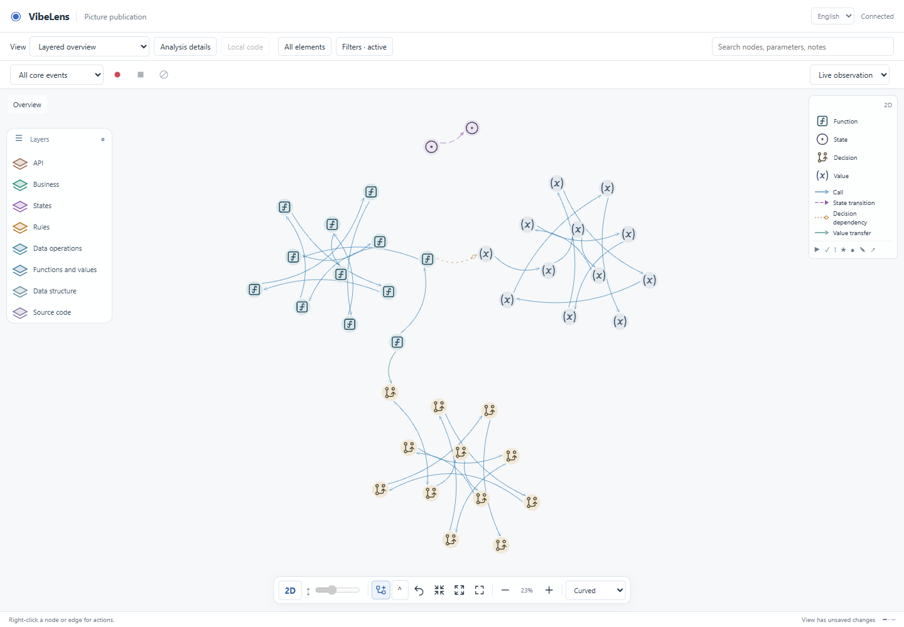
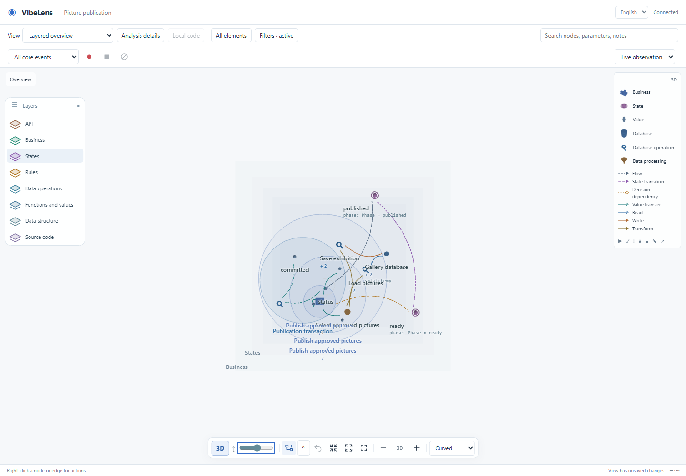

# Solid objects, compact layers and planar clusters

This iteration corrects the graph presentation on `feature/spatial-graph`. The model, native executor, capture semantics and business requirements retain their identities.

## Changes

- **3D objects:** nineteen original compound solids replace thickened vector strokes. Databases use separated cylinder tiers; resources use stacked crates; functions use gears, with distinct source objects. Planar Tabler icons, semantic type colors and the matching WebGL legend remain consistent. Geometry is merged once per type and instanced; dense views reduce radial detail. Runtime status remains a separate badge.
- **Layers:** only visible, populated planes occupy consecutive slots in the selected order. Every adjacent plane uses the bottom toolbar's uniform spacing. Old individual gaps are ignored; X/Z coordinates, pins, order and visibility survive. No empty slots remain for absent API or hidden layers.
- **Edges:** straight means two current ports, including across layers. Curves retain a real bow. Routing epochs prevent an old dogleg from surviving a style change. Dashes follow physical path distance across vertices instead of discarding whole segments. Orthogonal and bus styles retain obstacle routing and original edge identities.
- **Layer navigator:** one event-driven Canvas2D surface draws plane tokens and labels. Click a token to toggle visibility, click a label to select, drag to reorder, and use the header to collapse or restore all. Keyboard: arrows select, Space toggles, Alt + arrows reorders, Delete hides the selected layer. Hidden accessible actions parallel the canvas. Uniform spacing is in the bottom toolbar in 3D.
- **2D clustering:** actual containment subtrees are retained. Repeated sibling types pack together; top-level subtree units form type groups, with cross-group bridge nodes biased toward the relevant rim. D3 forces run in a worker. Manual coordinates survive incremental updates; Arrange recomputes unpinned positions, and Undo restores the previous layout.

The circular clustering concept was compared with [CiSE](https://github.com/iVis-at-Bilkent/cytoscape.js-cise), [fCoSE](https://github.com/iVis-at-Bilkent/cytoscape.js-fcose) and [ELK](https://eclipse.dev/elk/reference/algorithms.html). This implementation reuses the existing D3 engine and explicit node types, rather than installing a second graph renderer or manufacturing model containers.

## Screenshots

## Failures and repairs

1. [Before correction](before.json): a single visible state plane retained height 1300; a cross-layer straight relation had four points; the database used Tabler stroke geometry.
2. [Initial cluster browser failure](clusters-first/results.json): the test referenced an undeclared global before the page initialized. Corrected the readiness predicate.
3. [Actual clustering regression](clusters-retest/results.json): rectangular post-processing pushed a non-bridge node out of its type neighborhood. Use actual circular footprints for ordinary roots, and retain stricter foreign-label boundaries around expanded branches. [Passing cluster test](final-checks/test_cluster_browser/results.json) also checks exact pins and real pointer interactions.
4. [Strict example rejection](preliminary-delivery-verification.json): the Node-based layout check had no browser Worker. The same real solver now runs directly in headless/CLI contexts. Its unchanged branch-boundary assertions exposed another regression; both are preserved and pass after the repair.
5. [Old canvas selector](preliminary-viewer-controls.log) and [old DOM control selector](preliminary-code-browser.log): tests now target the graph canvas separately and operate the rendered layer controls with real pointer coordinates. Assertions for recording, source navigation and persistence remain.
6. [Earlier source-browser timeout](preliminary-checks/test_code_browser.log): one language reload stalled; it was retained, rather than extending its timeout or dropping the locale assertion. The complete subsequent run passed with the original timeout. Extra request diagnostics remain in the test for recurrence. Its root cause was not established.
7. [Formatting warning](preliminary-formatting.log): wrapped the diagnostic expression with the pinned formatter. Final copied assets are checked again after formatting.

## Validation

[Frontend regression receipts](final-checks/summary.json) cover 22 groups: object/shape geometry, real routing Wasm, worker clustering, layer controls, containment/planes, replay owners, view coverage/continuity, source views, database views, recording controls, localization and real browser interactions. The existing database-view check and [large-graph benchmark](performance/results.json) are additional checks. Both installed examples use the unchanged strict begin / inspect / verify / accept / check protocol, with immutable baselines; receipts are in [examples](examples/delivery-check.log).

The [native-source proof](final-checks/native-source-proof.json) compares 133 native/runtime/business files with the previous full repository run. Those files remain byte-identical. This iteration reruns affected UI/layout and example gates; it does not claim a fresh run of every database backend's unchanged integration suite. The whole-repository Python formatting wrapper was unavailable because Black was not installed; changed frontend files pass pinned Prettier checks. Package and Skill checks have their own receipts.

Synthetic Chrome / Intel Arc B390 measurements:

| Graph | Worker layout | Selection refresh | Render p95 |
| --- | ---: | ---: | ---: |
| 1,000 nodes / 4,000 edges | 1.12 s | 8.3 ms | 15.1 ms |
| 4,000 nodes / 16,000 edges | 4.73 s | 22.2 ms | 21.2 ms |

The 4k graph's actual three-move pointer interaction took 161 ms; rerouting plus drag settled in 947 ms. Straight routing took 335 ms, bus routing 1.30 s, and a cold orthogonal solve took 16.27 s in the worker. All 16,000 edges were accounted for with no unresolved routes in that fixture. Labels and draw calls retain their budgets. The 4,000-unit planar clustering worker remains responsive; its exact elapsed time and event-loop heartbeats are in the cluster receipt. These measurements describe this hardware and fixture, not arbitrary graph performance.

Straight geometry can intersect intervening nodes by design. Curves try alternate bows and report remaining geometric intersections; only avoidance styles claim a certified avoidance path. There is no guarantee of minimum crossings, collision-free labels, or resolving conflicting manual pins.

## Use

Refresh [the local graph](http://127.0.0.1:8882/graph?lang=zh-CN). Existing manual coordinates are preserved. In 2D, click **Arrange** to apply the new type clustering, or **Undo** to restore the previous layout. The left plane tokens control visibility and order; the bottom slider controls uniform 3D spacing.

Final delivery also verifies [Git asset bytes](git-byte-proof.json), the [local installation](local-installation.json), and the [live preview](live-preview.json). The installed Skill contains 217 files; the old copy is retained outside the active Skill directory.
