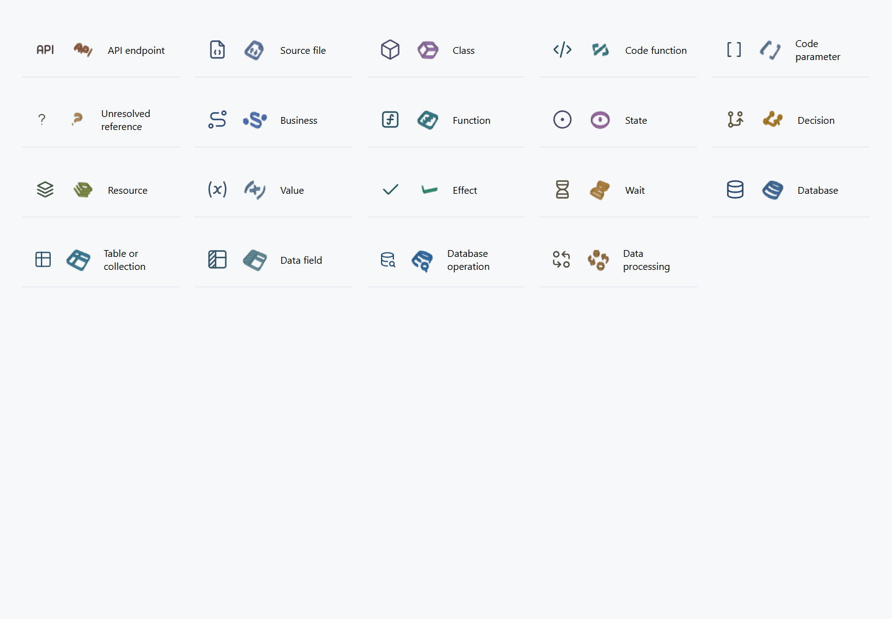

# Node icons and shared automatic routing

Feature branch: `feature/spatial-graph`. Based on `0223913`. This batch replaces the primitive node shapes, completes shared obstacle routing and bundles, and simplifies the layer ruler and database field labels.

## What changed

- All 19 node types use [Tabler Icons 3.49.0](https://github.com/tabler/tabler-icons), under MIT. The planar graph uses sampled vectors; the spatial graph uses original volumetric adaptations of the same strokes. These are genuine lit, instanced meshes, with reduced detail in dense scenes. The 3D legend is rendered from the same geometry. Empty icon centers remain easy to click and drag.
- Business, state, branch, function, parameter, resource, database, table, field, query and source concepts have recognizable silhouettes. Type identity, actual runtime badges and personal annotations stay separate.
- All four edge modes share worker routing. RBush checks actual segments; reusable D3 Delaunay channels and ngraph bidirectional greedy A* handle large planes; bounded local libavoid handles difficult routes. Typed bundles can join different source nodes and share cross-layer columns. Shared strokes offer the original edge choices. Routes are visual paths, not shortest-path or minimum-crossing proofs.
- Node/group movement, expansion, folding and layer changes invalidate geometry epochs. Unrelated moved obstacles also invalidate intersecting cached paths. Stale results are discarded. Large scenes upload the completed edge buffer once rather than repeatedly rebuilding growing buffers.
- The layer ruler collapses into a narrow strip, retaining eye controls, tooltips, ordering and gap gestures. Expanded counts use plain numbers. Field labels retain the native type; a gold marker identifies an actual primary key. Full key/nullability/required constraints remain in details.

## Verification

[All 22 regression groups passed](final-checks/summary.json), including real SQLite operations, source updates, capture scope, current-version recordings, pause/skip/loop behavior, view continuity, bilingual/mobile controls, region ports, group movement, worker routing and synthetic large graphs. The [real browser routing test](final-checks/test_routing_browser/results.json) exercises the actual Wasm dependency, moved-obstacle invalidation, original edge IDs and matched icon geometry. The [layered interaction test](final-checks/test_layered_browser/result.json) has 12/12 initial routes and no blocked path.

The two examples use a fresh `spatial-routing-20261025` change. Their final [strict gate receipts](verification/summary.json) cover review, verification, acceptance and check; [baseline proof](verification/baseline-proof.json) preserves the original bytes and independent expectations. A failed vendor registration was repaired by recording exact reviewed dependency hashes, without relaxing the source parser or dependency checks. The [negative test](vendor-negative.json) confirms a changed bundle is rejected.

The archive example has a separate `spatial-routing-git-20261025` follow-up for its nested Git binary rule. It began from the restored accepted attribute file, then reapplied the correction and repeated [review, verification and acceptance](git-acceptance/summary.json), retaining its [original baseline](git-acceptance/baseline-proof.json). The [Git byte proof](git-byte-proof.json) compares staged assets and evidence with the tested files, including all four identical Wasm copies. The intermediate stale check is retained in `verification/post-stage-team-archive.log`.

[Failure and repair notes](failures.md) distinguish product defects, harness changes and performance failures. Earlier receipts, screenshots and prototypes are retained byte-for-byte in [the preliminary evidence archive](preliminary-evidence.zip), with a SHA-256 manifest.

[Native-source proof](final-checks/native-source-proof.json) checks 133 unchanged native/runtime/business source hashes against the earlier complete repository suite. This frontend batch does not claim a fresh live test of every database adapter. Package references, six document-link tests and Skill validation also passed.

## Performance on the test host

Synthetic 3D rendering in Chrome / Intel Arc B390; [raw results](performance-accepted/results.json). Synthetic geometry is separate from business correctness.

| Case | Layout | First routing | Selection | Renderer frame P95 |
|---|---:|---:|---:|---:|
| 1,000 nodes / 4,000 edges | 1.06 s | 1.28 s | 9.6 ms | 28.2 ms |
| 4,000 nodes / 16,000 edges | 4.81 s | 17.79 s | 45.0 ms | 11.4 ms |

At 4,000 nodes, cached style changes completed in 1.21–2.08 s. Actual pointer picking took 3.3 ms; the three-move pointer gesture took 196 ms, and rerouting after it took 1.10 s. All 16,000 edges were routed with no unresolved path. The integrated 1,000-node coordinator selection took 44 ms. These measurements do not guarantee frame rate or route completion time on other devices, arbitrary dense graphs, overlapping user pins or very complex containment.

## Use and source map

Refresh the [current graph](http://127.0.0.1:8882/graph?lang=zh-CN). Switch 2D/3D, expand a node and compare it with the upper-right legend. The left ruler's header button collapses it; its separate spacing button opens uniform spacing. Edge shape remains in the bottom toolbar. Existing personal views were [verified unchanged](live-preview.json).

The [local installation](local-installation.json) has 214 files matching the accepted Skill, with a recoverable previous-version backup. No legacy `business-observer` entry is active.

`routing-scene.js` adapts renderer geometry; `routing-client.js` / `routing-worker.js` own epochs and cancellation; `routing-engine.js` owns route policy and bundles; `routing-navigation.js` owns reusable channels; `routing-geometry.js` owns exact collision checks; `route-picking.js` retains original edge choices. `node-icons.js` is generated from the pinned vectors, consumed by `glyphs.js` and `spatial-geometry.js`. See the [source guide](../../source-guide.en.md), [spatial reference](../../../skills/vibelens/references/spatial-graph.md) and [dependency replacement/source notes](../../../skills/vibelens/references/vendor/README.md).

Overlapping endpoints or bounded-search failures remain explicit routing gaps; graph relations are retained. The router avoids node/region silhouettes, not every label. Native states, events, database effects and recordings are unchanged. This feature-branch delivery does not merge main or publish a release tag.
