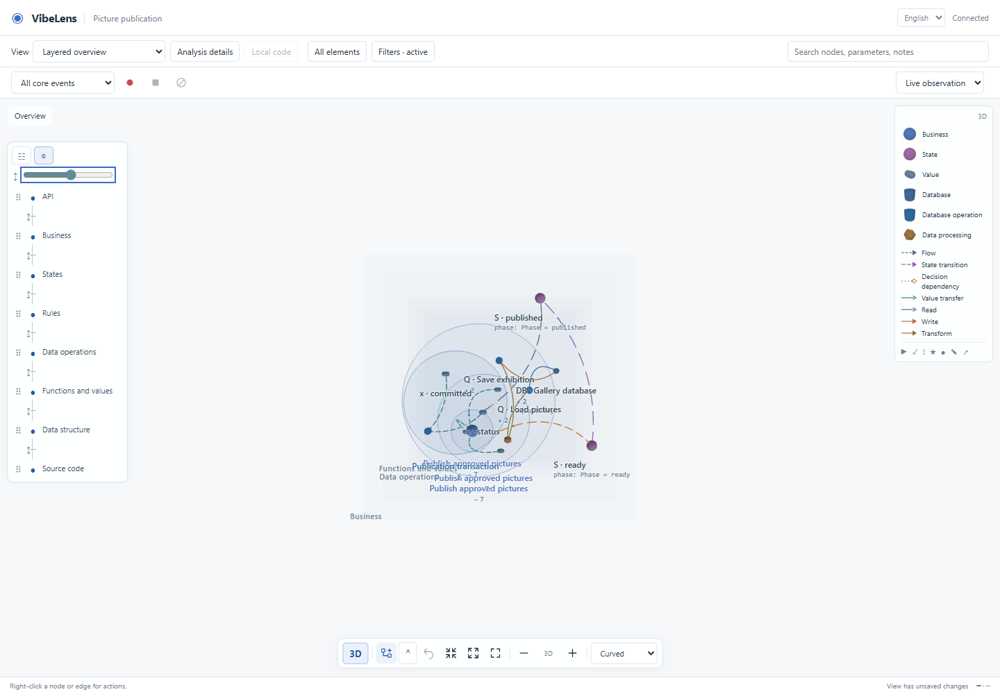

# Layer ruler, edge routing and replay controls

Date: 2026-10-25. Branch: `feature/spatial-graph`. Base: `431090b`.

## Using the viewer

- The left ruler shows full layer names. Click a name to select a layer, its dot to show/hide it, and drag its grip to reorder. Drag the tick below a layer to change its gap. Alt + Up/Down reorders a row; Up/Down adjusts a focused gap. The ruler header button reveals uniform spacing. Default gaps are 260 units; hiding a layer keeps its height slot.
- Double-click a node to expand its circle. External 3D edges attach to its rim. Counts and live status remain visible in both renderers; expanded 2D captions sit below the circle.
- Delete hides the selected node, edge or layer. Text inputs retain normal editing. **All elements** restores exclusions. Positions, layer order/gaps, masks and routing remain private project view settings.
- Choose **Curved**, **Straight**, **Orthogonal** or **Bus** in the bottom bar. Relation colors, solid/dashed meaning and original endpoint identities remain unchanged.
- Pause repeats the current step's animation. **Steps** contains inclusion checkboxes and an optional loop range. Skipped steps remain in the original recording and in subsequent actual snapshots; selecting playback steps does not undo business effects. Export retains the original recording.

## Implementation

[Layer ruler](../../../skills/vibelens/assets/stategraph-viewer/layer-ruler.js) owns layer gestures. [Layer settings](../../../skills/vibelens/assets/stategraph-viewer/graph-layers.js) computes stable elevations for layout, meshes and restore. [Edge routing](../../../skills/vibelens/assets/stategraph-viewer/edge-routing.js) shares coordinate interpolation and circle ports; 2D/3D renderers own their graphics. [Playback selection](../../../skills/vibelens/assets/stategraph-viewer/replay-selection.js) filters event IDs independently of recording reconstruction. Native application and observer-runtime sources are unchanged. The three added modules are isolated from business capture and the recording store.

The lightweight bus route groups a shared source and relation kind. Edges remain separate facts. It does not promise obstacle avoidance, global crossing minimization or full force-directed edge bundling. Existing ELK node layout and constrained 3D force layout remain active. Useful primary references: [ELK routing](https://eclipse.dev/elk/reference/options/org-eclipse-elk-edgeRouting.html), [ELK compound layout](https://eclipse.dev/elk/reference/algorithms/org-eclipse-elk-layered.html), [yWorks routing/bundling comparison](https://www.yworks.com/products/yfiles/features.html). No proprietary yFiles code was added.

## Evidence

- [Current regression summary](final-checks/summary.json) includes geometry, state projection, view continuity, controls, real SQLite/source browser cases and the synthetic large-graph test. All 19 groups passed on the final candidate.
- [Real recording controls](final-checks/test_ruler_browser/result.json): unchanged repair-project recording; 2D/3D pause repeat, skipped steps, bounded looping, real canvas focus and Delete hiding. This replay test executes no business commands.
- [Live SQLite viewer](final-checks/test_layered_browser/result.json): drag/key layer ordering, gap drag, reload persistence, all four circular endpoint routes, real 3D picking, group dragging, undo, recording/replay, source context and EN/ZH mobile controls.
- [Failure and repair log](failures.md) preserves actual failures and distinguishes harness repairs. Earlier receipts retain their original folder names and exact bytes in the [preliminary evidence archive](preliminary-evidence.zip), with a SHA-256 manifest; they are not relabeled as final acceptance.

The two complete examples use a fresh `spatial-ruler-20261025` change with immutable baseline bytes and unchanged independent requirements. Both examples passed final review, verify, accept and check; their frozen `spatial-ruler-20261025` snapshots retain the original baseline bytes. See the [strict gate summary](verification/summary.json) and [baseline proof](verification/baseline-proof.json). The [native-source proof](native-source-proof.json) verifies 133 unchanged files against the earlier complete suite; the [live preview proof](live-preview.json) verifies current assets and untouched personal views. This frontend-only batch reuses the earlier complete native-runtime receipt only after checking exact native/business file hashes; it does not claim a new live test of every database adapter.

## Performance on the test host

Intel Arc B390 / Chrome: 4,000 nodes and 16,000 edges settled in 8.53 s, selection 32.6 ms, renderer-frame P95 27.5 ms. Rebuilding straight/orthogonal/bus routes took 124.6 / 227.4 / 238.8 ms. The 1,000-node and integrated coordinator cases also passed. These synthetic, host-specific values do not establish correctness of arbitrary application graphs or performance on other devices. See the [raw benchmark](final-checks/test_spatial_performance/results.json).

## Delivery

The [active local Skill](local-installation.json) contains 197 files matching the canonical candidate, with a recoverable prior-version backup. The current [graph page](http://127.0.0.1:8882/graph?lang=zh-CN) serves the verified assets. Refresh the page to load the controls. Existing personal filters, positions and notes were not reset.

This is a feature-branch update, without a main-branch merge or release tag. The full native/runtime suite referenced in the source proof predates this frontend-only batch; current verification consists of the unchanged-source check, both strict examples, all 19 regression groups, package/link/Skill checks and local installation/live-asset verification.
