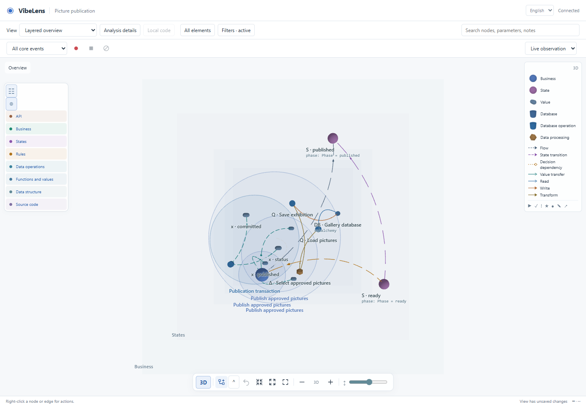

# Spatial workspace review

This review covers the canvas controls, planar semantic layers, readable 3D labels, and faithful executable-state projection on `feature/spatial-graph`. It starts from accepted commit `c5b8cad01257d27f161e537ce2fbfd16de52ab4c`. It does not change the examples' business rules or independent business expectations.

## Delivered behavior

- Breadcrumbs sit above the graph. Shared 2D/3D view actions and the 3D layer-spacing slider sit in one bottom-centered control bar.
- A narrow left drawer controls layer visibility. The upper-right legend lists visible node and relation types vertically; its 3D icons are rendered from the same geometry factory as graph nodes.
- Nodes, containment regions, and same-layer curves remain on their semantic plane. Hiding another layer does not move that plane. Cross-layer relations connect their actual endpoint planes.
- Node captions use light, transparent text below the node. Expanded regions carry their owner's name below the projected circumference; the anchor follows camera orbit. Region captions retain selection, expansion, and group dragging.
- State nodes enumerate the executable declaration. True nesting, internal transitions, conditions, and alternative transitions retain their identities. Current leaf states activate their declared ancestors. A flat name containing `_` does not imply hierarchy.
- Runtime evidence marks only witnessed paths. If a journal entry cannot distinguish two declared conditional branches with the same endpoints, neither branch is presented as proven execution.

## Source responsibilities

| Module | Responsibility |
| --- | --- |
| `machine-projection.js` | Project executable states, hierarchy, transition definitions, and journal evidence into the common inventory. It does not execute another state machine. |
| `spatial-model.js` | Preserve semantic layer elevations and group identity across projections. |
| `spatial-geometry.js` | Share geometry between instanced graph nodes and cached WebGL legend images. |
| `spatial-labels.js` | Compute the lowest projected point of a region circumference without DOM reads. |
| `spatial-paths.js` | Create plane-preserving curves and visible self-transition loops. |
| `spatial-renderer.js` | Render geometry, labels, picking, and saved spatial interactions. |
| `viewer.js`, `graph-layers.js`, `viewer.css` | Shared controls, personal preferences, localization, and responsive placement. |
| `bo_contracts.py` | Reject a projected state set that differs from the executable state declarations. |

Canonical assets live under `skills/vibelens/assets/stategraph-viewer/`. Example copies are generated by the existing synchronization and ownership workflow.

## Failures and corrections

1. The initial regression failed because nested code nodes had a depth-dependent vertical offset (`234` instead of their plane's `260`). See [initial failure](initial-failure.log). Layout and renderer now keep them on their semantic plane.
2. Inspection found that alternative conditional transitions could share one edge ID. Each executable entry is now retained, while unchanged unique transition IDs stay stable.
3. Parent matching previously treated underscores in state names as ancestry. Hierarchy now comes only from the executable `children`/`parallel` declarations. Current active ancestors use the same relationship.
4. An internal transition had coincident endpoints and could render as a zero-length curve. It now has a visible loop on its plane.
5. The first strict verification run was interrupted before acceptance to include the active-ancestor correction. Its [partial receipt](verification/summary.json) remains separate. Final acceptance uses the original pre-change baselines; none was replaced to suppress drift.
6. A final renderer review found that background layer meshes still used an old downward offset and could survive a layer mask. The [rendered-mesh regression](plane-failure.log) reproduced `195` versus the nodes' `260`. The guide now uses the node plane and omits empty/hidden layers. The first workspace cycle was already accepted; its frozen record is preserved. A new `spatial-planes-20261025` cycle started from that accepted candidate before this correction. The complete repository gate runs on this final cycle.
7. The complete repository run rejected two old hierarchical test fixtures that listed only leaf states. The fixtures in `test_refactor.py` and `test_assessment_fixes.py` now include the declared compound/parallel parents; their engine, precedence and mismatch assertions remain intact. Targeted [parent/child tests](state-fixture-retest.log) and [engine tests](hierarchy-fixture-retest.log) passed. The new negative test explicitly rejects a missing parent. The [original failed full run](verification-planes/full-repository.log) is retained.
8. The first full retest stopped at the existing portable-link check because the exact dialogue transcript retained local source/screenshot links. Their actual targets are now archived and registered through the repository's existing historical-link mechanism. The [failed link check](repository-retest/full-repository.log) is retained; no link check was disabled and the original dialogue was not rewritten.
9. A later [full run](repository-final/full-repository.log) correctly rejected the drive/observe example's stale source fingerprint after the shared validator update. [Review](python-modes-binding-review.json) confirmed that only the intended canonical validator had changed, with the business model and tests unchanged. Its binding was regenerated and [all six mode tests passed](python-modes-retest.log). Package checks now detect this stale-binding condition before the long suite.
10. The independent trial exposed duplicate change rows in the state view: one recorded migration was displayed once per endpoint. [The initial owner regression failed](replay-owner-failure.log). Replay now emits one row per fact and retains all visual owners, prefers the destination for selection, and keeps distinct instances/calls separate. The original actual recording is preserved as [an unchanged fixture](replay-fixture-provenance.json).
11. A first browser assertion used the database-operation demo, which does not publish executable-state frames; it therefore [could not prove a state change](browser-replay/result.json). The assertions moved to a read-only harness using the actual repair recording. The harness also needed its recorded context merged with the final projection and the correct `aria-pressed` selection attribute; those [initial](replay-browser/result.json) and [retest](replay-browser-retest/result.json) failures remain. The [final 2D/3D recorded replay](replay-browser-final/result.json) passes without generating any business event. The live independent trial separately verified a new actual run after the normal upgrade.

## Verification evidence

| Scope | Evidence | Status |
| --- | --- | --- |
| Workspace browser: control positions, true-geometry legend, actual rendered planes, group/label drag, saved views, source semantics, replay, EN/ZH and mobile | [Final result](browser-validated/result.json), [3D screenshot](browser-validated/3d-top.png), [mobile screenshot](browser-validated/layers-mobile-zh.png) | Passed |
| Shared controls, optional source structure, database browser, synthetic spatial performance | [Suite summary](browser-suites-final.json) | Passed |
| State declaration completeness and invalid declarations | `tests/test_state_projection.py` | Passed targeted; included in repository gate |
| Conditional branches, exact hierarchy, active ancestors, plane-preserving curves, region caption anchors | `tools/test_spatial_workspace.mjs` | Passed targeted; included in repository gate |
| Actual guide mesh and caption coordinates; hidden layers leave no mesh | `tools/test_spatial_planes.mjs`, workspace browser assertions | Passed targeted; included in repository gate |
| Existing strict source/graph review, verification, acceptance and freeze for both examples | [Workspace gates](verification-final/summary.json), `examples-final/` | Passed; following repository runner interrupted before full suite for the plane correction |
| Plane correction: strict review, verification, acceptance and freeze | [Gate summary](verification-planes/summary.json), `planes-examples/` | First three phases passed; the subsequent failed full run is retained as described above |
| Complete repository including database contracts, after fixture, archival and binding repairs | [Complete run](repository-validated/full-repository.log), [receipt](repository-validated/summary.json) | Passed in 1453.9 seconds |
| Final replay presentation repair: strict review, verification, acceptance and freeze | [Exact final gate summary](verification-replay/summary.json), `replay-examples/` | Passed for both examples |
| Actual captured recording replay: one row, dual endpoints, target selection | [Final browser result](replay-browser-final/result.json), `tools/test_replay_owners.mjs` | Passed in 2D and 3D; distinct instance/call cases retained |
| New independent simulated-user project | [Conversation, results, failures, source and screenshots](dialogue-trial/README.md) | Complete; initial process deviation and later clean scoped acceptance distinguished |

The complete repository run preceded the final replay-only presentation repair. That repair received fresh strict example gates, viewer units, a full workspace browser regression, and actual-recording browser tests. [All 133 native runtime and business source hashes remained unchanged](replay-runtime-unchanged.json). The full framework receipt is not relabeled as a second full command run against the later viewer bytes.

The [live preview check](live-preview.json) verifies current canonical assets and saved-view preservation. The [local installation receipt](local-installation.json) confirms all 194 Skill files match, with a recoverable previous installation and no active legacy entry. This work remains on `feature/spatial-graph`; it does not merge or publish a main-branch release.

The [final performance run](performance-planes/results.json) measured 4,000 nodes / 16,000 edges at 34.8 ms render P95, 29.9 ms selection, and zero per-frame viewport reads on this host. Worker layout settled in about 9.81 seconds. The [earlier run](performance-final/results.json) is retained separately. These are synthetic, host-specific measurements; they are not a general performance guarantee. Browser data tests use SQLite and adapter contracts, not a fresh validation of all external database servers.

## State meaning

An executable state node represents a state declared by the actual program's machine; a transition represents an executable transition definition. A declaration is not a runtime instance, and its existence does not prove it has run. Runtime marking comes from the application's observed state and journal. Business summaries and function anchors remain separate node types connected by explicit mappings.

In drive mode, the application's executor and graph consume the same declaration. In observe mode, the application keeps its own authoritative logic and the observer maps its actual state. The observer never becomes a second source of business truth.
