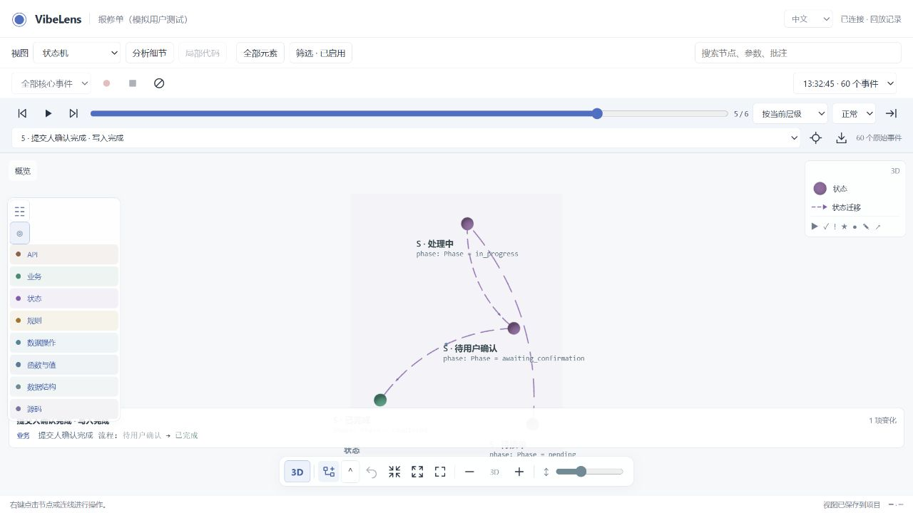
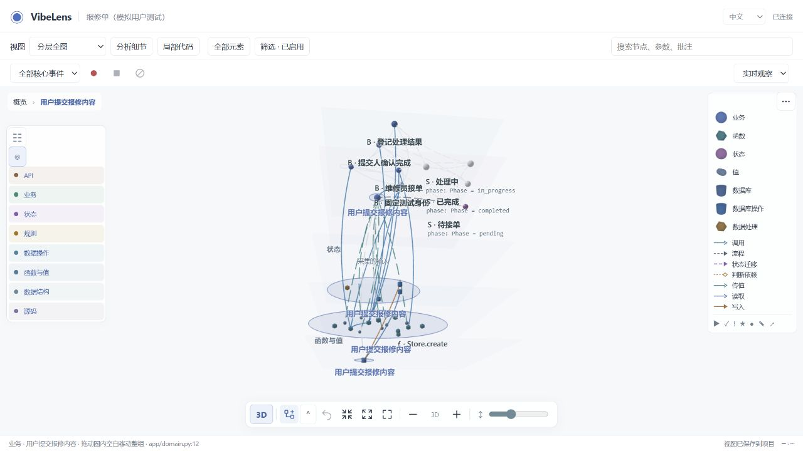

# Repair ticket: independent conversation trial

The new conversation is **报修单 · VibeLens 独立验收** (`01a1713d-d460-7353-9d3f-58c351e70704`). This is an independent AI project trial with simulated-user answers, not a human usability study.

The confirmed program lets a user submit a repair ticket, a technician claim it and record a result, and the submitting user confirm completion. The controller chose drive mode, fixed test identities without login, and SQLite + SQLAlchemy. The initial graph was shown and explicitly confirmed before behavior implementation. The trial did not add rejection, rework, or login workflows.

## Read the actual conversation

- [Exact delivered messages](conversation-exact.md) and [structured export](conversation-exact.json): 52 messages, including the controller's actual answers, graph confirmation and engineering interventions. Internal reasoning and host session logs are excluded.
- [Design graph screenshot](screenshots/design-2d.jpg).
- [Failure history](receipts/failures.jsonl), [later repairs](receipts/supplemental-events.jsonl), and [final ownership correction](receipts/runtime-owner-events.jsonl).

The conversation export comes from the original session records. It does not rely on the trial agent's manually maintained dialogue index. Original local links retain their wording; their actual linked files are registered in the repository's historical-link catalog and preserved in `original-linked-files.zip`. Its Skill copy is the version captured at the first design confirmation; the maintained Skill also includes the later refinements described below.

## Final results

| Check | Result and receipt |
| --- | --- |
| Confirmed intent, independent business expectations | [39 of 39 assertions executed; six mapped features](receipts/runtime-owner-gate-summary.json) |
| Implementation mapping and state projection | Same receipt: 153 independent mapping witnesses, 213 projection checks; mapping, business and state results reported separately |
| Actual latest run | [60 real events, four native state frames, three actual transitions](receipts/runtime-owner-delivery-check.json); no reported capture gaps/errors/drops |
| Correct event attribution and one row per change | [Four actual operation sources, row counts 1/1/1/1, both state endpoints retained](receipts/runtime-owner-browser-check.json) |
| Scoped update and immutable baseline | [The complete R6 baseline hash is unchanged from begin through accept](receipts/runtime-owner-baseline-byte-proof.json) |
| Geometry, layers and interaction | [Actual geometry checks](receipts/runtime-geometry-retest.json), screenshots below; top view, spacing, hidden planes, coplanar nodes/curves, circumference captions, orbit and group movement |
| Source lookup | [Only the actual `actor_id` parameter token is highlighted](receipts/source-parameter-proof.json) |
| Saved preferences across upgrade | [Positions, pins, layers and 2D entries retained](receipts/preferences-replay-upgrade-semantic-proof.json); a camera damping difference of about `6.47e-12` is disclosed in the original receipts |
| Observer independence and Web removal | [Web mode checks](receipts/web-modes-result.json); observation off/failing/queue-limited cases and the core export are in the evidence archive |
| Published core bytes | [Independent extraction and actual self-test](receipts/independent-core-run.json); same four states, observer runtime and viewer absent |

## Failures, repairs and scope

The first initialization omitted confirmation/scope metadata and the trial agent manually amended a baseline scope field. This was a process error, and that first acceptance is not presented as a clean immutable-baseline pass. The original baseline and repair are retained. Later R6 batches declared their scope before editing and verified complete baseline byte equality.

The first actual recording reported transport errors. A later recording had complete event capture but public queries initially lacked transition journals; the isolated adapter was corrected to publish actual events, states, evaluated guards and commit witnesses. Function/state/guard calls also needed distinct call identities. A deliberately removed middle transition witness now reports partial evidence even though the final state remains completed. Queue loss leaves business execution intact and is reported as loss.

The original state-view replay showed two rows for one migration because it displayed a row for each endpoint. The maintained viewer now keeps one fact with multiple visual owners. The trial's fixed creation-node override also misattributed later state changes; removing it lets actual native commit sources supply the attribution. Original recordings and before/after browser receipts remain separate.

The Skill now explicitly requires confirmed metadata before `begin`, immutable baseline bytes including scope, and path checks against actual executor/query/recording evidence. These additions guide implementation and acceptance; they do not prove arbitrary AI compliance or arbitrary business correctness.

Live journals remain process-local in this example. After restart, the current persisted state is available while an uncaptured past path remains unknown. Saved recordings retain their actual previous frames. The program uses synthetic fixed identities and is not a production login system.

## Download or reproduce

- [Project source and installed candidate resources](project.zip), [original review evidence](evidence.zip), [file/hash manifest](archive-manifest.json).
- Extract both ZIPs into the same empty directory. They assemble `project/` and `project/review/`. Create a Python environment there and install `requirements.txt`; the project README gives run and verification commands.
- [Verified standalone core](core.zip): extract separately, install the project's dependencies, then run `python -B bo_core_run.py --self-test`. This exact archive was independently executed after copying.

The archives exclude virtual environments, private view settings, live SQLite files and raw host session logs. The public conversation export contains the actual delivered dialogue. Disposable mutation copies are recreated by the supplied tests; selected read-only verification helpers are retained. Review artifacts are synthetic evidence snapshots; a new host must perform its own source/build acceptance before claiming a fresh run.
