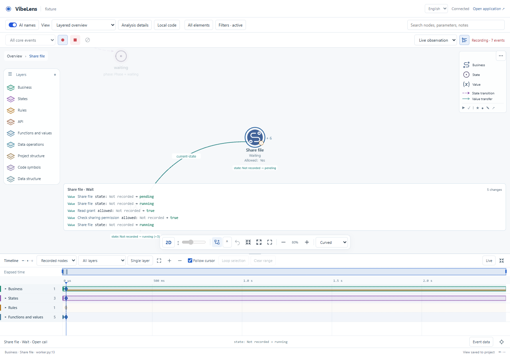
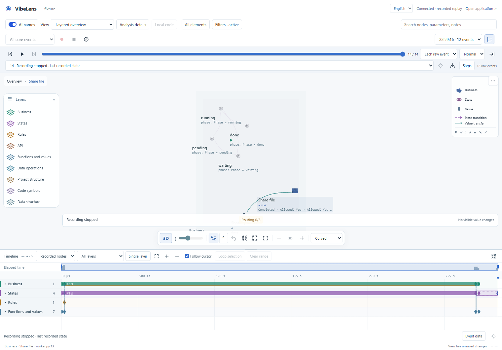

# Activation lifecycles and causal timeline

Branch: `feat/recording-timeline`. Review date: 2026-10-30.

The graph and timeline now retain actual operation lifetimes. An enclosing
business operation remains running or waiting while its owned work executes;
return or error completes it. Edge animation represents a transfer separately.

## Delivered behavior

| Area | Behavior |
|---|---|
| Graph | Running, waiting, completed, failed and unknown invocation states persist between their actual boundaries. Concurrent running/waiting counts remain separate. |
| Duration | Matched entries and completions form bars. Waiting segments are marked. Open/ambiguous intervals remain explicit. Native state/activity frames supply occupancy intervals, including active ancestors. Operations already running at capture start continue from witnessed context, clipped at the left boundary. Pre-existing intervals show a minimum observed duration with `≥`. |
| Causal chain | Same-layer dependencies and cross-layer calls/returns remain visible in the time window. Returns attach at child completion within the parent's interval; invalid outliving children stay qualified. Native state changes connect their state rows. |
| Live and recordings | The first live snapshot is a baseline. Subsequent facts, active capture and saved records share event IDs and the existing read-only graph seek. The live buffer is bounded at 20,000 events. |
| Observation depth | A bottom layer retains every layer above it in the selected order. Single-layer mode isolates one layer. Lower facts remain stored and hidden links do not become shortcuts. |
| Navigation | Ruler drag, interval selection, overview pan/resize, smooth zoom, adaptive ticks and keyboard/touch seeking use one cursor. The active interval receives an outline at that cursor. |
| Parameter identity | Independent semantic node IDs declare `represents: {path, symbol, parameter}`. The source index resolves them to one physical AST parameter ID and emits an explicit equivalent mapping. Missing/renamed parameters fail validation. Mappings never create execution flows. |

Static files, declarations and source equivalence do not receive invented
execution lifetimes. Optional AI names remain display overlays over fixed IDs.

## Actual runtime acceptance

[The live service test](../../../tools/test_trace_lifecycle.py) starts a separate
Python application and observer. The application reads a real SQLite grant,
waits for a release, then inserts one sharing record. It drives its native FSM
and supplies exact state frames. Browser actions operate actual controls.

[Final browser result](context-browser-complete/result.json): one share, final state `done`,
13 business observations including pre-recording context, 12 interval events,
two exact native frames and zero probe errors. The parent operation lasted about
2.72 seconds in this run. Timeline, recording and view controls added zero
business events.

The [mid-operation capture](midspan-browser-complete/result.json) starts recording
while the same actual application is waiting. Five interval events complete the
left-clipped parent and its call/return chain. Both trials also freeze the live
cursor at its current boundary, read the complete source file and retain the
already-loaded code projection with its original physical IDs.

The [historical-recording suite](compatibility-browser-complete-final/result.json) retains
the existing cursor, native state, transfer, skip/loop, transform-duration,
language, mobile/touch and byte-integrity assertions. The
[naming suite](names-browser-final/result.json) retains source/explained naming
and identity checks. Historical snapshots are not presented as live services.

## Regression and integration evidence

- [Lifecycle facts](lifecycle-unit.json): nested boundaries, scoped parentage,
  concurrent activity, waiting, explicit completion, source projections, state
  occupancy, depth and hidden links, live retention and boundary handling.
- [Context regression](context-unit.log): left-clipped running scopes, parent
  returns, unchanged context bytes and isolated child revision/dependency fields.
- [Python tests](python-tests.log): nested and concurrent async contexts, exact
  source parameter mappings, rename rejection and identical real SQLite effects
  with observation on, off, faulted and queue limited.
- [Existing multi-language tests](multilanguage-tests.log): common protocol,
  native Python/JavaScript execution, scanners, event delivery and isolation.
- [Recording atomicity](recording-atomicity-after.log): controlled concurrent
  start and a real Windows reader that briefly excludes replacement.
- [Managed example receipts](examples-complete.json): both shipped
  examples run generate → inspect → verify → accept → check. Implementation
  mapping, state constraints, business outcomes and project checks remain
  separate; previous frozen receipts are retained.
- [Source quality](source-check.json): Ruff, ESLint, Black and Prettier checks on
  113 Python and 83 JavaScript modules.
- [Skill validation](skill-validation.log) and [package validation](package-validation.log).
- [Clean staged export](clean-export.json): both examples pass their original
  checks from a fresh Git export with frozen approvals, without regeneration or
  reapproval.
- [Full verification](full-verification.log): original business scenarios,
  state constraints, source/graph synchronization, database adapters, HTTP
  runtime, installation, core package and independent archive checks.

## Performance

The [final 20,000-event component test](performance-complete/result.json) includes
9,999 causal links, nine layers and 41 seeks. On Windows/Chromium 151 at
1440 × 960, first index/draw was 169.6 ms, seek p95 64 ms and draw p95 16.1 ms.
This measures the timeline component; it excludes full-graph reconstruction.
Time/row indexes, pixel aggregation and a flow drawing budget bound each frame.
Earlier scale runs remain alongside the final result.

## Failures, fixes and retests

| Evidence | Finding and correction |
|---|---|
| [Link metadata](failures/link-metadata-before.log) | Preserve the existing public dependency shape; keep geometry metadata in its own index. Existing unit assertions remain unchanged. |
| [SQLite cleanup](failures/sqlite-close-before.log) | The trial's transaction context did not close its connection on Windows. Explicit connection closure fixed fixture cleanup. |
| [Zoom anchor](compatibility-browser-02/result.json) | Repeated smooth zoom used an intermediate window to anchor the next target. Anchor against the pending target instead. |
| [Transition timing](compatibility-browser-03/result.json) and [touch](compatibility-browser-complete-02/result.json) | Interaction tests now await the actual smooth-zoom completion before computing a fixed target coordinate; their exact event assertions remain. |
| [Start race](browser-complete/result.json), [raw interval](failures/recording-start-race.json), [controlled reproduction](failures/recording-start-boundary-before.log) | Events could arrive during the initial snapshot before its late start timestamp. Stamp the start before reading the snapshot. Legacy boundary overlap is displayed with a note; raw timestamps remain unchanged. Reversed producer timestamps still use event order. |
| [Stopped-record gate](failures/delivery-recording-gate-before.json), [held reader](failures/recording-file-lock-before.log) | The stopped/interrupted symptom was reproduced under a real Windows reader. Four replace attempts with a 35 ms sleep budget handle brief sharing failures; exhaustion retains interruption/gap reporting. |
| [Interrupted copy](failures/runtime-sync-before.log), [strict rejection](failures/partial-sync-gate-before.log) | A system file-open error interrupted local copy before metadata completion. Strict inventory rejected that candidate. A complete host copy and the same original gates recovered it. |
| [Static-only view](failures/static-view-model-before.log) | A static projection has no execution model. Guard lifecycle lookup so declared source nodes retain their existing behavior. The original frontend suite passes. |
| [Source quality](failures/source-quality-before.log) | Capture the exception class before a deferred result callback and remove a duplicate control key. Lint and format checks pass without suppressions. |
| [Mid-operation inspection](midspan-browser/result.json) | Seeking the current left boundary must still enter read-only inspection. Preserve loaded code IDs and use the live source endpoint for transient records. The complete normal and mid-operation browser trials pass. |

The complete final runtime trials are `context-browser-complete` and
`midspan-browser-complete`; earlier failed and successful attempts remain in
their original directories. Generated trial working folders
are ignored; the recordings retain their source bytes. Business source and
protected expectations in the shipped examples were not changed to obtain passes.

## Module map and usage

See the [source guide](../../source-guide.en.md),
[timeline design](../../development/recording-timeline.md) and
[capture/identity contract](../../../skills/vibelens/references/lifecycles-and-representations.md).

Open the timeline button beside recording controls. Use **Observation depth** or
**Single layer**, drag the ruler to inspect a step and Shift-drag a time interval.
**Loop selection** reuses the graph's replay loop. **Live** returns to current
observation. Expand a layer row for its node intervals. Ctrl/Command-wheel zooms;
the overview shows the retained interval.
