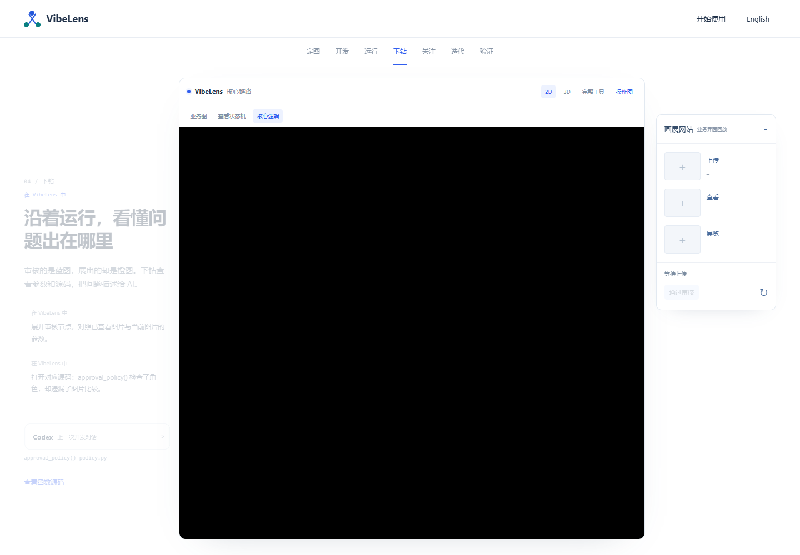
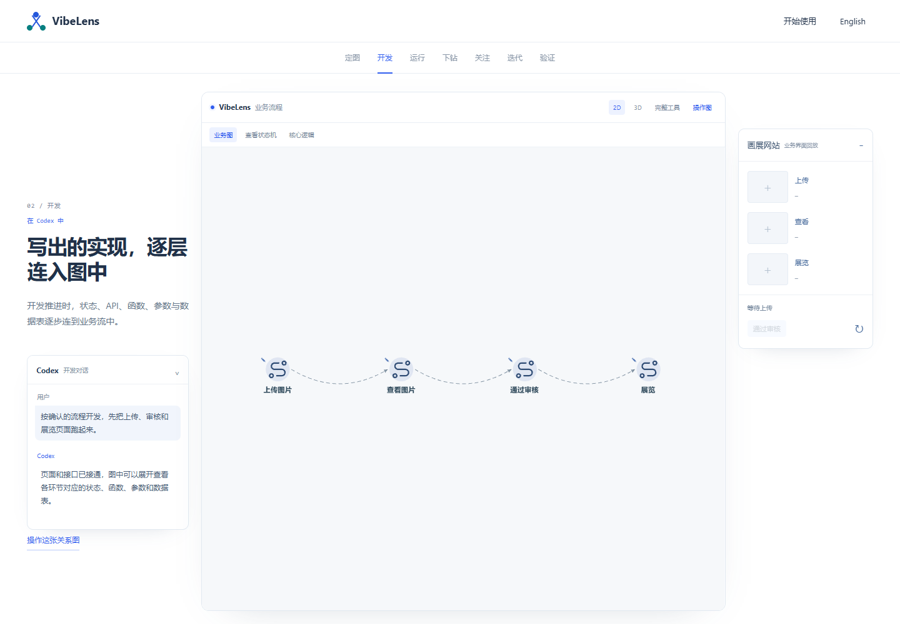

# Repaint the graph before a resized viewport is displayed

Scrolling between demo stages changes the available graph height when playback appears or disappears, and changes its width when source inspection opens. Resizing a WebGL drawing buffer clears its contents. The viewer previously deferred the replacement draw until another animation callback; the compositor could display the cleared buffer as a black panel.

The resize observer now cancels an already scheduled draw and repaints immediately, before composition. It paints the renderer background even when the graph has not loaded yet. The fix is shared by the maintained viewer and shipped examples. The Pages entrypoint revision also changes so previously cached demo modules load the repair.

## Regression evidence

The [before-frame measurements](before-frames.json) captured 77 black frames out of 382 compositor frames during ten forward/backward stage transitions. The failed frame above is from that run.

`node tools/test_case_transitions.mjs` now captures actual intermediate compositor frames instead of checking only settled screenshots. It exercises ten forward/backward transitions in English and Chinese, in both 2D and 3D. The test requires actual viewport-height changes, captured transitions for every stage, no browser/resource errors and zero predominantly black frames in the central graph area. Failure images and per-frame measurements are retained by the command.

[The local regression](transitions.json) covers 40 transitions and 1,629 compositor frames with zero black frames. This verifies the tested Chromium/SwiftShader host; it is not a claim about every graphics driver. The measurement region is a fixed central graph rectangle at a 1440 × 1000 viewport.

[The complete existing bilingual demo test](demo-browser.json) also passes, covering flow confirmation, source binding, recorded application responses, real edge animation, custom-view persistence, 2D/3D gestures, mobile layout and reduced motion. [Source lint/formatting](source-quality.json), artifact integrity and viewer semantic checks remain enabled. Business logic, graph identities, runtime event captures and previous frozen approval records are preserved.

## Shipped examples

[Separate mapping, state, project and business checks](example-maintenance.json) pass in both examples under new `viewport-repaint-20261027` records. [The prior approvals were checked before beginning](baseline-begin.json); previous frozen records remain unchanged. Architecture regeneration covers only reviewed managed files and runtime fingerprints. [All viewer copies match the canonical bytes](copied-viewer-proof.json), and [17 business/model/expectation declarations are unchanged](business-contract-proof.json).

[Clean Git export checks](clean-export.json) also pass using only frozen approvals. The export does not regenerate or reapprove either example.

## Published check

[Pages run 40420657283](https://github.com/li-bruce/VibeLens/actions/runs/40420657283) deployed commit `7a9849a`. [Published frame checks](published-transitions.json) cover 40 transitions and 1,608 compositor frames across both languages and both dimensions, with zero black frames or browser errors. [The deployed modules match the committed bytes](published-assets.json), and the entrypoint loads revision `story-7`. [Deployment receipt](deployment.json).

[Open the repaired demo](https://liblog.vip/VibeLens/demo.html?lang=zh-CN&rev=story-7). [Published 2D view](screens/published-2d.png) and [published 3D view](screens/published-3d.png).
