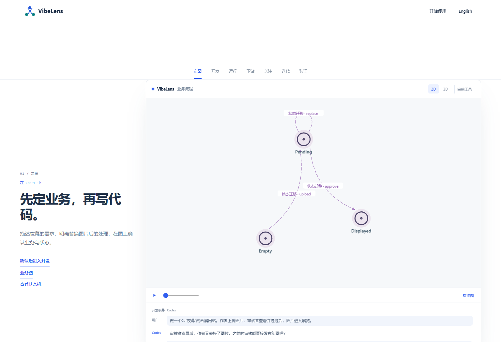
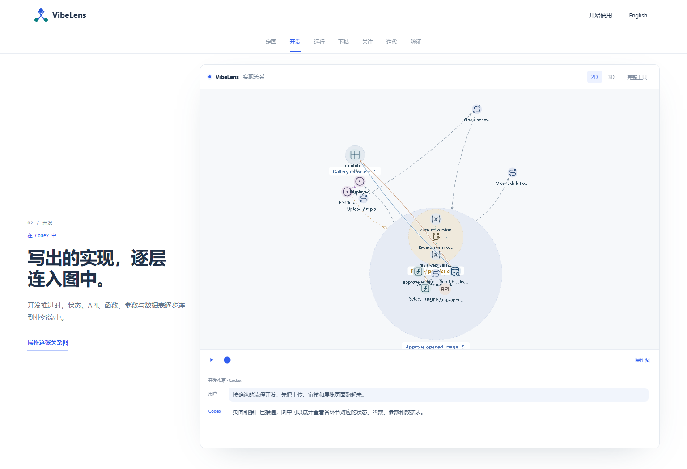
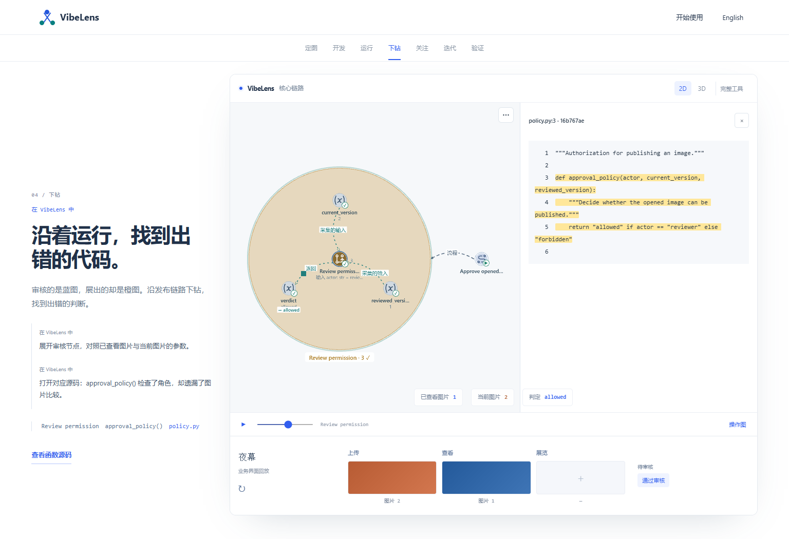
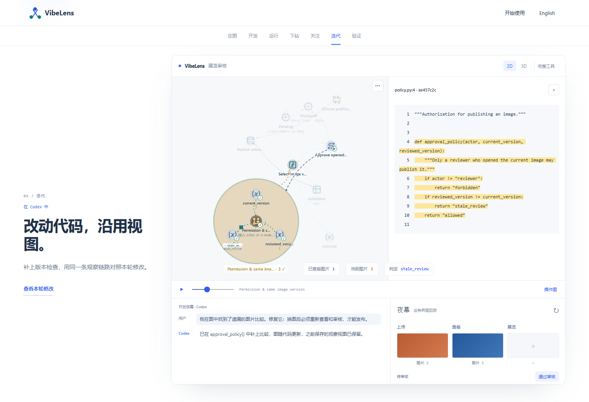
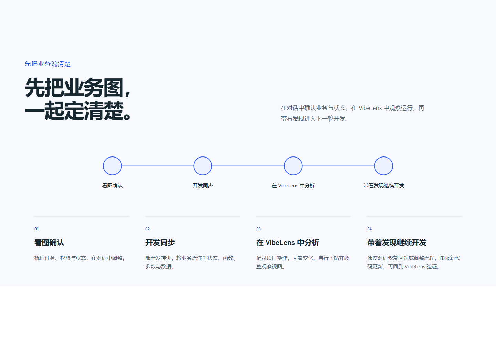

# Development and investigation in the VibeLens story

The demo separates the developer's coding conversation from their own use of VibeLens and the application. Codex dialogue appears only when defining, implementing or changing Afterlight (夜幕).

| Stage | Interaction | Visible result |
| --- | --- | --- |
| Define | Developer and Codex | Confirm business flow and inspect its states |
| Build | Developer and Codex | Connect the flow to API handlers, functions, selected inputs, states and data tables |
| Run | Developer uses VibeLens and Afterlight | Record application actions and replay the changing graph |
| Inspect | Developer uses VibeLens | Expand the approval path and read the bound function source |
| Focus | Developer uses VibeLens | Select elements and save a focused view |
| Refine | Developer and Codex | Repair the missing condition; update source bindings while retaining the saved view |
| Verify | Developer uses Afterlight and VibeLens | Repeat the operation and inspect the new recording |

The four investigation stages use side instructions with explicit locations. Their conversation panels are absent. The application preview follows completed responses from the actual recording. The definition and development stages show their conversation without a running-application preview.

The main introduction uses the same cycle: confirm, develop, investigate in VibeLens, then refine through conversation. English and Chinese copy and the mobile layout follow these roles.

## Checks

[Demo browser results](browser.json) assert all seven stages: exactly three coding conversations, no dialogue in the four investigation stages, connected state nodes and 15 actual implementation nodes. Existing source inspection, recorded image results, backward seeking, retained custom views, eight presets, eight 3D layers, mouse rotation/zoom/pan, mobile language switching and reduced-motion checks remain in place.

[Product browser results](product-browser.json) cover both languages, four workflow steps, scroll depths, custom examples, mobile and the separate illustrated viewer tour. [Source quality](source-quality.json) covers syntax, lint and formatting. Artifact freshness and the six documentation-link tests also pass.

Visual review caught [cropped 2D framing after a 3D stage](screens/before-switch-framing.png). [The retained failure](switch-framing-failure.json) shows an expanded region taller than the native minimum zoom could contain. A region first expanded in 3D had not received a compact 2D layout. The Pages adapter now prepares that layout once, waits for native layout completion and calls Fit after switching. The browser test still requires the entire displayed graph to fit in the 2D viewport.

The viewer renderer, business implementation, runtime protocol and captured events remain unchanged. This is a presentation update using the existing real execution artifacts; it does not represent a new backend or database acceptance run. Earlier [conversation-demo receipts](../conversation-demo/README.md) remain historical evidence of the presentation that this update corrects.
