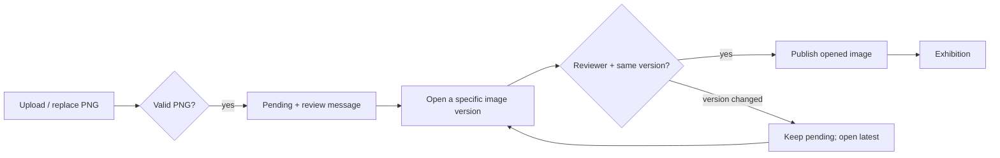

# Afterlight: scripted development conversation

This is an authored demonstration, not a transcript of an independent human or AI trial. The developer answers define the scenario. The faulty first policy is deliberately seeded. Browser actions, observer events, SQL queries, sources and test results are executed separately and exported without invented successes.

## Initial request

**Developer:** Build a small exhibition website. An artist uploads a PNG; a reviewer receives a message and opens the image, then decides whether it appears in the exhibition. The artist can replace an image while it is waiting for review.

**Assistant:** If a reviewer opens version 1 and the artist replaces it with version 2, may the old approval publish version 2?

**Developer:** No. A replacement stays pending until the reviewer opens that version and approves it.

**Assistant:** Does replacing an image create another review message?

**Developer:** Yes. Keep the previous image and create a message for the new version.

## Mode

**Assistant:** Should the state declaration drive the program, or should the program retain its own logic with VibeLens observing it?

**Developer:** Retain the program's own logic. Use the graph to understand and debug it.

## Database

**Assistant:** For this local demo, SQLite keeps the project easy to run. Is that suitable?

**Developer:** Yes. Use SQLAlchemy for the declared tables.

## Confirmed flow

**Developer:** This matches the intended flow. Continue.

The published page shows a verified graph from the resulting implementation. This transcript records scope confirmation; it is not evidence that the faulty v1 satisfied it.

## First implementation and recording

The deliberately faulty policy tests the reviewer role but omits the agreed version comparison. Run the browser scenario:

1. Start a real VibeLens recording.
2. Upload the blue PNG as version 1.
3. Open version 1 in the reviewer panel.
4. Replace it with the orange PNG as version 2.
5. Approve the still-open version 1.
6. Stop the recording and read the persisted exhibition through SQL.

**Developer:** I approved the blue image. Why is the orange image on the exhibition page?

**Assistant:** The captured request carries `reviewed_version=1`. The native database read returns `current_version=2`. The policy returns `allowed`; `choose_version` selects 2 and the exhibition transaction commits it. The first policy accepts the role and does not compare the two version parameters. Mapping checks pass; the independent business expectation fails.

These statements are checked against matching actual call IDs, source hashes, data contracts and the database result. The diagram alone is not treated as correctness evidence.

## Targeted change

**Developer:** Reject an approval of a replaced image. Ask the reviewer to open the latest version. Keep uploads, messages and the exhibition flow unchanged.

**Assistant:** I will compare `reviewed_version` with `current_version` before selecting or writing an image. Then I will repeat the stale review, reopen the latest image, and verify a successful approval. I will retain the graph identities and create a separate recording for the new source build.

## Retest

The same browser sequence now returns `stale_review`, with no exhibition write. An artist's approval returns `forbidden`. Invalid image content is rejected. Opening version 2 and approving it publishes exactly version 2. Observer queries, source inspection and recording controls add zero business events.

**Assistant:** The stale-review expectation now passes. The recording still exposes the rejected request and its actual parameters; reopening version 2 produces the successful write. Source mapping and business results are reported separately in the receipts.

## Scope

No further product requirements are proposed in this dialogue. Fixed synthetic identities replace real authentication. PNG header recognition is deliberately limited; the test uploads valid, checksummed PNGs and checks real browser decoding. This is a teaching project, not a production upload service.
