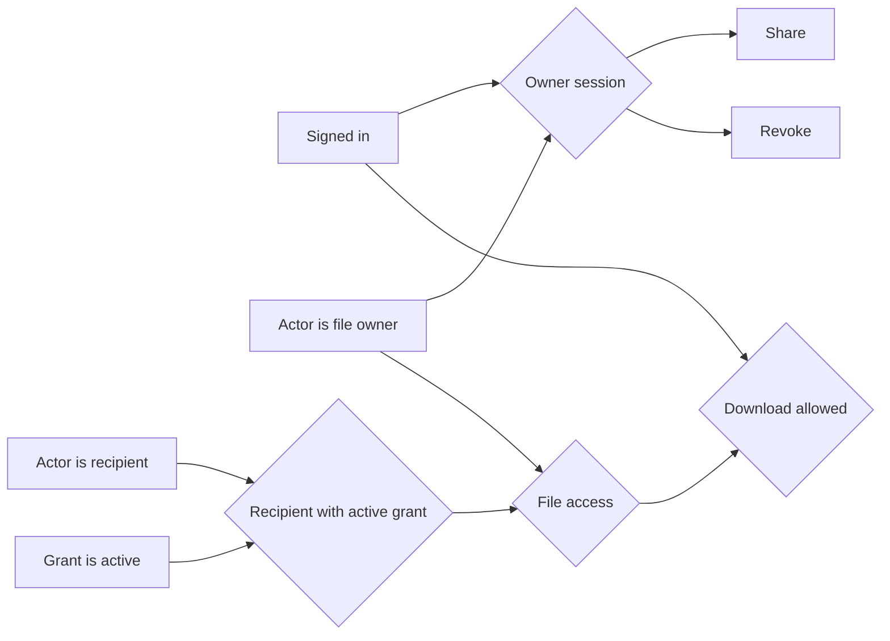

# Shared policy network

This small, executable example keeps a reusable predicate separate from each argument-bound condition. Sharing and revocation reuse the same ownership check. Downloading also allows a current recipient grant. Changing a task owner checks the direct parent's owner; an ordinary role-based edit cannot bypass that condition.



The implementation uses the same `same_identity(left, right)` function for file ownership, recipient identity and direct-parent ownership. Those are separate expression nodes because their arguments differ. Only an identical bound expression is shared.

From the repository root:

```bash
python examples/policy-network/build_example.py
python skills/vibelens/scripts/bo_policy.py validate --root examples/policy-network --policy policy.json
python -B tests/test_policy_network.py
node tools/test_policy_view.mjs
```

`policy.json` is a portable definition. `predicates.py` contains native business predicates. The tests run actual functions, record their selected inputs and results, validate the projection and reject stale source/evidence. They also exercise unknown facts, short circuit, revocation, concurrency, source moves and rule changes.

The Python evaluator is optional. Another implementation can keep its own authorization engine and emit the same evaluation protocol from its actual decisions. This example does not provide an adapter for every external policy engine or language. Database traversal stays with the application; the rule declaration does not enumerate every permission instance.
