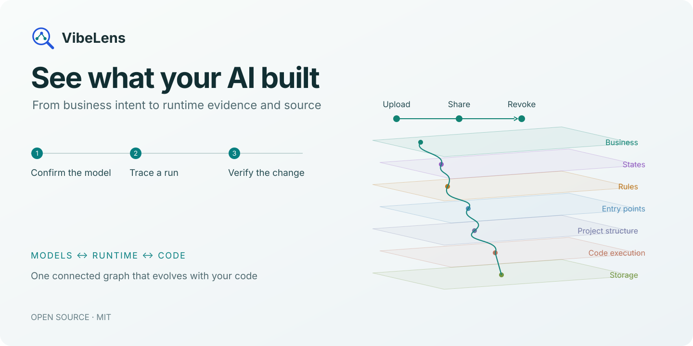
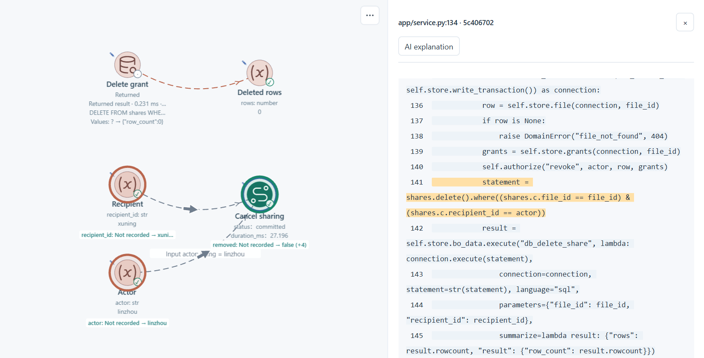
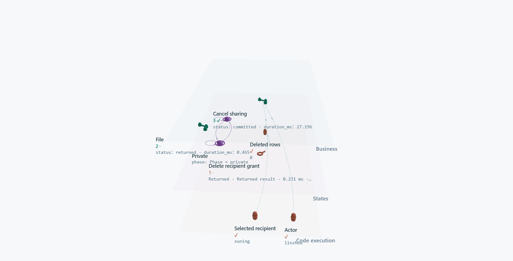

<p align="center"><a href="https://liblog.vip/VibeLens/"></a></p>

<p align="center">
<a href="https://github.com/li-bruce/VibeLens/blob/main/README.zh-CN.md">中文</a> ·
<a href="https://liblog.vip/VibeLens/?lang=en">Explore VibeLens</a> ·
<a href="https://liblog.vip/VibeLens/demo.html?lang=en">Try the interactive story</a> ·
<a href="#install-for-deepseek-harness">Install</a>
</p>

<p align="center">
<a href="https://github.com/li-bruce/VibeLens/releases/latest"></a>
<a href="https://github.com/li-bruce/VibeLens/actions/workflows/check.yml"></a>
<a href="https://github.com/li-bruce/VibeLens/blob/main/LICENSE"></a>
</p>

# Understand the program behind the screen

Your AI can build a working app quickly. Understanding its permissions, state changes and hidden dependencies takes a clearer view.

**VibeLens connects the model you confirm, the code your agent writes, and what actually happens when you run it.** Follow one operation from business intent to the value, function or query that explains its behavior.

## Confirm the model before the code

> “/vibelens Show me the business flow, states and rules for this project so we can confirm how it should work.”

VibeLens turns the conversation into connected **business, state and rule graphs**. Clarify the important details, see the graph, then build. Choose **Drive** to develop from executable state declarations, or **Observe** to inspect your application's own logic.

Each workflow and stateful object can have its own model. Inspect independent capabilities separately, or follow their connections in the same graph. Shared functions keep one source identity across these models.

## Follow the evidence to the source

Record an operation and replay its state and value changes. Keep the relevant chain in a custom view, expand a decision and its inputs, then open the highlighted source.

[](https://liblog.vip/VibeLens/demo.html?lang=en#drill)

Tell your coding agent what you found. VibeLens keeps the model, source mappings and checks alongside the change. Run it again and inspect the result.

[**Explore the interactive story →**](https://liblog.vip/VibeLens/demo.html?lang=en)

## One graph, the detail you need

[](https://liblog.vip/VibeLens/?lang=en#explore)

| Start with a question | Follow it through the graph |
|---|---|
| What should happen? | Business actions, object states and shared rules |
| Where is it implemented? | Entry points → folders and files → functions and parameters |
| What changed at runtime? | Captured inputs, decisions, states, queries and effects |
| What matters in this iteration? | A saved custom view, focused recording and synchronized timeline |

Switch between **2D and 3D**, expand a region, filter relationships, and keep your layout and annotations as the code evolves. Live observation, recording and replay share the same graph.

## Install for DeepSeek Harness

```sh
dsh plugin --profile web add https://github.com/li-bruce/VibeLens/releases/download/v0.15.0/dsh-vibelens-0.15.0.tgz
```

Tested host: DeepSeek Harness **0.2.2-rc.1**, Node.js **24.9+**. Python **3.11+** runs the shared observer.

Start with `/vibelens` followed by your project idea. The plugin registers a user-invoked skill with complete resources. [Setup, compatibility and checks](https://github.com/li-bruce/VibeLens/blob/main/docs/deepseek-harness.md).

The **v0.15.0** plugin is about **0.74 MB**. First use downloads verified viewer resources from a CDN, with GitHub as a fallback. Later launches reuse the local cache. Viewer libraries stay in the local debugging tool; your application keeps its native state and probe adapters.

[MIT](https://github.com/li-bruce/VibeLens/blob/main/LICENSE) · [Third-party licenses](https://github.com/li-bruce/VibeLens/blob/main/THIRD_PARTY_NOTICES.md)
