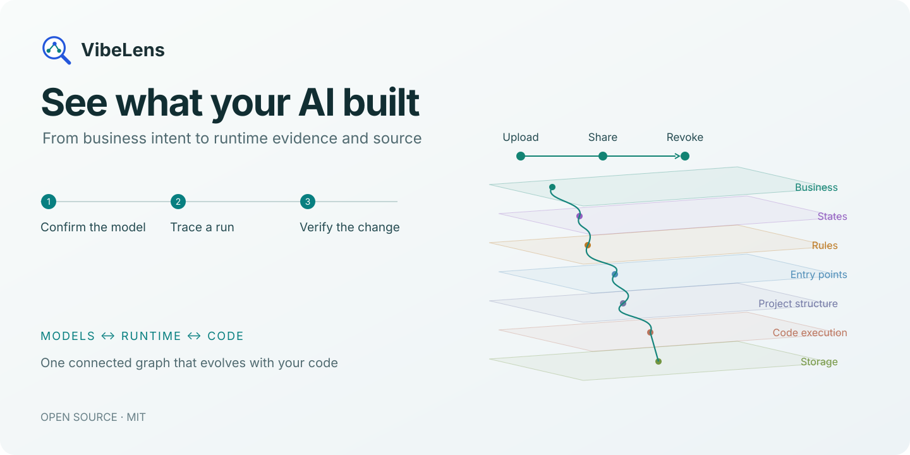
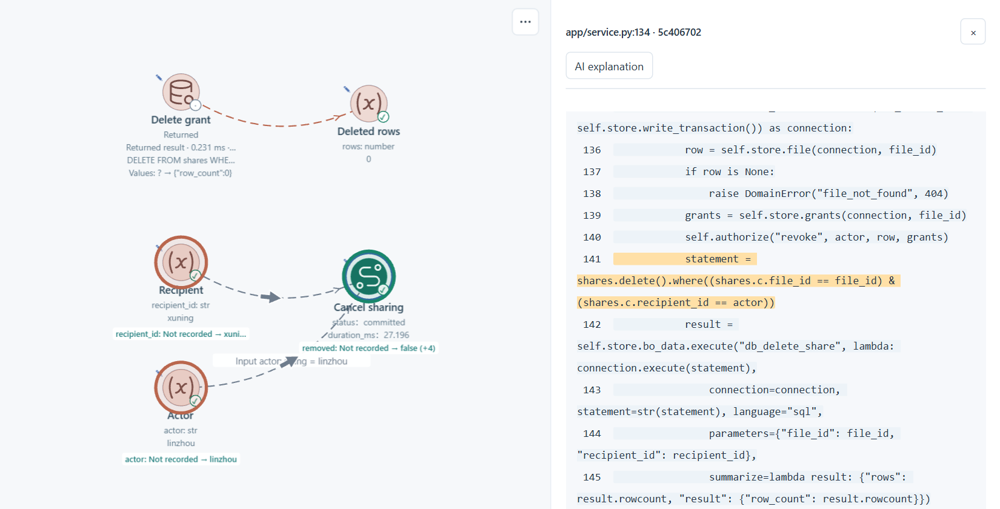
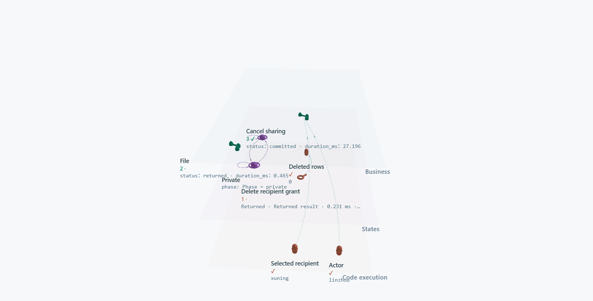

<p align="center"><a href="https://liblog.vip/VibeLens/"></a></p>

<p align="center">
<a href="https://github.com/li-bruce/VibeLens/blob/main/README.zh-CN.md">中文</a> ·
<a href="https://liblog.vip/VibeLens/?lang=en">Explore VibeLens</a> ·
<a href="https://liblog.vip/VibeLens/demo.html?lang=en">Try the interactive story</a> ·
<a href="#get-started">Install</a>
</p>

<p align="center">
<a href="https://github.com/li-bruce/VibeLens/releases/latest"></a>
<a href="https://github.com/li-bruce/VibeLens/actions/workflows/check.yml"></a>
<a href="https://github.com/li-bruce/VibeLens/blob/main/LICENSE"></a>
</p>

# Understand the program behind the screen

Your AI can build a working app quickly. Understanding its permissions, state changes and hidden dependencies takes a clearer view.

**VibeLens connects the model you confirm, the code your agent writes, and what actually happens when you run it.** Follow one operation from business intent to the value, function or query that explains its behavior.

## Confirm the model before the code

> “Use $vibelens for this project. Show me the business flow, states and rules so we can confirm how it should work.”

VibeLens turns the conversation into connected **business, state and rule graphs**. Clarify the important details, see the graph, then build. Choose **Drive** to develop from executable state declarations, or **Observe** to inspect your application's own logic.

Each workflow and stateful object can have its own model. Inspect independent capabilities separately, or follow their connections in the same graph. Shared functions keep one source identity across these models.

## Follow the evidence to the source

Record an operation and replay its state and value changes. Keep the relevant chain in a custom view, expand a decision and its inputs, then open the highlighted source.

[](https://liblog.vip/VibeLens/demo.html?lang=en#drill)

Tell your coding agent what you found. VibeLens keeps the model, source mappings and checks alongside the change. Run it again and inspect the result.

[**Try the interactive walkthrough →**](https://liblog.vip/VibeLens/demo.html?lang=en)

## One graph, the detail you need

[](https://liblog.vip/VibeLens/?lang=en#explore)

| Start with a question | Follow it through the graph |
|---|---|
| What should happen? | Business actions, object states and shared rules |
| Where is it implemented? | Entry points → folders and files → functions and parameters |
| What changed at runtime? | Captured inputs, decisions, states, queries and effects |
| What matters in this iteration? | A saved custom view, focused recording and synchronized timeline |

Switch between **2D and 3D**, expand a region, filter relationships, and keep your layout and annotations as the code evolves. Live observation, recording and replay share the same graph.

## Get started

### Codex

Install the complete skill into your project:

```bash
npx skills add li-bruce/VibeLens --skill vibelens
```

The **v0.15.0** Skill ZIP is about **0.92 MB**. First use downloads the viewer resources, then reuses them locally. An [offline package](https://github.com/li-bruce/VibeLens/releases/download/v0.15.0/vibelens-offline-v0.15.0.zip) is also available.

Start a project conversation with:

```text
Use $vibelens for this project.
Show the business, state and rule graphs before we implement it.
```

### DeepSeek Harness

Install the packaged plugin from the [v0.15.0 release](https://github.com/li-bruce/VibeLens/releases/tag/v0.15.0):

```bash
dsh plugin --profile web add https://github.com/li-bruce/VibeLens/releases/download/v0.15.0/dsh-vibelens-0.15.0.tgz
```

Open that profile and start a conversation with `/vibelens` followed by your project idea. [Harness setup and tested compatibility](https://github.com/li-bruce/VibeLens/blob/main/docs/deepseek-harness.md).

**Python · Node.js · React · Vue** — English and Chinese interface. Python 3.11+ runs the shared observer; application adapters stay native. [Installation, dependencies and versioned downloads](https://github.com/li-bruce/VibeLens/blob/main/docs/usage.en.md).

Also available through [SkillHub](https://skillhub.cn/skills/user_fbf26156/vibelens).

## Built for inspection

The source is open. Reproducible examples and retained checks let you inspect the implementation as well as the interface.

[Architecture & source guide](https://github.com/li-bruce/VibeLens/blob/main/docs/source-guide.en.md) · [Supported capabilities](https://github.com/li-bruce/VibeLens/blob/main/docs/capabilities.md) · [Validation records](https://github.com/li-bruce/VibeLens/blob/main/docs/review/release-v0.15.0/README.md) · [Release notes](https://github.com/li-bruce/VibeLens/blob/main/docs/releases/v0.15.0.md) · [Distribution](https://github.com/li-bruce/VibeLens/blob/main/docs/distribution.md)

[MIT](https://github.com/li-bruce/VibeLens/blob/main/LICENSE) · [Third-party licenses](https://github.com/li-bruce/VibeLens/blob/main/THIRD_PARTY_NOTICES.md)

The viewer, routing and layout libraries run in the local debugging tool. New integrations put only native state/probe adapters and project declarations in your application. [Dependency and packaging boundaries](https://github.com/li-bruce/VibeLens/blob/main/skills/vibelens/references/dependency-distribution.md).
